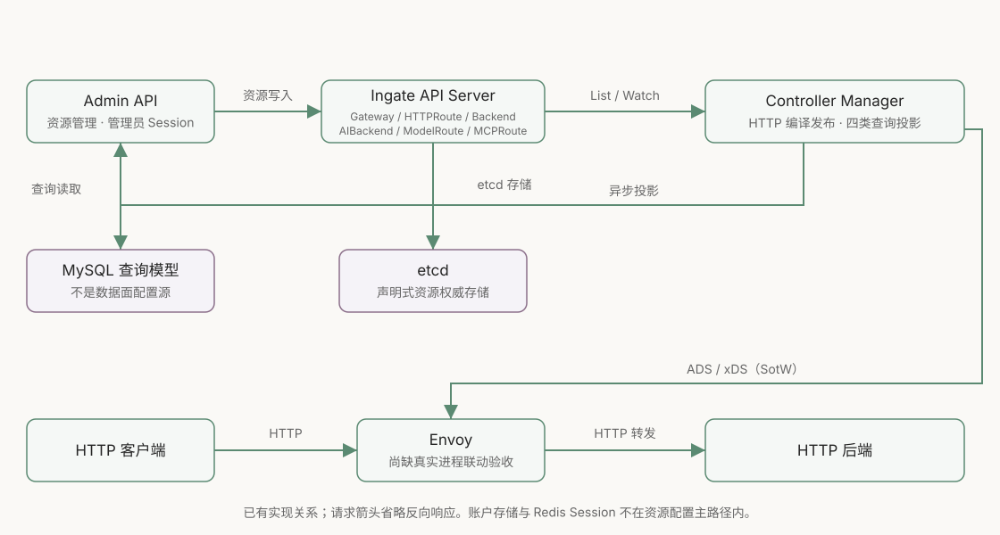

# API 网关完成度与 AI 网关开发条件

- 评估日期：2026-10-10
- 源码基线：`56205b84321c60b9e6e73d2b9f2d5664575ea275`；本页已同步本次提交的阶段 B 与 0012 名称/查询模型修正实现
- 分支：`codex/rebuild-from-zero`
- 范围：现有三个组件、资源契约、控制面到数据面的调用关系与已有测试；HTTPRoute/Backend 替换已实现，用户于 2026-10-11 授权提交，真实组件验收仍未完成
- AI 方向：[0010 决策](decisions/0010-unified-ai-proxy-config-delivery.md)
- 图示：[架构与流程图](diagrams/ai-gateway.html)

## 结论：可继续 AI 契约与开发，真实组件留待统一测试

Ingate 已具备 HTTP 网关的控制面主结构和最小转发配置实现：声明式资源存储、全量裁决、ADS/xDS 服务、管理端 CRUD 与查询投影都已存在。AI 设计可以沿这些边界继续，不需要先重做 API Server、Controller 或管理端分层。

但「能生成并提供 Envoy 配置」与「真实 Envoy 正确转发并能恢复」还不是同一层证据。当前没有完成 API Server → Manager → Envoy 的真实流量验收，也没有完成含 MySQL、Redis 和 Admin API 的整链路联动。安全、配置确认与长流控制仍有明确缺口。

2026-10-11 补齐 MySQL 多资源子记录归属和五个事务读取入口的选项回归测试；错误归属、关闭只读和降低隔离级别的临时 overlay 均被测试捕获。这不证明真实 MySQL 隔离效果。用户随后明确当前开发阶段不安排这类实库与真实数据面测试，留到后续统一测试；[HTTP 主链路隔离验证方案](design/http-gateway-validation-plan.md) 仅保留清单与隔离边界，本轮没有启动真实组件。

当前继续 AI 契约设计，契约 review 通过后进入对应最小切片开发，不以 HTTP 主链路实测作为开发前置条件。日常单元测试、静态检查和代码 review 继续执行；真实组件、整链路与故障场景在后续统一测试阶段验收。未完成的验证仍不能表述为已验收，也不能据此扩大到生产部署、完整 MCP 聚合或多提供商重试。

## 当前主路径与术语

Gateway 定义 HTTP Listener；HTTPRoute 通过 parentRefs 绑定入口，通过有序 rules/matches 选择 Backend；Backend 保存地址、端口和权重。三者都是集群级 `gateway.ingate.io/v1alpha1` 资源，不是 Kubernetes Gateway API 的全部实现，也不是目前已经安装的 CRD。

Admin API 按 Handler → Service → Repository 处理请求。创建、更新、删除写入 Ingate API Server；读取和列表来自 Controller 异步维护的 MySQL 查询模型。刚写入的资源可能暂时读不到，更新令牌可能滞后，不能据此认为写入失败；现有契约不承诺读后立即一致。

Gateway Controller 把三类资源事件合并到一个固定队列键，每轮从 Cache 列出全部对象，依次解析引用、稳定裁决、编译 `dataplane.Config`、发布 xDS，再更新 Gateway 的 `Accepted` 和 HTTPRoute 的逐父引用 Conditions。三次 List 没有跨资源事务；后续事件驱动再次收敛。

ADS 是 Envoy 接收多个 xDS 资源类型的 gRPC 服务。当前使用 SotW，不提供 Delta RPC；按 Envoy 的 `node.cluster=ingate-shared-data-plane` 获取同一配置组。LDS 描述 Listener，RDS 描述路由，CDS 描述后端 Cluster，EDS 描述端点分配。发布 Cache、Envoy ACK 和请求成功需要分别验证。

## 能力和证据

| 范围 | 当前已有实现 | 当前证据与边界 |
| --- | --- | --- |
| 资源 API | 三类资源 CRUD/List/Watch、Status 子资源、字段校验、Generation、resourceVersion 冲突 | 真实 HTTPS + 隔离 etcd 存储集成测试；没有覆盖生产认证授权 |
| 资源裁决 | Listener 端口/Host 冲突、独立父引用接纳、缺省路径、重叠规则优先顺序及失效目标恢复 | 单元测试覆盖正反例、输入顺序变化及不修改输入；没有验证真实 Manager Watch 收敛 |
| HTTP 配置 | Exact 优先、长 PathPrefix 优先；路径段匹配；IP 使用 EDS，含 DNS 使用 STRICT_DNS；端点权重与 ROUND_ROBIN | protobuf、失效后端的 500 directResponse、稳定排序、内容版本和空配置替换测试；尚非真实 Envoy 转发证据 |
| ADS 服务 | 原生 gRPC，监听/取消生命周期，首次 Snapshot 就绪 | 本地监听测试和 bufconn ADS 客户端收取四类资源；没有真实 Envoy ACK/NACK 验收 |
| 管理端资源 | HTTP/gRPC 管理三种资源、完整 PUT、并发版本冲突、错误映射 | fake Kubernetes Client 与模拟查询模型合同测试；没有实库联合服务验收 |
| MySQL 投影 | 启动补齐后清理残留、三类单 Worker、HTTPRoute 单行 JSON、Gateway/Backend 父子记录事务、Status 版本投影、失败重试 | fake Client + sqlmock；未证明真实 MySQL SQL、迁移与事务行为 |
| 管理鉴权 | 账户、密码校验、Redis Bearer Session、改密后的会话版本校验 | Service、Session 存储及真实 RequireSession 有回归测试；中间件测试使用 sqlmock 与 miniredis，不代表实库或真实 Redis 故障转移已验证 |
| 客户端与运行入口 | MySQL 原生客户端、Redis UniversalClient、版本、日志、组件装配与清理 | 普通测试；历史 Redis 拓扑结果见重构记录，本轮不将其当作全部重新验证 |
| CI / 开发入口 | 格式、lint、Vet、测试、构建与生成代码校验 | 工作流存在；阶段 B 执行结果见 0011，后文仅保留历史验证，不代表远端 CI 已运行 |
| AI / MCP | 尚无模型、MCP、凭据或运行时快照 API/处理器 | 只有已确认设计方向；普通 Backend 不能替代这些契约 |

可审计入口：

- [资源类型](../pkg/apis/gateway/v1alpha1/types.go)、[HTTPRoute](../pkg/apis/gateway/v1alpha1/httproute.go)、[Backend](../pkg/apis/gateway/v1alpha1/backend.go)、[存储注册](../internal/apiserver/registry/gateway/storage.go)。注册映射只有三类资源及其 Status，没有 Secret、Pod、Lease 或运行时快照。
- [Gateway Reconciler](../internal/controllermanager/controller/gateway/controller.go) 的 `Reconcile` 与 `SetupWithManager`；[裁决测试](../internal/controllermanager/controller/gateway/resolve_test.go)、[编译测试](../internal/controllermanager/controller/gateway/compile_test.go)、[Status 测试](../internal/controllermanager/controller/gateway/status_test.go)。
- [Envoy 资源构建](../internal/controllermanager/dataplane/envoy/resources.go)、[发布器](../internal/controllermanager/dataplane/envoy/publisher.go)、[服务](../internal/controllermanager/dataplane/envoy/server.go)、[ADS 测试](../internal/controllermanager/dataplane/envoy/server_test.go)。
- [投影测试](../internal/controllermanager/controller/projection/projection_test.go)、[MySQL 资源测试](../internal/adminapi/repository/mysql/resource_test.go)、[管理 HTTP 测试](../internal/adminapi/server/server_test.go)、[管理鉴权实现](../internal/adminapi/middleware/authentication.go)。
- [Makefile](../Makefile)、[CI](../.github/workflows/go.yml)、[历史审查记录](refactoring-review.md)。

## 开发与后续验收需要保留的边界

### 后续统一测试需要覆盖真实转发与 ACK

`Publisher.Publish` 只构建 Snapshot 并调用 `SetSnapshot`；ADS 用 `sotwv3.NewServer(..., nil)`，没有业务 ACK/NACK 回调和逐实例状态。`CheckReady` 只要求监听和首份 Snapshot，甚至空 Snapshot 也满足这一条件。`TestADSStreamsPublishedResources` 验证消息可发送，不能证明 Envoy 安装了 Listener 或后端可访问。

建议验收覆盖：创建资源后请求命中；Exact/PathPrefix 的匹配与不匹配；不同 Host；后端 IP/DNS；更新与删除；引用缺失与恢复；Controller 重启后 ADS 重连；真实 ACK/NACK 及错误版本。记录请求结果、相关资源版本和 Envoy 已接收状态，不只观察 Controller 日志。

本机 PATH 未发现 `envoy` 可执行程序。本轮未安装 Envoy、启动容器或搭建新 E2E 工程，因此真实转发仍是未验证项；Docker CLI 的存在不代表测试环境已经就绪。

### 新快照和凭据不能沿用尚未验证的权限假设

当前资源注册没有 Secret、Pod 或 Lease。API Server 使用上游 RecommendedOptions，但这不等于已经验收独立部署的权限系统。[存储集成测试](../internal/apiserver/integration_test.go) 在 `startGatewayAPI` 中将 Authentication、Authorization、Admission 与 CoreAPI 设为 nil，以隔离存储测试。

为 Go Proxy 下发运行时快照之前，需要明确谁可写领域对象、谁可写派生对象、Proxy 可读哪些对象、谁可回报实例状态。引入模型密钥之前，还需凭据机制、传输与存储保护、轮转和撤销测试。不能先将明文密钥放入通用资源后再补权限。

ADS 当前为明文 gRPC，默认 `:18000`，只适用于隔离可信网络；跨网络部署前需确定认证与加密。当前 Listener 协议仅为 HTTP，Envoy 构建没有配置上游 TLS。未来访问 HTTPS 模型端点，需要明确 SNI、证书校验、端口与域名语义，不能把 Redis 客户端已有 TLS 当作网关 TLS 已实现。

### 管理鉴权回归已补齐，真实组件验证仍需独立执行

[authentication_test.go](../internal/adminapi/middleware/authentication_test.go) 现已通过 HTTP Transport 调用真实 `RequireSession`，覆盖有效、伪造、过期、撤销会话与 Redis 故障，并验证身份注入和失败时不调用下游。2026-10-11 临时绕过认证调用后，新增测试确实失败；恢复真实实现后通过。SQL 与 Redis 分别使用 sqlmock 和 miniredis，这补齐的是回归断言，不替代实库、真实 Redis 或完整部署的端到端鉴权验证。修复记录见 [0012](decisions/0012-resource-names-and-query-schema.md)。

管理端认证与未来 AI 客户端认证属于不同契约，新增中间件测试不覆盖未来模型和 MCP 客户端。现有 Admin API 在接入 TLS、登录限流前限制监听回环地址，这个保护不能被部署模板无意取消。

### 当前配置发布协议不足以保证 Go 与 Envoy 协调切换

现有单输出 Publisher 接口、完整 Snapshot 和独立类型版本可以复用；但派生对象持久化、Proxy 加载、Envoy ACK、旧流排空均未实现。不能把「同一轮编译」当作两端同时生效，更不能使用 API resourceVersion 数值比较推导跨系统顺序。

这些属于下一阶段 AI 设计的核心内容，见 [0010 配置流程](decisions/0010-unified-ai-proxy-config-delivery.md#候选发布流程必须区分加载ack-和真实生效)。阶段 B 已按确认契约将 HTTPRoute 改为逐父引用的 Accepted/ResolvedRefs；AI 加载与激活契约定稿前，不把这些 Conditions 改成运行就绪承诺，也不增加含义不明的全局 Ready。

### 长流、重试、实库与运行恢复需要分别验证

现有 Envoy RouteAction 没有显式配置模型长流所需的超时、流空闲、业务重试或限额策略；不能把框架默认值视为已批准的 AI 契约。模型 SSE 和 MCP 流需要端到端的 Flush、取消、背压、有界缓冲、退出排空和断线策略。

MySQL 投影不是配置源，但 Manager 启动会先打开 MySQL，因此数据库初始化失败会阻止该 Manager 的 Controller 与 ADS 启动。见 [运行入口](../internal/controllermanager/command.go)；是否将投影与发布生命周期解耦需要单独评审，本次不调整。

当前没有启用 Leader Election，也未提供 Lease。只按单 Manager 部署，不直接扩大为主备或多活。已有指标、探针与日志入口不等于已具备配置滞后、ACK/NACK、投影延迟、SSE 容量或凭据撤销的业务观测。

## 设计评估基线的历史验证记录

以下命令属于此前设计评估，不能冒充本次代码验证。本次阶段 B 的执行结果和环境缺口见 [0011 实现记录](decisions/0011-http-resource-contract.md)。

此前设计评估使用 Go `1.27.0`、golangci-lint `2.13.2`；依赖为 Go `1.27.0`、go-control-plane `v0.14.0`、Envoy protobuf `v1.39.0`、Kubernetes `v0.37.0`、controller-runtime `v0.25.0`。这些依赖版本不是运行组件的兼容验收结果。

| 检查 | 此前设计评估结果 | 证明范围 |
| --- | --- | --- |
| `gofmt -l cmd internal pkg` | 通过，无输出 | 现有 Go 文件格式 |
| `golangci-lint run ./...` | 通过，0 issues | 当前已配置静态规则 |
| `go vet ./...` | 通过 | Vet 检查范围 |
| `go test ./... -count=1` | 通过 | 普通测试，不包括 integration 标签 |
| `go build ./...` | 通过 | 全仓库编译 |
| `go test -tags=integration ./internal/apiserver -count=1` | 通过 | 隔离 etcd + HTTPS 存储契约；无认证授权验证 |
| `go test -race ./internal/controllermanager/... ./internal/adminapi/... ./internal/apiserver/... ./internal/pkg/... -count=1` | 通过 | 选定包在测试路径中的竞态检测 |
| `git diff --check` 与全部新文档检查 | 通过 | 逐一检查 8 个未跟踪文件的空白；55 个本地文件引用存在，全文和设计边界已核对 |
| 四张 SVG 几何检查与实际渲染 | 通过 | 43 条箭头落点、框重叠与间距；实际 PNG 检查文本与布局 |

此前设计评估未重跑生成器，因为当时没有修改 API/protobuf。阶段 B 已修改并重新生成，结果单独记录在 0011。此前没有使用真实 MySQL、重建 Redis 拓扑、运行完整网关 E2E 或远端 CI；这些缺口不被历史命令通过消除。Redis 单节点、Sentinel 和 Cluster 的结果仍仅作为 [历史记录](refactoring-review.md) 引用。

## 建议进入设计阶段，开发按验收切片推进

现在可以确定 AI 资源的语义和关系，选择首个模型协议与 MCP 范围，并设计运行时快照、凭据及配置激活。现有 API Server 的资源机制、Controller 统一裁决、原生 ADS 和管理端分层均可复用。

对应功能编码前先 review 契约；HTTP 与新 AI 路径的真实组件验收留到后续统一测试，不阻塞当前已批准范围的开发。安全与凭据方案仍先于任何真实密钥接入。首个 AI 切片只做批准的模型后端、普通响应、SSE、取消和热更新，再推进 MCP，不同时扩展多提供商、聚合、分布式会话与计费。

不需要为了开始设计就先实现完整 Kubernetes、完整产品化 TLS、HA 或所有网关插件；这些按真实部署和产品需求分阶段推进。但未经验证的基础能力不能写成 AI 网关已拥有的功能。

## 设计评估基线的文档工作流来源

此前设计评估未提供可调用的 GoCanon MCP，使用本地规则源 `/Users/lgc202/workspace/source/lgc202/gocanon`，当时 Git HEAD 为 `e4f88af7b385cf13d58fa55a5b7856971f60f997`。当时工作树存在 `.gitignore` 与生成器 `.gitignore.tmpl` 两处修改，读取的规则与开发入口没有本地修改。设计评估按「仅文档」任务完整读取 AGENTS、开发 Skill、规范索引和执行清单的开发/交付部分；没有将草案规则、参考业务或本地生成器改动引入 Ingate。本次代码审查重新核对的版本与适用规范见 [0011](decisions/0011-http-resource-contract.md)。

此前设计评估仅新增文档和图示，不作全仓库逐函数合规认证。阶段 B 的手写代码审查及实际执行结果见 0011；图示检查不替代代码语义 review。所有文件仍留在工作区，待用户评审，不提交。

## HTTP 资源替换后的当前边界

原生资源与 Admin 管理路径已统一为 HTTPRoute/Backend，没有旧 Route/Upstream API 或兼容别名。多父引用各自接纳；省略 sectionName 选择合格 HTTP Listener，状态只承诺至少一个入口接纳。HTTPRoute 省略 matches/path 时默认 PathPrefix /，每条规则当前必须有一个 Backend 引用；不开放正则、Header、Query、Method、filters 或多目标。

完全相同的路径保留所有候选，按 Exact、最长 PathPrefix、跨资源创建时间/名称和同资源规则列表顺序选择。缺失 Backend 的匹配生成 500 directResponse，不能让更具体的失效路径落到正常兜底。其父状态可同时为 Accepted=True 和 ResolvedRefs=False/BackendNotFound；发布成功仍不代表 Envoy ACK。

[00002 资源表基线](../internal/adminapi/migration/00002_create_gateway_resources.sql)直接定义当前五张资源投影表，不再保留旧 Route/Upstream 表或 00003。HTTPRoute JSON 数组保留规则、匹配与引用顺序；三类资源的 `display_name` 可重复、可修改，Admin 创建时生成稳定 `name`，列表支持展示名称包含匹配。未操作任何已有数据库或 etcd 数据；应用过旧迁移的环境仍需单独重建。当前修正与验证见 [0012](decisions/0012-resource-names-and-query-schema.md)，后续凭据、TLS、AI/MCP 协议和运行时快照仍按独立切片推进.
