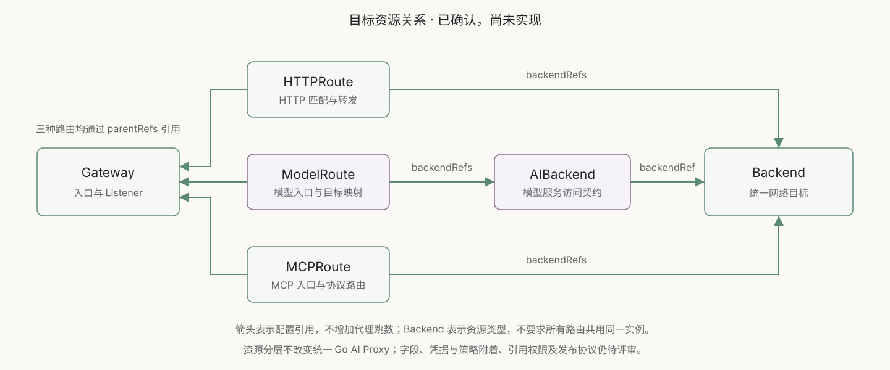
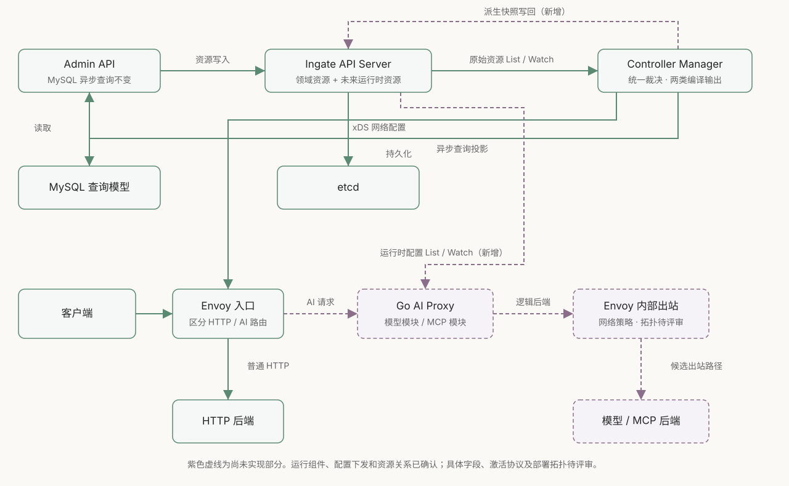
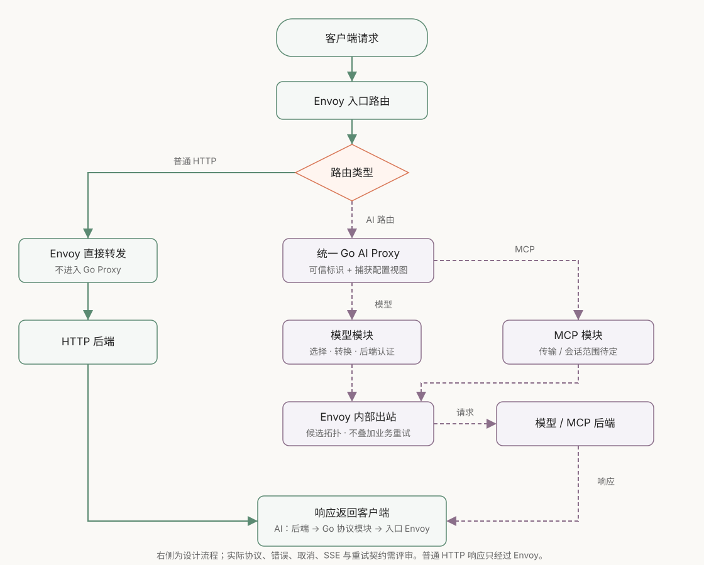
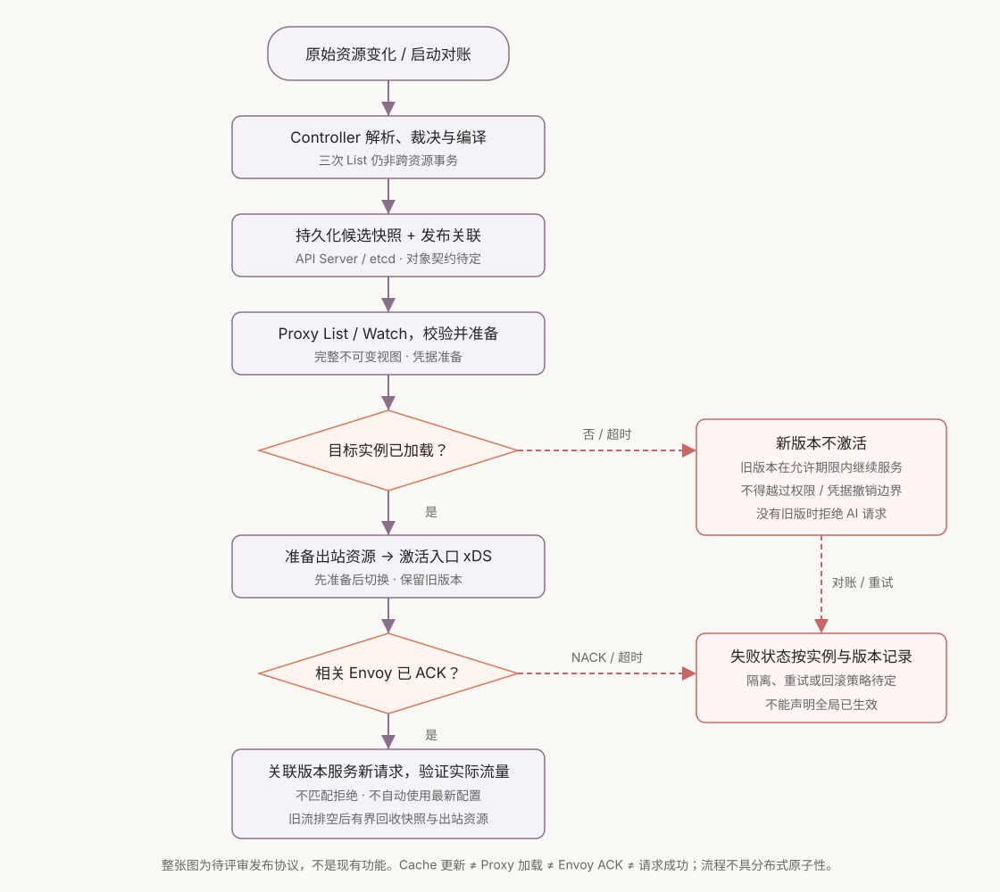

# 0010：模型与 MCP 使用统一 Go AI Proxy，由 Controller 编译配置并通过 API Server 下发

- 日期：2026-10-10
- 状态：统一运行组件、配置下发和资源关系已确认；具体字段、发布协议和实现计划待评审
- 讨论入口：本仓库文档 review；当前没有对应 Issue 或 PR
- 当前能力：[API 网关完成度](../api-gateway-readiness.md)
- 图示：[可离线打开的架构与流程图](../diagrams/ai-gateway.html)
- 后续设计：[资源契约与替换计划](../design/ai-gateway-resource-contract.md)，字段和行为待评审
- 上游核对：[固定版本契约、实现与测试对照](../design/ai-gateway-upstream-alignment.md)

## 摘要

我们已确认：模型请求和 MCP 请求统一交给 Go AI Proxy 处理；Controller 负责解释领域资源并编译配置，Envoy 经 ADS/xDS 接收网络配置，Go AI Proxy 经 Ingate API Server 的 List/Watch 接收运行时配置。普通 HTTP 请求继续由 Envoy 直接转发。统一的是运行组件、配置加载和生命周期，不是把模型协议与 MCP 强行抽象成一种协议。

本决策只记录方向，不创建新的 API、Go 包、接口或依赖。文中的运行时快照、配置激活和出站拓扑均是待评审设计，不能据此认定已有实现或直接生成业务代码。

资源关系已确认采用 `HTTPRoute → Backend`、`ModelRoute → AIBackend → Backend`、`MCPRoute → Backend`；三种路由通过 `parentRefs` 关联 Gateway。项目没有旧方案兼容压力，后续按这套目标模型设计，不保留仅为兼容旧资源形态存在的适配层。

## 背景：当前只有 HTTP 转发契约，AI 语义尚无承接位置

本 ADR 的代码基线中，Route 只描述 Gateway、Listener、路径和 Upstream 引用；Controller 汇总三类资源，由 Envoy 适配层发布 LDS、RDS、CDS、EDS。2026-10-10 的 HTTP 资源替换已按 [0011](0011-http-resource-contract.md)实施，当前契约见 [HTTPRoute](../../pkg/apis/gateway/v1alpha1/httproute.go)与[数据面配置](../../internal/controllermanager/dataplane/config.go)；[0002](0002-shared-data-plane-controller.md)保留历史分工记录。

模型名选择、提供商协议转换、每次尝试的认证、流式响应，以及 MCP 的会话、JSON-RPC 和通知流，都不是上述路径匹配契约已经支持的能力。它们需要独立的协议实现和明确的公开契约。不会因为 Upstream 已能保存地址，就把它视为已经支持模型提供商或 MCP 后端。

## 已确认的边界

| 组件 | 责任 | 不承担的责任 |
| --- | --- | --- |
| Ingate API Server | 保存期望状态与未来派生运行时资源；提供资源版本、List/Watch 和存储校验 | 不在 CRUD 请求中执行跨资源业务裁决；不执行流量转发 |
| Controller Manager | 引用解析、冲突裁决、编译 Envoy 与 Go 配置、发布及状态汇总 | 不让多个 Controller 分别修改同一份共享数据面配置 |
| Envoy | HTTP 网络转发；AI 路由到 Go Proxy；按批准配置执行连接、TLS、负载均衡等网络策略 | 不在 xDS 内替代 Go 的协议实现；这些网络策略也不等于当前全部已实现 |
| Go AI Proxy | 共用进程与配置视图；模型、MCP 分别实现协议语义 | 不重复 Watch 全部原始领域对象并重新裁决；不使用 MySQL 投影作为配置源 |
| MySQL 查询投影 | 为 Admin API 提供可重建的异步查询模型 | 不参与数据面配置生效判定，不直接向 Proxy 下发配置 |

这里的「mini k8s」指使用 Kubernetes API 机制的 Ingate 控制面。目前没有 kubelet、Pod 编排或 Secret 卷投射，也不是一套完整 Kubernetes 集群。即使以后添加名为 Secret 的资源，它也不会自动变成容器文件。

## 资源模型：路由、模型服务契约与网络目标分层

以下关系由用户确认；箭头表示配置引用，不表示新增代理跳数。具体 API Group、版本、字段类型、作用域与权限尚未定稿，也不据此宣称符合 Kubernetes Gateway API 的全部契约。

```text
Gateway
  ↑ parentRefs（以下三种路由均引用 Gateway）
  ├─ HTTPRoute ───────────────────→ Backend
  ├─ ModelRoute → AIBackend ──────→ Backend
  └─ MCPRoute ────────────────────→ Backend
```



| 资源 | 职责 | 不放入的内容 |
| --- | --- | --- |
| Gateway | 定义入口及 Listener；由路由的 parentRefs 关联 | 上游模型映射、模型提供商账号 |
| HTTPRoute | 普通 HTTP 请求匹配与转发，引用 Backend | 模型 API 转换、MCP 方法语义 |
| ModelRoute | 定义对外模型入口、请求匹配、目标选择与实际模型映射，引用 AIBackend | 重复定义网络端点和服务账号 |
| AIBackend | 定义模型服务访问契约，包括上游 API 格式、版本、基础路径及服务级访问配置；引用 Backend | Gateway 监听、路由匹配；不等同于某一个具体模型 |
| MCPRoute | 定义 MCP 入口及协议级路由行为，直接引用 Backend | 模型提供商的 API schema；不新增仅转接引用的 MCPBackend |
| Backend | 统一表达网络目标，包括端点和连接所需信息；网络策略与其关联 | 模型名、模型 API schema、MCP 工具选择、模型账号身份 |

认证策略、凭据引用、TLS、超时等配置的字段及附着位置仍需评审；以上职责不授权新增全部策略资源或默认启用治理功能。模型后端认证与 AIBackend 的访问契约关联，不代表必须内联在其 spec；修订稿拟参考官方 BackendSecurityPolicy 独立附着，实际凭据存储与获取另行设计。MCP 后端安全配置拟沿用引用上的 securityPolicy；TLS 拟沿用 Envoy Gateway Backend 内联子集。这些附着建议未改变已确认主资源关系，也未批准新增策略 API。

一个示意场景是：两条 ModelRoute 分别公开 `coding` 和 `summary`，映射到同一模型服务的 `code-v2` 和 `text-v3`；它们可共用一个 AIBackend。另一个账号使用不同 AIBackend，但在网络设置和隔离要求相同的情况下，可以引用同一个 Backend。更换实际模型只改变路由绑定；账号访问配置与网络端点分别维护。相同域名不自动代表可以共用连接池、健康状态或安全配置，是否复用必须由完整网络契约和隔离要求决定。

单独保留 AIBackend，是为了让模型服务契约可被多个路由引用，同时让 Backend 保持协议无关。若 ModelRoute 直接引用纯网络 Backend，模型 API 和账号配置只能重复进入路由，或使通用 Backend 同时承担模型协议职责。MCPRoute 不经过 AIBackend，是因为模型 schema 转换不是 MCP 的职责；统一 Go 运行组件不要求统一这两种协议的资源语义。

这个边界参考 Agent Router 的 [资源说明](https://theagentrouter.ai/docs/concepts/resources/)和 [API 契约](https://theagentrouter.ai/docs/api/)：其模型路由引用 AIServiceBackend，后者定义上游 schema 并引用网络 Backend；后端认证另有安全策略。Ingate 接受上述资源关系，但不因此完整照搬官方字段、策略体系或运行拓扑。

当前 HTTP 代码已统一为 [HTTPRoute](../../pkg/apis/gateway/v1alpha1/httproute.go)和 [Backend](../../pkg/apis/gateway/v1alpha1/backend.go)，同步替换了客户端、Controller、管理接口和查询投影，没有兼容别名；见 [0011](0011-http-resource-contract.md)。Go 协议配置仍属后续设计：目标是由 Controller 编译领域引用，请求处理不逐层读取 API Server。

## 架构：保留 HTTP 主路径，增加 AI 协议处理支路



控制面有两条输出路径：网络配置进入 Envoy；协议配置写入 API Server，供 Go Proxy 订阅。两条路径来自同一轮业务裁决，但不具有天然的原子生效能力。

候选数据面路径为 `客户端 → Envoy 入口 → Go AI Proxy → Envoy 内部出站入口 → 后端`。内部出站入口让 Go 选择逻辑后端、Envoy 执行网络策略；入口与出站可以属于同一 Envoy 进程，图中没有要求再部署一套 Envoy。它仍需评审：与 Go 直接访问后端相比，会增加一次本地代理转发，需要验证取消、背压、流式延迟和连接资源。

同机/同 Pod 部署、UDS 或 TCP，以及独立二进制入口尚未确认。Go Proxy 不应对公网开放可绕过 Envoy 的内部处理入口；如果分机部署，需要可信连接和实例身份，不能用「内网」代替认证设计。

### 模型和 MCP 分开实现，共用运行基础



模型处理要从原始请求创建每次后端尝试，避免对已经转换过的请求重复转换。若将来支持跨提供商重试，Go 负责重新选择、转换和认证；Envoy 不应再叠加同一业务重试。首个响应字节发出后的重试边界、错误编码、usage 统计和取消语义需单独定稿。

MCP 是独立协议模块，不能只转发 `tools/call`。支持哪些传输与协议版本、是否聚合多个后端、是否处理通知与服务端请求、断线续传和会话跨实例，必须先选定首个切片。现有管理员 Redis Session 不等于 MCP Session；不会因 Redis 已接入就新增 MCP 状态存储或默认启用聚合。

共享能力先限定为启动、停止、配置加载和通用网络资源所有权。出现真实的第二个消费者后再判断是否提取公共代码，不预建通用 Processor、插件系统或泛型协议框架。

## 配置：订阅编译结果，不让 Proxy 重复解释领域资源

「运行时快照」是 Controller 编译的完整配置视图：它应包含处理一次请求所需的已解析信息及来源关联。`RuntimeSnapshot` 仅为讨论用名称，API Group、对象作用域、字段、大小上限、存储版本和可见权限都未批准。

建议由订阅适配层负责 Kubernetes 客户端、初始 List、Watch 重连和对象转换，协议模块只读取不可变视图。初次加载前拒绝 AI 请求；后续配置必须完整校验成功才替换当前视图，失败不部分应用。请求捕获其使用的视图，不能在一条流中途混用更新前后的配置。

本设计将 `metadata.resourceVersion` 原样用于并发与 Watch，不自行解析排序，也不把它当成 Envoy 与 Go 的共同业务版本。现行 Kubernetes 文档允许在规定条件下比较同一 API Group、同一资源类型的十进制版本；这不提供跨资源类型或跨系统的共同发布顺序。Watch 过期后重新 List，再恢复订阅；采用 client-go 已有机制，避免自建轮询协议。断线期间保留旧配置多久、删除后的撤销期限、重启时是否使用磁盘旧配置，均须明确，不能把无限保留旧视图当作安全策略。依据：[Kubernetes API 的 List/Watch 与版本语义](https://kubernetes.io/docs/reference/using-api/api-concepts/)。

凭据分发仍是独立待定项。建议快照保存凭据引用，不把明文密钥复制到通用快照、MySQL、状态或日志；凭据获取权限、存储加密、轮转、立即撤销和引用版本必须有自己的契约。现有 API Server 集成测试关闭了 Authentication/Authorization，不能据其通过认定凭据访问隔离已经成立。

### 候选发布流程必须区分加载、ACK 和真实生效



建议使用独立的发布标识关联 Go 配置与 Envoy 路由；标识覆盖什么内容及凭据版本仍需定义。保留当前按资源类型计算的 xDS 内容版本，不把所有 xDS 版本强制改成同一字符串。

一个候选顺序是：

1. Controller 完成裁决并持久化候选快照。相同输入的重试不能制造无限新版本。
2. 目标 Go 实例校验、准备快照与所需凭据，并逐实例报告已加载版本。Envoy 只把请求送往满足目标版本的实例。
3. 准备 Envoy 出站资源，保留旧资源，再激活与该快照关联的入口路由；等待相关 Envoy 的 ACK，处理 NACK 与超时。按依赖顺序发布，而不是假定一次 `SetSnapshot` 已完成这一流程。
4. 请求携带受信任的路由、后端和发布标识，Go 拒绝缺失或不匹配的标识。Envoy 必须移除客户端伪造值并写入内部值；具体载体尚未定，不指定示例 Header 为公开 API。
5. 新流量通过后，等待旧请求排空，再按界限回收旧视图与旧出站资源。长流、离线实例和凭据撤销不能使保留空间无限增长。

这不是分布式事务。Go 配置存储和 xDS 发布之间崩溃，Controller 重启后需要从持久状态重建发布进度；仅依赖内存的「上次发布版本」不能支撑恢复。离线实例的准入、目标实例集合、最小确认数量、回滚和垃圾回收策略必须进入正式契约。Envoy 官方也要求考虑资源的最终一致性和先准备后切换：[xDS 一致性说明](https://www.envoyproxy.io/docs/envoy/latest/api-docs/xds_protocol#eventual-consistency-considerations)。

| 故障窗口 | 候选处理原则 | 尚需明确 |
| --- | --- | --- |
| 新快照无效、Proxy 加载失败 | 不激活新入口；保留旧的已确认版本 | 超时、告警及旧配置允许服务期限 |
| xDS NACK 或部分实例滞后 | 不把 Cache 发布写成全局已生效 | 实例隔离、重试和回滚条件 |
| 发布中途 Controller 重启 | 对持久发布状态对账并重试 | 状态所有者、重复执行幂等边界 |
| 上游删除或密钥撤销 | 不能仅靠保留旧快照继续无限访问 | 撤销优先级及在途请求处理 |
| 旧 SSE/MCP 会话长期占用 | 引用旧视图，有界排空或结束 | 最长保留时间、恢复和错误语义 |

状态需要分别表达业务接纳、编译完成、Proxy 已加载、Envoy 已确认与真实探测结果，并附实例和版本。`Accepted` 不升级为「可服务」；HTTP 子集的 Accepted/ResolvedRefs 语义已由 [0011](0011-http-resource-contract.md)继任实现，引用失效仍可能被接纳并返回 500。Proxy 加载、Envoy 确认及实例生效仍属后续方案；多个 Proxy 不能竞争覆盖同一个无实例身份的全局状态。相关指标应暴露版本滞后、加载失败、NACK、在途流数和撤销延迟，避免记录原始提示词、Token 或密钥。

容量验证至少要测量并发流数、每条流的有界缓冲、保留视图数与视图大小。内存预算由这些量共同决定；实现前不填写没有测量依据的吞吐或延迟承诺。

## 理由与取舍：学习官方的责任分工，不复制其部署前提

Agent Router 的模型流量使用 ExtProc；Router 阶段保留请求上下文，Upstream 阶段在每次后端尝试中转换并认证。MCP 提案采用 HTTP Proxy，是为了管理终止、合并的 SSE 流和任意后端流式调用，其讨论指出了当时扩展接口的限制。它没有说明所有 AI 协议必须永远分开，也不能据此推断作者未来一定会统一。依据：[官方数据面说明](https://theagentrouter.ai/docs/concepts/architecture/data-plane/)、[MCP Gateway 提案](https://github.com/theagentrouter/agent-router/blob/main/docs/proposals/006-mcp-gateway/proposal.md)。

我们选择统一 Go 运行组件，减少两种集成方式的维护面，也把重试与转换的责任放在协议实现内部。代价是模型流量额外经过 HTTP Proxy，需要自行保证流式背压、错误映射、取消和协议兼容；不宣称性能优于 ExtProc。

官方 Controller 更新 ExtProc 配置 Secret，并在 Envoy Pod 中挂载。Kubernetes 的 kubelet 负责把 Secret 更新投射成卷文件，应用再加载文件；这减少了数据面应用对 Kubernetes API 的直接依赖。挂载更新存在传播延迟，`subPath` 不会自动刷新。依据：[官方控制面说明](https://theagentrouter.ai/docs/concepts/architecture/control-plane/)、[Kubernetes Secret 卷语义](https://kubernetes.io/docs/concepts/configuration/secret/#using-secrets-as-files-from-a-pod)。

Ingate 没有这层运行设施，因此选择已有 API 的订阅机制，并把依赖局限在订阅适配层。相较文件模式，Go 进程需要持有 API 访问权限并处理重连；这是责任转移，不是两种方式的纯粹程度或质量排序。如果以后部署在完整 Kubernetes 上，可以重新评估由宿主集群投射文件；无需现在实现 kubelet 替代品。

未选择的方案：模型仍走 ExtProc、MCP 单独走 Proxy，会保留两套数据面集成；Proxy 直接 Watch 原始领域资源会重复 Controller 的裁决；让 Envoy 再转发配置给 Go 则混淆了 xDS 网络配置与协议配置；从 MySQL 读取会引入投影滞后。以上均不作为当前方向。

本 ADR 的架构背景链接包含官网和可变 main；2026-10-10 的后续[上游对照](../design/ai-gateway-upstream-alignment.md)已固定 Agent Router v1.2.0、Gateway API v1.6.1、Envoy Gateway v1.9.2 的提交并核对关键实现与测试定义。它未验证 Ingate 的 SDK/Envoy 二进制或端到端运行；Go protobuf 模块版本仍不等于实际可执行程序版本。MCP 最新协议与发布网关的支持范围也须分开：此版本的 modern POST 分派尚未接通。

## 行为边界：没有旧资源兼容压力，保留现有功能

本 ADR 记录目标架构；HTTP 资源替换已按已确认契约在阶段 B 实施，用户于 2026-10-11 授权提交当前实现。它不要求保留旧资源名称、字段或兼容接口，也不因没有兼容压力而删除已实现功能。

普通 HTTP 继续由 Envoy 直接转发。管理员 Session 与异步 MySQL 查询职责不因资源命名变化而改变；管理员登录凭据不作为 AI 客户端或模型后端认证。缺省附着、缺省匹配、重叠规则优先级、失效引用和 Conditions 的 HTTP 子集已通过设计 review；这些行为变化及实现证据见 0011，不能说成只改资源名而没有行为影响。

## 实施建议：先通过设计 review，再按切片开发

| 阶段 | 范围 | 验收条件 |
| --- | --- | --- |
| 0 HTTP 主链路验收 | 真实 Envoy、API Server、Manager，验证创建/更新/删除、冲突恢复、重启与 ACK/NACK；单独补真实管理鉴权回归 | 普通转发结果与配置状态可关联，失败路径可解释 |
| 1 契约设计 | 按已确认资源关系定义字段及引用；Route/Upstream 替换影响面；首个模型与 MCP 协议；运行时资源、凭据、实例准入、版本激活 | 字段与错误、删除和失败语义通过人工 review，不先写实现 |
| 2 模型最小切片 | 仅实现已选模型协议和后端；普通响应、SSE、取消与热更新；暂不做跨提供商重试 | 真实 Envoy + 协议测试后端验证；旧 HTTP 路径不变 |
| 3 MCP 最小切片 | 按批准协议版本、传输与会话能力接入同一运行组件；与模型分别测试 | 所选版本的请求交互、方法拒绝、关闭与断线语义均可验证，不默认所有版本都有初始化握手 |
| 4 扩展与部署验收 | 仅按新批准需求扩展；实库联动、TLS/权限、限额、容量与故障恢复 | 组件和整链路证据齐备后评估上线，不靠单测作结论 |

阶段 0 的验证与阶段 1 的设计可以并行推进；它们不是在此授权编码。每阶段审查所有新增及修改的手写文件，生成结果核对可重复性；提交前仍必须等用户 review。

## 尚需确认的产品与运行契约

- 六种资源关系已确认；具体字段、API Group/版本、作用域、引用权限、状态和删除语义，以及认证和网络策略的附着位置仍需确认。
- 首个模型 API、提供商、认证形式、错误与 SSE/usage 兼容范围。
- MCP 传输版本、代理或聚合模式、会话恢复与跨实例需求。
- Go/Envoy 共部署方式、出站拓扑、可信内部标识与取消/重试责任。
- 运行时对象的字段、作用域、大小、保留数量；敏感配置的权限与凭据机制。
- 发布/激活版本、实例状态、ACK/NACK 汇总、撤销、超时、重启恢复和回滚语义。

这些问题决定下一阶段的实现范围；参考项目示例不能代替用户选择。
