# AI Proxy 编译资源契约

- 状态：已实现资源级 Delta ADS；真实数据面与部署验收尚未执行。
- 更新日期：2026-10-20。
- 范围：Controller 到 AI Proxy 的编译资源，不是管理 API 或服务启动配置。

本文取代原 ConfigMap/JSON 下发说明。当前 Controller 不持久化派生 ConfigMap，
AI Proxy 不再连接 API Server，也没有配置 Namespace 参数。选型与编译图见
[控制面增量设计](control-plane-incremental-design.md)，启动参数见
[控制面与数据面启动](../control-plane-initialization.md)。

## 边界与数据流

Controller 解析六种领域资源，将相同的一份 AI 期望分别转换成 Envoy 网络资源和 AI Proxy 规则。
Envoy 管理入口、出口和网络连接；AI Proxy 只接收已经解析的入口、匹配与目标，不重新解释领域引用。



两类输出共享 ADS 服务，但各有资源类型、缓存和客户端连接。普通 HTTPRoute、端点和 TLS 配置
不下发给 AI Proxy；MySQL 查询投影也不参与这条链路。领域 Namespace 决定引用范围，
共享数据面组决定哪些代理消费相同输出，二者不是同一维度。

## 资源结构

可生成的协议源为 [resource.proto](../../api/aidataplane/v1/resource.proto)。
统一 type URL 对应 `aidataplane.v1.Resource`，外层 `name` 必须与 xDS Resource.name 一致；
payload 使用 oneof，必须且只能包含以下一种内容。

| Payload | 粒度与名称 | 主要字段 |
| --- | --- | --- |
| Entry | 一个已接纳的 AI 入口；`entry/{port}/{hostName}` | port、host_name、hostname |
| ModelRule | 一条 ModelRoute 规则；`model/{namespace}/{name}/rule/{index}` | entry_refs、origin、rule_index、matches、target 或 unavailable |
| MCPRoute | 一个 MCPRoute 对象；`mcp/{namespace}/{name}` | entry_refs、origin、path、target 或 unavailable |

`host_name` 是 `gateway/{namespace}/{name}/listener/{listener}` 形式的内部标识，
不是客户端 Host；`hostname` 才是外部主机名，空值表示不限主机名。一个 Gateway 的多个 Listener
具有不同标识，多个 Gateway 可以共享物理端口但仍分别匹配主机名。

规则引用 Entry，而不是由 Entry 嵌入全部规则。因此改一条模型规则不会改变 Entry 或兄弟规则消息。
同一规则附着多个入口时，共享一个命名资源，entry_refs 列出全部有效入口。

以下为 ModelRule 的 ProtoJSON 结构示意，不是可提交给管理 API 的资源；target_name 的内容摘要省略：

```json
{
  "name": "model/team-a/coding/rule/0",
  "modelRule": {
    "entryRefs": [
      {
        "port": 8080,
        "hostName": "gateway/team-a/public/listener/api"
      }
    ],
    "origin": {
      "namespace": "team-a",
      "name": "coding",
      "creationTime": "2026-10-19T08:00:00Z"
    },
    "matches": [
      {"exact": "coding"}
    ],
    "target": {
      "bindingName": "team-a/model-service/route/coding/rule/0/ref/0",
      "schema": {"name": "API_SCHEMA_NAME_OPENAI", "prefix": "/v1"},
      "modelNameOverride": "code-v2",
      "networkBackendName": "team-a/model-network",
      "targetName": "ai/target/<content-hash>"
    }
  }
}
```

rule_index 在这个示例中为零，按 ProtoJSON 缺省规则省略。完整字段约束以 protobuf 和
[接收校验](../../internal/aiproxy/pkg/aiconfig/resource_validation.go)为准。

## 匹配、引用和拒绝

模型规则只支持精确模型名与 catch-all。先比较精确条件，再按来源创建时间、Namespace、
名称、规则位置、匹配位置排序。Origin 只保存排序所需信息，不含 displayName、资源版本或查询字段。
可选规则名称不决定优先级。

MCP 使用精确路径并保留尾斜杠；同路径候选按来源排序。缺失或正在删除的后端不删除仍有效的匹配，
而是生成 unavailable。命中首个 unavailable 候选时拒绝，不尝试后面的候选或普通 HTTP。
真正删除路由则撤销匹配，公开入口可能重新落到已有普通 HTTP 路由。

非空 entry_refs 必须唯一，候选中每个被引用入口恰有一个 Entry。Loader 合并整批更新和删除后
检查这些约束，不接受悬空引用或重复规则身份。当前不支持 TTL、别名或部分资源 payload。

## 目标关联

ModelTarget 保存协议绑定、OpenAI schema/prefix、模型名覆盖、网络后端标识与 target_name；
MCPTarget 保存固定上游路径、网络后端标识与 target_name。两者都不包含端点、CA 或密钥。

target_name 由 [aidataplane](../../internal/pkg/aidataplane/target.go) 按协议参数和网络内容生成，
Controller 将同一个目标同时用于 Proxy 规则与 Envoy 静态出口。网络端点、TLS 或模型协议参数改变
会产生新的目标名；客户端不能据任意 Header 选择 Cluster。

目标名不是凭据，也不冻结 DNS。两路配置独立传播时，旧目标可能暂时不可用，但不能因复用逻辑
Backend 名称而改投新目标。不保留双版本出口，也不承诺在途流永不中断或撤销立即完成。

## 编译与缓存所有权

[Controller](../../internal/controllermanager/controller/gateway/controller.go) 从已收敛的 krt 集合
组装候选；[转换缓存](../../internal/controllermanager/controller/gateway/ai_resource_translation.go)
复用未变化的 Entry、ModelRule、MCPRoute 及目标。只保留当前有效键，不保存历史代次；
重启从领域资源重建，不依赖这份缓存恢复事实。

构建、引用或协议校验失败不登记半份候选。发布失败则重试最新期望，不能假定已经安装的缓存会回滚。
HTTP 与 AI 输出分别尝试，错误返回 controller-runtime；配置组装、边界比较及部分版本计算仍遍历完整状态，
不将缓存复用描述为所有步骤均为 O(变化量)。

内部 `aidataplane.Config` 是 Controller/Envoy 的中间表示，不是 ADS 消息。
现有 JSON Encode/Decode 和 `testdata/v1.json` 用于该表示的校验与测试夹具，
其整份 revision 不参与 Proxy 准入、ACK 或逐资源版本恢复。

## 分发与应用

[共享发布器](../../internal/controllermanager/dataplane/xds/publisher.go) 组合两类原生缓存：
Envoy 使用 SnapshotCache，AI Proxy 使用 LinearCache，MuxCache 按资源类型及固定数据面组分流。
当前组为 `ingate-shared-data-plane`；Node ID 区分实例，不是身份认证。

每个资源使用 go-control-plane 的内容版本。首次订阅得到当前全集；后续发送变化和明确删除；
重连携带 initial_resource_versions。SystemVersionInfo 仅作诊断，不代替逐资源接受状态。
ADS 不提供 SotW 兼容入口，Envoy bootstrap 必须使用 DELTA_GRPC。

[Loader](../../internal/aiproxy/pkg/aiconfig/loader.go) 由一个订阅循环持有写权限：

1. 校验响应类型、nonce、外层与 payload 名称、版本及 protobuf 字段。
2. 将更新和删除合并进候选表，检查引用，只重建旧、新引用影响的入口索引。
3. 完整成功后登记资源与版本，在锁内交换不可变 Config 指针，再发送 ACK。
4. 坏批次不修改任何已接受状态，发送通用 NACK 后换流，使用已接受版本重新对账。

一次请求通过 Capture 捕获一次只读视图。锁只保护指针交接，已交付的 map、切片和消息不再修改；
更新复用未变入口，查询结果按值返回，不向请求暴露可变引用。

| 情况 | 本地结果 |
| --- | --- |
| 首次同步未完成 | Capture 返回不可用，请求拒绝 |
| 合法空响应完成初始同步 | 安装有效空视图，不等于尚未加载 |
| 普通更新或显式删除 | 整批应用后影响后续请求 |
| 断线、接收失败或坏更新 | 保留最近有效视图，退避重连 |
| 本地已应用但 ACK 丢失 | 新流报告本地已接受的资源版本 |
| 进程重启 | 内存状态丢失，从空表完整同步 |
| Loader 停止 | 撤回当前指针，不修改在途请求已捕获的视图 |

重新连接的基准退避从 1 秒增长到 30 秒，并附加抖动。断线保旧没有新鲜度期限，
不能据此承诺故障期间即时撤销；安装缓存、发送响应、收到 ACK 和实际转发成功是不同确认边界。

## 容量与安全

不再受单 ConfigMap 的 1 MiB 限制，但配置容量并非无限。启动参数 max_response_bytes
限制单个 gRPC 响应，初始全集和重连差异也必须装入同一预算；示例为 16 MiB，并非默认值。
超限会使订阅失败并重试，首次同步无法建立视图。当前不分块、不落盘，候选顶层 map 仍需复制，
容量须结合资源数、序列化大小、引用扇出和在途旧视图测量。

ADS 目前使用明文 gRPC，依赖受保护部署网络，没有服务身份鉴权。Node、资源名和内容哈希
都不能替代认证。协议不含凭据；Secret 存储、密钥注入、轮转和撤销仍属于未实施的安全设计。

## 验证边界

已有普通测试覆盖编译结果、转换复用与失效、引用变化、删除与恢复、通知失败重试、
原生 Delta 订阅与重连，以及 Loader 拒绝坏批次和不可变视图交接。
测试分别位于 [gateway](../../internal/controllermanager/controller/gateway/ai_resource_translation_test.go)、
[xds](../../internal/controllermanager/dataplane/xds/ai_resources_test.go)和
[aiconfig](../../internal/aiproxy/pkg/aiconfig/resources_test.go)。

这些证据不替代真实 Envoy、API Server/etcd、数据库和跨进程部署验收。
旧 ConfigMap 写入器、Informer Loader 与固定对象名已经移除，不保留兼容调用路径；
原生 ConfigMap API 的独立存储能力仍按 [0014](../decisions/0014-upstream-core-resources.md)保留。
