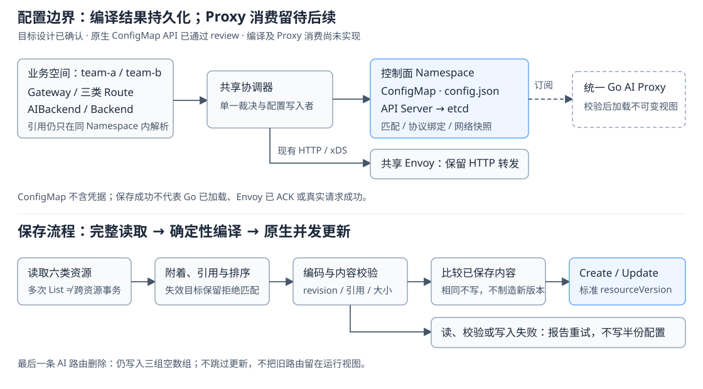

# AI 编译配置：沿用官方编译分层，使用标准 ConfigMap 保存非敏感结果

- 状态：契约已于 2026-10-13 经用户确认；原生 ConfigMap API 已通过用户 review 并获准本地提交，编译与数据面尚未实现
- 作者：Ingate 开发协作
- 日期：2026-10-13
- Ingate 基线：`cda0478e`，分支 `codex/rebuild-from-zero`
- 上游源码：Agent Router 固定提交 `daa9f891a8afcb18576d4593ad18870d1d18abac`
- 讨论入口：[资源契约](ai-gateway-resource-contract.md)、[配置与凭据草案](ai-credentials-and-runtime-config.md)
- 范围：非敏感配置的载体、字段、编译、存储和删除；首个代码切片只安装原生 ConfigMap API

## 摘要

采用官方的分层：Controller 解析领域资源，生成独立于 Kubernetes 类型的强类型配置；运行层只加载编译结果，不在请求中查询 ModelRoute、AIBackend 或 Backend。

Ingate 的模型和 MCP 都进入 Go HTTP Proxy，而官方模型使用 ExtProc，所以不能直接复制官方整个配置。我们保留官方按路由规则绑定后端、schema 和模型覆盖的语义，补入 Go 必须消费的模型匹配；MCP 只编译已确认的单后端和路径，不带入官方的聚合、工具过滤、CEL 或身份插件。

载体为一份标准 `core/v1 ConfigMap`，对应现有共享数据面；内部 payload 使用 JSON。它只保存当前完整期望配置，不保存密钥，也不声称一次写入使 Go 与 Envoy 原子切换。代码阶段先完成编译与存储，不发布 AI 入口，不实现 Proxy Watch。

用户已确认普通 HTTP 路由不进入这份配置。只被 HTTP 引用或无人引用的 Backend 也不下发给 Go；同一个 Backend 同时被 HTTP 和 AI 使用时，分别进入 xDS 与 AI 输出。为共享入口裁决读取普通路由，不等于将它们序列化给 Proxy。

## 背景：官方哪些设计可以直接借鉴

以下依据均来自固定提交的实际源码，不用当前 main 代替它。官网和 Kubernetes 文档属于读取日的可变资料。此次没有运行上游组件，也没有重新核验 release tag。

| 官方实现与依据 | Ingate 采用范围或必要差异 |
| --- | --- |
| [filterapi.Config](https://github.com/theagentrouter/agent-router/blob/daa9f891a8afcb18576d4593ad18870d1d18abac/internal/filterapi/filterconfig.go)：协议配置与 Kubernetes 类型分离 | 沿用这个边界；不直接依赖上游 `internal` 包，也不另建公开业务资源 |
| [Gateway 编译](https://github.com/theagentrouter/agent-router/blob/daa9f891a8afcb18576d4593ad18870d1d18abac/internal/controller/gateway.go)：每个路由规则的 backendRef 生成独立绑定，附带 schema、modelNameOverride | 同一 AIBackend 被两个规则使用不同 override 时，仍生成两个绑定；不能只按 AIBackend.name 去重 |
| [派生 HTTPRoute](https://github.com/theagentrouter/agent-router/blob/daa9f891a8afcb18576d4593ad18870d1d18abac/internal/controller/ai_gateway_route.go#L255)：模型 Header 条件和网络目标进入 Envoy 路由 | 我们由 Go 选择模型，所以必须把这些匹配编入 Go 配置；这是统一 HTTP Proxy 的必要适配，不是增加新的业务路由类型 |
| Config 的 Models/ModelsByHost/UnscopedModels 用于模型发现 | 不用这几个列表冒充模型匹配表；首步不增加 `/models` 接口 |
| [MCPConfig](https://github.com/theagentrouter/agent-router/blob/daa9f891a8afcb18576d4593ad18870d1d18abac/internal/filterapi/mcpconfig.go)与 [MCP 请求消费](https://github.com/theagentrouter/agent-router/blob/daa9f891a8afcb18576d4593ad18870d1d18abac/internal/mcpproxy/handlers.go)：路由/后端标识关联 Envoy 本地出口 | 沿用已解析目标绑定；本次不写死本地端口、socket 或内部 Header，也不复制多后端功能 |
| [配置分片写入器](https://github.com/theagentrouter/agent-router/blob/daa9f891a8afcb18576d4593ad18870d1d18abac/internal/controller/filter_config_bundle.go)及 [加载器](https://github.com/theagentrouter/agent-router/blob/daa9f891a8afcb18576d4593ad18870d1d18abac/internal/filterapi/watcher.go)：分片与索引 Secret，校验内容后加载 | 官方不是一份无限大的配置文件；我们先限定单 ConfigMap，超限拒绝，不提前照搬分片和 kubelet 文件投射 |
| 官方 Backend.Auth 可以包含编译后的实际凭据 | 不能把整个官方 Config 放入 ConfigMap；本稿没有 auth 字段，凭据另按 Secret 安全方案评审 |

当前 Ingate [共享协调器](../../internal/controllermanager/controller/gateway/controller.go)只编译 Gateway、HTTPRoute、Backend；[核心存储](../../internal/apiserver/registry/core/storage.go)现已安装 Namespace 与 ConfigMap，后者已通过用户 review 并获准本地提交。AIBackend、ModelRoute、MCPRoute 已有声明、管理和查询投影，但尚未生成本稿配置；没有 Secret 存储或 AI 转发能力。

## 设计：配置载体与所有者

固定对象名 `ingate-shared-data-plane-ai`，固定 key `config.json`；Namespace 由部署配置显式提供，不固定为某个租户空间、不自动创建。本文使用 `ingate-system` 作为示例值，不是已有 Namespace。对象名对应当前唯一的 `ingate-shared-data-plane`，不增加可由用户编辑的 dataPlaneId。

一个共享协调器拥有该对象的 `data["config.json"]`；API Server 仍提供标准 ConfigMap 原生接口，没有 AI 配置 Admin CRUD、MySQL 投影表或 ConfigMap status。其他身份不得修改该 key；权限部署必须另行验证，`managed-by` 标签本身不是授权。建议标注 `app.kubernetes.io/managed-by: ingate-controller-manager` 用于诊断，已有同名对象若不是约定的受管对象，应报冲突而不是静默接管。

这里的单一写入者也包含进程边界：首步只运行一个活动 Manager。`MaxConcurrentReconciles=1` 只约束单进程，resourceVersion 也不能防止两个进程用各自陈旧输入反复覆盖结果。多 Manager HA 要使用框架标准 Leader Election 并确认其存储/部署前置能力，不在本稿假设 Ingate 已安装 Lease 或实现自制选主。

六种业务资源仍在自己的 Namespace 内解析引用。中央配置包含不同 Namespace 的编译结果，是共享数据面的汇总，不代表 ModelRoute 可以引用其他空间的 AIBackend。不能把整个共享 ConfigMap 的 ownerReference 设为其中一个 Gateway，也不能依赖跨空间 ownerReference 实现回收。控制面 Namespace 的删除和维护权限必须受限。

ConfigMap 标准只校验其自身字段，不会理解字符串里的路由表；payload 的结构、引用和 revision 由编译器及未来加载器校验。采用 [Kubernetes ConfigMap](https://kubernetes.io/docs/concepts/configuration/configmap/) 的非敏感配置语义与 1 MiB 数据限制，不自建第七种业务 Kind。非敏感不等于可公开：网络地址和资源关联仍应只让必要身份读取。



### payload 的具体字段

建议内部强类型配置放在 `internal/aiproxy/config`，不导入 Kubernetes API 类型；这是未来 Controller 与 Proxy 的共享数据契约，不是现在创建一个空服务。核心组 ConfigMap 存储仍在 `internal/apiserver/registry/core`，编译与写入留在现有共享协调器中，不按六种资源各建一个配置写入者。

| 字段 | 类型与有效值 | 来源、消费与边界 |
| --- | --- | --- |
| formatVersion | 必填字符串，首版 `v1` | 内部序列化格式，不是软件发布版本或 OpenAI 版本；未知值拒绝加载 |
| revision | 必填，64 位小写十六进制 SHA-256 | 当前有效配置的内容标识；不是 UID、metadata.resourceVersion 或 xDS version_info |
| listeners | 必填数组，可空 | 只包含附着了模型/MCP 匹配的已接纳 Listener；普通 HTTP 不进入这份 payload |
| listeners[].port / hosts | 端口与 Host 数组 | 沿用现有 HTTP 编译布局；汇总相同端口，保留不同有效 Host |
| hosts[].name / hostname | 编译标识 / 有效 Host，hostname 可空 | name 沿用 `gateway/{namespace}/{name}/listener/{listener}`；空 hostname 沿用当前无 Host 限制的语义，不新增 wildcard 能力 |
| hosts[].modelRoutes | 必填数组，可空 | 每项对应一条已展开的模型 match；Controller 已确定优先级，运行层按序选择首个命中项 |
| modelRoutes[].name | 必填编译标识 | 沿用 HTTP 编译习惯：`{namespace}/{route}/rule/{i}/match/{j}`；索引用于绑定和诊断，不是数据库 position 列 |
| modelRoutes[].headers | 必填数组，0 或 1 项 | 0 项表示所有模型；1 项固定 `name=x-ai-eg-model,type=Exact`，value 保留原值。它匹配 Go 提取的模型，不信任客户端同名 Header |
| modelRoutes[].backendName | 必填字符串，可空 | 非空引用下面的 backends；空字符串表示保留匹配并拒绝，不是匿名、兜底或动态解析 |
| backends | 必填数组，可空 | 沿用官方按路由规则生成的协议后端绑定；不是重新暴露 AIBackend CRUD |
| backends[].name | 必填编译标识 | 借鉴官方 [PerRouteRuleRefBackendName](https://github.com/theagentrouter/agent-router/blob/daa9f891a8afcb18576d4593ad18870d1d18abac/internal/internalapi/internalapi.go#L143) 的 `{ns}/{aiBackend}/route/{route}/rule/{i}/ref/0`；消费者按完整字符串查找，不解析字符串重建领域引用 |
| backends[].schema | 必填对象：name、prefix | 仅已确认的 `OpenAI`；prefix 保存有效默认值 `/v1` 或显式原值，不开放官方其他 schema/version |
| backends[].modelNameOverride | 必填字符串，可空 | 空值保留请求模型；非空只覆盖该绑定的出站模型名。沿用官方语义 |
| backends[].networkBackendName | 必填字符串 | 引用 networkBackends；为 Ingate 显式区分协议与网络的必要字段，不让 Go 自建 DNS/端点池 |
| hosts[].mcpRoutes | 必填数组，可空 | 只含当前单后端 MCPRoute，不含工具/提示词过滤、聚合或会话配置 |
| mcpRoutes[].name / path | 资源作用域标识 / 有效精确路径 | name 为 `{namespace}/{route}`；path 省略值已编译成 `/mcp`，保留尾斜杠 |
| mcpRoutes[].backendName / backendPath | 网络 Backend 编译标识 / 有效上游路径 | backendName 直接引用 networkBackends，空值拒绝；backendPath 已默认化为 `/mcp` 或保留显式路径，不从请求拼任意 URL |
| networkBackends | 必填数组，可空 | 只保存被有效模型绑定或 MCP 路由引用的网络快照；不是另一个领域资源，也不包含所有闲置 Backend |
| networkBackends[].name / endpoints | `{namespace}/{backend}` / 非空端点数组 | address、port、weight 沿用现有 Backend 契约及排序；用于后续重建同 revision 的 Envoy 出口，不由 Go 负载均衡 |

所有数组输出 `[]`，不输出 null。除表中允许的空字符串外，标识、路径与引用不能为空；非空引用必须在本份配置内存在，标识在对应集合内唯一，端口与端点满足现有校验。加载层应拒绝未知字段、重复 JSON 成员、缺少必填字段和非法枚举；不能仅依赖 `DisallowUnknownFields` 就称为已检查重复成员和必填项。原生 ConfigMap API 不因此新增一套通用 JSON 校验。

不输出 displayName、领域 status、对象 resourceVersion、完整 metadata、请求数据、密钥、Token 或密钥哈希。排序需要的创建时间只在 Controller 输入中使用。配置中的内部 name 是已有资源绑定信息，不再添加一套用户必须管理的 ID。

### 完整示例：领域引用在编译后不再需要查询

以下为构造示例，不是仓库已有对象或真实提供商。业务 Namespace `team-a` 和控制面 Namespace `ingate-system` 都需预先存在；示例明文内网端点只解释编译关系，不表示允许用明文访问真实模型账号。

```yaml
apiVersion: gateway.ingate.io/v1alpha1
kind: Gateway
metadata: {namespace: team-a, name: public}
spec:
  listeners:
    - {name: api, protocol: HTTP, port: 8080, hostname: gateway.example.com}
---
apiVersion: gateway.ingate.io/v1alpha1
kind: Backend
metadata: {namespace: team-a, name: model-network}
spec:
  endpoints:
    - {address: model.internal.example, port: 8081, weight: 1}
---
apiVersion: gateway.ingate.io/v1alpha1
kind: AIBackend
metadata: {namespace: team-a, name: model-service}
spec:
  backendRef: {name: model-network}
  schema: {name: OpenAI, prefix: /v1}
---
apiVersion: gateway.ingate.io/v1alpha1
kind: ModelRoute
metadata: {namespace: team-a, name: coding}
spec:
  parentRefs: [{name: public, sectionName: api}]
  rules:
    - matches:
        - headers: [{name: x-ai-eg-model, type: Exact, value: coding}]
      backendRefs: [{name: model-service, modelNameOverride: code-v2}]
---
apiVersion: gateway.ingate.io/v1alpha1
kind: Backend
metadata: {namespace: team-a, name: tools-network}
spec:
  endpoints:
    - {address: tools.internal.example, port: 8082, weight: 1}
---
apiVersion: gateway.ingate.io/v1alpha1
kind: MCPRoute
metadata: {namespace: team-a, name: tools}
spec:
  parentRefs: [{name: public, sectionName: api}]
  path: /mcp
  backendRefs: [{name: tools-network, path: /stream}]
```

对应的完整输出如下。revision 根据本稿下述字段顺序和紧凑 JSON 算法计算；展示缩进不参与哈希。ConfigMap 创建时不填写 resourceVersion，更新时使用 API 返回的原值。

```yaml
apiVersion: v1
kind: ConfigMap
metadata:
  namespace: ingate-system
  name: ingate-shared-data-plane-ai
  labels:
    app.kubernetes.io/managed-by: ingate-controller-manager
data:
  config.json: |
    {
      "formatVersion": "v1",
      "revision": "29e071533c8e5e4bb2f5c78460aeacd14bad01ffe4e7ee0a5450e5ab23a3cc0a",
      "listeners": [{
        "port": 8080,
        "hosts": [{
          "name": "gateway/team-a/public/listener/api",
          "hostname": "gateway.example.com",
          "modelRoutes": [{
            "name": "team-a/coding/rule/0/match/0",
            "headers": [{"name": "x-ai-eg-model", "type": "Exact", "value": "coding"}],
            "backendName": "team-a/model-service/route/coding/rule/0/ref/0"
          }],
          "mcpRoutes": [{
            "name": "team-a/tools",
            "path": "/mcp",
            "backendName": "team-a/tools-network",
            "backendPath": "/stream"
          }]
        }]
      }],
      "backends": [{
        "name": "team-a/model-service/route/coding/rule/0/ref/0",
        "schema": {"name": "OpenAI", "prefix": "/v1"},
        "modelNameOverride": "code-v2",
        "networkBackendName": "team-a/model-network"
      }],
      "networkBackends": [{
        "name": "team-a/model-network",
        "endpoints": [{"address": "model.internal.example", "port": 8081, "weight": 1}]
      }, {
        "name": "team-a/tools-network",
        "endpoints": [{"address": "tools.internal.example", "port": 8082, "weight": 1}]
      }]
    }
```

未来运行层只需：在可信 Listener 绑定中匹配 `model=coding` → 查协议绑定 → 得到 OpenAI、`/v1`、`code-v2` 和网络目标；MCP 命中 `/mcp` → 得到 tools-network 和 `/stream`。这里没有增加中间网络调用。`model=other` 没有命中且没有 catch-all，拒绝；`/mcpx` 不命中 MCP 精确路径。凭据、入口操作、内部传输与协议错误尚未实现，这份配置本身不能使请求可用。

### 编译、排序与内容版本

一次协调沿用共享 Gateway/Listener 裁决及同空间引用，得到原有 HTTP/xDS 配置与本稿 AI 配置。保留原有 Gateway、HTTPRoute、Backend 的读取、发布及状态路径；再补读 AIBackend、ModelRoute、MCPRoute。公共输入读取失败时两份结果都不更新，AI 专属输入读取失败只停止 AI 更新，不阻止 HTTP 路径完成。AI 结果必须基于六类完整输入，不能把读取失败当成空集合。多次 List 不是跨资源事务；短暂引用不一致通过重协调收敛，不增加自行实现的 etcd 事务协议。

HTTP 与 AI 输出分别执行并报告失败；某一路失败不回滚另一路已成功的发布，也不抑制另一路能完成的状态更新，最后汇总错误交给框架重试。HTTP status 继续只在其原有发布条件满足后写回；AI status 只报告自身可证明的解析结果。这是新增输出需要遵守的隔离边界，不新增独立协调器或后台发布任务。

领域 Watch 覆盖六类资源的 spec 变化和进入删除状态/最终删除，不能只依赖 Generation 变化处理撤销。受管 ConfigMap 的创建、删除、所属 key 或受管标签变化也应入队对账；仅监听显式 Namespace/name，不监听全部配置作为输入。ConfigMap 的内容更新没有业务 spec Generation 语义，不能直接套用当前全局 GenerationChangedPredicate；自己的幂等写入最多触发一次无写回的对账，不循环制造版本。

ModelRoute 的 OR matches 展开为多项 modelRoutes；每项 headers 仍是 AND。省略或空 matches 生成 `match/0` 且 headers 为 `[]`；显式空 match 同样为 catch-all。一条规则中同时有精确 match 和空 match 时分别排序，不能让 catch-all 排在其他资源的精确匹配之前。同一规则的各项引用同一个协议绑定，多个父 Listener 复用该绑定。

先按模型精确匹配优先于 catch-all 排序，再按资源创建时间、Namespace、name、rule 索引、match 索引稳定排序；可选 rule.name 不参与排序。保留较低优先级候选，不因后端失效改变排序。MCP 相同精确路径的同类候选沿用创建时间、Namespace、name 顺序，运行层取首个；这是已确认的编译契约，尚无 MCP 运行实现。跨 HTTP/模型/MCP 的完全相同网络匹配仍按后文的激活前置项处理。

listeners 按端口排序；hosts 沿用接纳 Gateway 与 Listener 声明顺序；MCP 路由按上述元数据顺序；backends 与 networkBackends 按完整 name 排序，endpoints 沿用现有确定排序。内容中没有无序 map。缺失引用的匹配保留，backendName 输出空字符串；只有有效且被引用的后端进入后端集合，不能输出悬空的非空名字。

建议 revision 算法为：稳定排序后的强类型值移除 revision 字段 → Go 标准 `encoding/json.Marshal` 紧凑编码、不附加换行 → SHA-256 → 小写十六进制。字段声明顺序固定为上面完整 JSON 示例顺序；revision 紧随 formatVersion，但计算时不输出。它不是对任意语言 JSON 文本的通用规范化算法，加载层按同一强类型契约重编码核对，不直接 hash 展示文本。以 golden case 固定编码结果，改字段顺序或格式需显式评审。

status、resourceVersion、displayName 和闲置 Backend 的改变不进入哈希；有效匹配、顺序、模型覆盖、schema、路径或网络目标改变才影响 revision。普通 HTTP 的无关变更不会改变 AI revision。内容标识不提供身份认证，授权与受保护传输仍是必要条件。

### 写入、失效和删除

Controller 先完整编译并校验，核对显式控制面 Namespace 存在且未进入删除/终止，再 Get/Create/Update 受管 ConfigMap；这是写入者保护，不声称原生准入会拒绝终止空间内的所有 Update。相同 key 内容及所属标签不写回；更新使用原生 resourceVersion，Conflict 或 Create 的 AlreadyExists 交由标准重试重新读取，不关闭版本校验。只维护所属 key 和约定标签，保留其他合法 metadata/data；按完整对象 data 与 binaryData 的总数据大小核对标准上限，API Server 仍作权威校验。若已有 immutable ConfigMap 阻止所需内容更新，不强删重建，明确报告发布失败。

| 输入或故障 | 编译/保存行为 | 后续加载要求与不能承诺的部分 |
| --- | --- | --- |
| 路由未成功附着 | 不生成该 Listener 的匹配 | 不凭名字猜测其他 Gateway |
| AIBackend 或 Backend 缺失/正在删除 | 保留仍附着的模型/MCP 匹配，backendName 为空；移除无有效使用者的后端 | 命中后拒绝，不跳到下一候选或普通 HTTP 兜底；响应 body/状态由协议切片确定 |
| 删除一条 ModelRoute/MCPRoute | 删除其编译匹配并重新汇总 | 该入口是否回到现存 HTTP 兜底，是删除路由的行为影响，不等于永久路径封禁 |
| 最后一条 AI 路由删除或其 Gateway 删除 | 仍写完整空配置：listeners/backends/networkBackends 均为 `[]`，重算 revision | 空配置必须清空旧视图，不能以 nil/空内容跳过加载 |
| ConfigMap 被删除 | Controller 对账重建当前结果 | 未来加载器收到确定删除后停止 AI 新请求；普通 HTTP 不受这份配置控制 |
| 某次领域 List 失败 | AI 所需输入不完整时不更新 AI 配置；HTTP 按其完整输入独立推进，最后报告错误供框架重试 | 保存旧配置不表示旧目标持续获授权；失联新鲜度/撤销另行定稿 |
| ConfigMap 超限、Namespace 不存在/终止、写权限失败、版本重试失败 | 不截断、不拆出半份结果，不另找 Namespace；报告写入失败 | 旧对象可能仍在，不能声称删除或撤销已生效；本阶段尚无运行消费者 |
| payload 格式、内容哈希或内部引用校验失败 | 编译端禁止发布；未来加载端禁止替换当前完整视图 | 初次加载失败不 ready；是否可暂留旧版及其期限由运行方案确定，禁止静默无限沿用 |

Namespace 生命周期应包含标准 ConfigMap，不增加一个「AI ConfigMap Controller」代替原生资源删除。控制面 Namespace 中的 ConfigMap 不进入六种领域资源的 MySQL 投影。源代码中 AIBackend/MCPBackend 引用的个别注释仍写“集群级”，与已提交的同空间实现不一致；它们应在下一代码切片修正，本稿不把过时注释当作契约。

持久化成功只证明 API Server 接受了当前对象，不证明 Proxy 已加载、Envoy 已 ACK 或真实服务可调用。本阶段不新写“运行成功”的 Ready，不在 ConfigMap 添加全局 loaded/status。领域 Conditions 如需扩展，只报告实际完成的附着和引用解析，不把写入配置当成数据面成功。

## 理由与取舍

| 选择 | 为什么采用，以及代价 |
| --- | --- |
| 标准 ConfigMap，而非 AIProxyConfig Kind | 减少公开类型、生成和存储维护；代价是 API Server 不做 payload 字段级校验，必须由生产者/消费者执行 |
| 一份共享配置，而非每个业务 Namespace 一份 | 与当前共享 Listener 裁决和 Envoy 输出所有者一致；代价是共享数据面拥有汇总读取范围，不提供租户进程隔离 |
| JSON，而非照搬官方 YAML | 复用 Go 标准序列化、显式字段和确定性内容版本；外层仍是标准 ConfigMap YAML 示例。此前 config.yaml 只是占位示例，不是已确认契约 |
| 独立协议绑定，而非只按 AIBackend 汇总 | 两个规则可以对同一服务使用不同模型覆盖；绑定数量随实际规则增长，但没有新增业务实体 |
| 保存网络快照，但 Go 不连接这些端点 | 未来可重建匹配 revision 的 Envoy 出口，不从当前可变 Backend 猜旧目标；少量重复数据换取明确版本边界 |
| 首步单对象、只保存当前版本 | 一次原生写入不会出现分片拼装混合；代价是 1 MiB 规模界限，且不能仅凭此实现并行双版本或无损更新 |

不复制官方所有分支，也不照搬个别直接赋值的运行配置交换方式。未来加载器先构建不可变视图，完整校验后同步交换；新请求捕获单版，不能一边匹配旧路由一边查最新网络目标。这是运行期必要约束，不在本轮增加 goroutine、Watch 或并发抽象。

## 兼容性与实施

这是新能力，没有旧 AI 配置兼容要求。格式 `v1` 的标识是解码契约，不是承诺保留旧方案。原有 HTTP 发布、业务资源与管理查询保持现有行为。本稿替代凭据草案中的“先建空载体、以后定 payload”实施顺序；AIProxyConfig、双版本和本地健康准入仍是历史候选/后续议题，不成为本轮新增资源的授权。

按小步推进，每步审查全部手写改动，等待用户 review 后再提交：

1. 原生 ConfigMap API：复用项目锁定 Kubernetes 版本的官方校验、转换和 Generic Store，核对 CRUD/List/Watch、resourceVersion、immutable、1 MiB 和 NamespaceLifecycle；本步已通过用户 review 并获准本地提交，不生成空 Proxy 服务、不新增依赖。
2. 内部强类型配置与编码校验：按本稿 payload 实现，不导入 Kubernetes API 类型；核对确定性 revision、必填/未知/重复字段、引用、空配置及错误路径。本步尚未实现。
3. 在现有共享协调器接入 AI 依赖解析、确定排序、完整编译与 ConfigMap 幂等写入。证明精确/catch-all、同名多 Namespace、不同 override、失效目标、全量删除、写冲突和超限不会被误当成功；核对受管对象漂移与删除状态 Watch。不改变 HTTP/xDS 内容及既有错误/状态行为，验证 AI 专属失败不阻止 HTTP 更新。
4. 编译存储完成后，再按已批准的协议和运行边界实现 Proxy 消费与 Envoy AI 入口/出口；不能因 payload 已存入 etcd 就提前开放真实流量。

前三步只提供配置存储和编译能力。原生 API 存储契约变更仍执行仓库要求的隔离 integration；真实 Manager/Envoy/Proxy 联调按用户指定的统一测试阶段进行，不混淆两者。

### 接流量前必须另行确定的契约

这些项不要求先实现再保存配置，但未确认前阻止相应运行代码：

- 首批模型操作及 MCP 版本/SDK 的具体采用范围；本配置不添加 operation/provider 插件字段，`schema=OpenAI` 不自动开放所有接口。
- 普通 HTTP、模型与 MCP 完全相同的网络匹配如何裁决；不能在本次偷偷按 Kind 字典序决定，也不能抢占现有 HTTP 路径。
- Envoy → Go 的可信 Listener/revision 标识、Go → Envoy 的固定出口与版本绑定；公网标识必须清除后重写，不能允许客户端选择任意后端。
- 跨组件热更新、前版本网络描述的保留/回收和重启恢复。本稿只存当前期望配置；若采用此前双版本建议，需要扩展并 review 持久 envelope，不能靠内存缓存或一份当前 ConfigMap 声称已冻结旧出口。
- 服务身份/授权、Secret 与政策的正式契约、TLS、新鲜度及撤销/排空期限。超限或控制面断联时可能保留旧对象，尤其不能承诺即时撤销；首步不接真实凭据或匿名调用真实提供商。

## 原生 ConfigMap 实现记录

这一步不创建示例 ConfigMap 或 Namespace，不接 Controller 写入，不修改 HTTP 编译或转发，也不新增 Admin API、MySQL 表、Secret 或依赖。标准 ConfigMap 不包含 Spec/Status，不维护业务 Generation；原生 API 允许无条件 Update，后续配置写入者仍必须携带 resourceVersion 防止覆盖并发修改。

| 本地实现 | 官方来源与适配边界 |
| --- | --- |
| [内部类型](../../pkg/apis/core/types.go)与标准 core/v1 注册 | Kubernetes [v1.37.0 core/types.go](https://github.com/kubernetes/kubernetes/blob/v1.37.0/pkg/apis/core/types.go)；仅安装支持的类型，不注册整个核心组 |
| [字段校验](../../pkg/apis/core/validation/configmap.go) | Kubernetes [v1.37.0 validation.go](https://github.com/kubernetes/kubernetes/blob/v1.37.0/pkg/apis/core/validation/validation.go) 的 ConfigMap 校验；复用公开 metadata/key 校验和大小常量，保留 immutable 限制，不解析 payload |
| [写入策略](../../internal/apiserver/registry/core/configmap/strategy.go) | Kubernetes [ConfigMap Strategy](https://github.com/kubernetes/kubernetes/blob/v1.37.0/pkg/registry/core/configmap/strategy.go)；注入私有 ObjectTyper，保留显式校验，不引入主仓库 DeclarativeValidation |
| [REST 存储](../../internal/apiserver/registry/core/configmap/etcd.go) | Kubernetes [ConfigMap storage](https://github.com/kubernetes/kubernetes/blob/v1.37.0/pkg/registry/core/configmap/storage/storage.go)；使用公开 Generic Store、默认 metadata 选择器与默认 TableConvertor，不复制主仓库 printers |
| Scheme、转换与 DeepCopy | 沿用现有显式注册和 `scripts/generate-api.sh`；没有手写生成产物或另造客户端，外部调用使用标准 core/v1 客户端 |

来源文件保留 Apache 2.0 文件头，许可证见 [KUBERNETES-LICENSE](../KUBERNETES-LICENSE)。不增加第三方源码目录，不依赖 `k8s.io/kubernetes` 主仓库；公开模块版本仍为项目锁定的 v0.37.0。

## 审查与验证边界

设计时的 GoCanon MCP 启动快照为 `336a025-dirty`。本次实施重新查询来源 `/Users/lgc202/workspace/source/lgc202/gocanon`，revision `08260b72394a104ebe8286088eb23383cd6a6235`，gitVersion `08260b7-dirty`；完整读取开发入口及规范索引，按 API Server、类型/声明/函数、错误、边界校验和测试规范审查，草案不等同于已接受规则。能力查询确认原生 ConfigMap 不适用业务 Spec/Status 资源生成器，因此复用仓库现有官方生成命令，而不是套业务模板。Go 审查技能辅助逐文件检查；technical-writing 用于区分确认契约、实现和验证边界。

设计阶段已解析示例的七个 YAML 文档与内层 JSON、复算 revision、核对内部引用和本地链接，并渲染检查 SVG。实现阶段逐个检查新增/修改的手写文件，先核对声明顺序，再核对职责、签名、错误与语义分段；转换和 DeepCopy 只核对生成结果及可重复性。隔离集成用例通过标准客户端、真实 HTTPS 和独立 etcd 验证 CRUD/Patch/DeleteCollection、名称/空间/标签筛选、Watch 不匹配反例、版本冲突和无条件更新、immutable、大小校验、Discovery/OpenAPI 与本地 NamespaceLifecycle 正反例。装配失败用例核对没有部分存储映射，并销毁已创建的 Namespace 存储。

`gofmt -l cmd internal pkg`、包含未跟踪文件的空白检查、`golangci-lint run ./...`、`go vet ./...`、`go test ./... -count=1`、`go build ./...`、`go test -tags=integration ./internal/apiserver -count=1` 均通过。额外的 `golangci-lint run --build-tags integration ./internal/apiserver` 发现原测试启动辅助函数遗漏响应 Body.Close 错误检查，补齐后重跑为 0 issues；常规检查及完整 integration 也已复跑通过。生成命令在受限缓存下失败，按原命令获准使用共享构建缓存后成功，重复生成的 31 个产物哈希一致。没有执行真实 Manager/Envoy/Proxy 联调、部署身份授权或自动 Namespace 删除联动；没有凭据或真实提供商验证。上述结果只覆盖本 API 切片，不证明 AI 编译、加载或转发已经可用，用户已完成 review 并授权本地提交。
