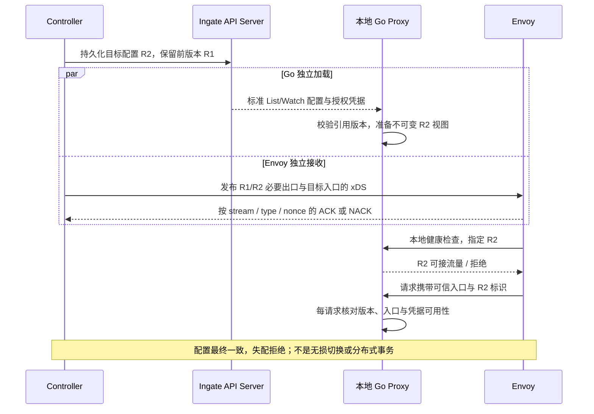

# 集中管理模型凭据，按版本加载派生配置

- 状态：待 review；用户已要求凭据参考官方，具体资源安装、安全机制和发布行为尚未批准实现
- 日期：2026-10-11
- 源码基线：`b247a4c6`，分支 `codex/rebuild-from-zero`
- 讨论入口：[统一 AI Proxy 决策](../decisions/0010-unified-ai-proxy-config-delivery.md)、[模型操作与部署建议](ai-model-operations-and-deployment.md)
- 范围：凭据职责、派生配置、版本关联、撤销与恢复；仅修改文档

## 摘要

我们建议沿用官方的 Secret 与 secretRef：密钥集中保存，BackendSecurityPolicy 附着 AIBackend 并引用凭据。首批只设计 OpenAI API key，不增加云身份交换、任意 Header 模板或多种凭据插件。Secret 原文不进入普通派生配置、MySQL 查询投影、状态或日志。

Controller 负责裁决并生成完整配置，Go 负责加载配置与授权凭据，Envoy 负责入口和网络出口。建议增加一个 Controller 所有的派生 AIProxyConfig 对象，使用独立发布标识关联两种输出；请求必须命中相同版本，失配时拒绝，不用「最新配置」猜测目标。

共部署方案下，建议借用 Envoy 本地主动健康检查验证对应 Go 配置是否就绪，不先增加实例注册、心跳、发布任务和全局确认资源。这能减少未加载实例接流量，但不提供分布式原子切换，也不承诺配置更新期间完全没有失败。

## 背景：当前缺的是存储与确认契约

2026-10-13 状态补充：[网关 Registry](../../internal/apiserver/registry/gateway/storage.go) 已安装六种业务资源及其 status；[核心组](../../internal/apiserver/core.go) 的 Namespace 主资源、status 和 finalize 已提交。官方 NamespaceLifecycle 的 Ingate 本地数据源已提交；删除内核与 Manager 的 Namespace Watch、重试调度已提交为 `5cc450d5`，尚未验证真实自动删除联动。本轮 Backend 默认存储筛选的准备性重构待 review；六种业务资源的存储作用域仍未切换，没有 Secret 或运行配置 API。作用域目标以已确认的 [0013](../decisions/0013-namespaced-resources.md) 为准，本稿其余凭据与发布建议仍待 review。

当前 [Options](../../internal/apiserver/options.go) 沿用 RecommendedOptions；其上游采用委托认证与授权，并依赖 CoreAPI/Admission 的配置。已有 HTTPS Listener 不证明身份和资源权限已配置正确。[存储测试](../../internal/apiserver/integration_test.go) 为隔离存储，将这些选项设为 nil，不能作为密钥访问隔离的证据。

当前 [Publisher](../../internal/controllermanager/dataplane/envoy/publisher.go) 按 `node.cluster=ingate-shared-data-plane` 发布共享快照，以不同资源类型的内容哈希作为 xDS 版本。[ADS Server](../../internal/controllermanager/dataplane/envoy/server.go) 使用 SotW 服务，没有 Callback。Cache 发布成功和 Manager ready 只说明本地状态，不说明任一 Envoy 已接受配置。

官方 BackendSecurityPolicy 的 `apiKey.secretRef` 引用 Secret，其中 key 为 `apiKey`，组件必须有读取权限。依据：[Agent Router API](https://theagentrouter.ai/docs/api/#backendsecuritypolicyapikey)。官方将编译配置和凭据放入挂载 Secret；我们已经选择直接订阅 Ingate API，因此需要另外定义读取和版本绑定，不复制 kubelet 文件投射过程。

## 设计

### 凭据沿用 Secret 原义，不增加同义 Credential 资源

我们建议采用 `core/v1 Secret` 的 namespaced 身份、Opaque 数据和 resourceVersion 更新语义。模型 key 使用 `apiKey`，不另加明文 token 字段，不把 key 写进 AIBackend 或 ModelRoute。BackendSecurityPolicy 的 `targetRefs` 限定为 AIBackend；首批每个 AIBackend 只允许一份适用策略，重复附着报告冲突，不按名称随机取一份。

下面仅表示拟采用的引用，不是当前可运行配置；目标对象与 Secret 均未创建：

```yaml
# BackendSecurityPolicy.spec，拟定
targetRefs:
  - name: model-service
    kind: AIBackend
apiKey:
  secretRef:
    name: model-api-key
    namespace: ingate-system
```

`namespace` 必须明确，不能从集群级 AIBackend 猜一个「同命名空间」。`ingate-system` 只是示例名称，不是已经存在的 Namespace。cluster-scoped 网关资源不因此自动变成 namespaced，也不因此具备租户隔离。

采用标准 Secret 有基础设施代价。Ingate 若自行托管它，必须先设计并安装命名空间与生命周期、Secret 存储校验及转换、授权和存储加密；不能把现有 cluster-scoped Registry 复制后换个 Kind 就称为标准 Secret。若部署在完整 Kubernetes 上，也可以让宿主集群保存 Secret，但那需要独立客户端和权限，是另一个部署选择。本稿建议 Ingate 集中托管；不隐含要求已有外部 Kubernetes，也不在未确认范围时新增 Namespace/Secret 的实现。

密钥管理界面和原生 Secret API 的可见性不同。管理端创建/替换密钥只返回名称、版本与维护信息，不回显密钥；普通列表和详情不返回 data。被授权的数据面通过原生 API 读取数据。不能声称 Secret 原生 GET 本身是「只写」接口；它对授权读取者会返回数据。

第一切片不把 Secret data 或密钥摘要投影到 MySQL，也不把 Secret 包装进普通资源的 JSON 子表。技术名称由管理端生成和维护，原生 API metadata 仍按标准处理。删除、替换与并发更新继续由权威 API 存储执行，不能用先查询后写入代替版本冲突检测。

### 权限与存储保护必须先于真实密钥接入

| 身份/组件 | 必要权限 | 不授予的权限 |
| --- | --- | --- |
| 凭据管理员，经受保护管理入口 | 创建、版本化替换和删除批准范围的 Secret | 普通查询入口读取密钥全文 |
| Controller | 读取领域资源、策略和编译所需凭据元数据；写派生配置与所属状态 | 用普通配置输出携带明文；复制全部 Secret 到 Manager Cache |
| Go 配置加载层 | 读取所属数据面配置及获授权的凭据 | 修改 Secret、领域资源、派生配置；读取其他数据面凭据 |
| Go 协议模块 | 使用请求捕获的配置与必要凭据 | 持有 Kubernetes Client，在每次请求中查 Secret 或重新裁决 |
| Envoy | 通过受保护 ADS 获取网络配置 | 通过公开入口获取 Secret；以客户端内部标识选择任意目标 |

权限表是授权目标，当前未实现。元数据请求不会自动变成一套独立的 Secret 权限；使用同一资源的 GET/LIST/WATCH 时，授权范围仍需按实际 Authorizer 契约核对。共享数据面需要哪些凭据，就授予对应范围；它不是多租户凭据隔离。

修改策略和账号绑定可以间接使用凭据，不能只禁止 Secret GET 就认定没有权限提升。建议首批只让凭据管理员维护安全策略与 AIBackend 的账号绑定，不向普通路由编辑身份开放任意 Secret 引用。更细的委托使用权限需要独立契约，不用一个名称存在性检查代替授权。

不能用管理员 Redis Session 充当 Proxy 的长期服务身份，也不能把 API Server 的 loopback 或 `system:masters` 凭据发给数据面。现有委托授权所需的身份提供方尚无部署契约；独立部署时如何认证和授权服务身份，仍需单独定稿。不能以关闭 Authentication/Authorization 或建立 AllowAll 方式接通 Secret。

Secret 的 base64 是编码，etcd 存储默认也不因 Kind 叫 Secret 而加密。需要使用框架支持的存储加密，并明确加密 key 的外部保存、轮换、备份和恢复；加密 key 不能与加密数据仅存放在同一个未受保护数据库中。依据：[Kubernetes Secret 安全要求](https://kubernetes.io/docs/concepts/configuration/secret/)。日志、审计、Trace、HTTP Debug、xDS config dump 和响应错误都要检查，不能只给业务 Logger 加脱敏。

### AIProxyConfig 只保存编译结果，不提供另一套业务 CRUD

建议使用自有 `gateway.ingate.io/v1alpha1 AIProxyConfig`，与现有共享数据面一一对应，名称沿用 `ingate-shared-data-plane`。它是机器维护的派生配置，不增加新的用户「模型入口」实体，不在 Admin 暴露可编辑 CRUD，也不增加 MySQL 表。

| 内容 | 必要性与边界 |
| --- | --- |
| 目标发布标识与完整协议配置 | 包含有效入口、schema/操作、模型规则、目标及明确拒绝动作；Proxy 不再逐层查询原始资源 |
| 所需凭据引用 | 绑定 Secret 的 namespace/name，以及实际对象 UID、opaque resourceVersion；不含密钥数据或密钥内容哈希 |
| 对应网络目标与出口绑定 | 保留重建该版本 AI 出口所需的已解析网络描述；网络池/TLS 执行仍在 Envoy |
| 来源关联 | 保留定位冲突和引用问题所需的资源身份；不复制完整领域对象或用户请求 |
| 一个前版本 | 支持受限重叠加载；不是历史归档，不保存无界 revision 列表 |

Secret UID 来自原生 metadata，用于防止删除后同名重建被旧配置误认为同一个凭据实例；这不增加 MySQL UID 列。resourceVersion 只做相等校验和标准并发控制，不解析排序。普通状态更新不改变发布内容；凭据版本改变时重新编译，宁可重新加载，也不公开密钥哈希作为优化。

发布标识依据稳定排序后的有效协议配置、其网络绑定和凭据引用版本确定性计算。它不是 metadata.resourceVersion，也不是某一种 xDS 的 version_info；xDS 继续按资源类型版本化。同样输入重试不产生新标识，普通 HTTP 的无关变更不要求重新加载整个 AI 配置。

建议 spec 只保留目标版本与一个前版本，Controller 是唯一写入者；Go 不竞争写全局 loaded 状态。对象只表达期望的可用配置集合，不把字段名或状态写成「所有实例已激活」。正式字段及序列化大小上限仍需在实现契约中确认，不能在未约束规模时加入无限嵌套映射。

前版本的网络描述也必须冻结并持久化，Controller 重启后不能拿当前 Backend 重新构造一个同名旧出口，否则旧模型视图仍可能被发送到更新后的网络目标。已删除或撤销目标则按撤销语义阻止使用，不因有前版本记录继续无限服务。

### 两条输出按版本关联，本地就绪不能代替请求校验



建议 AI 入站的本地 Proxy Cluster 按发布版本区分。Envoy 通过 UDS 主动检查该版本是否已经加载、凭据可用且未进入撤销/排空状态；普通 liveness 不查询远端提供商。采用 [Envoy HTTP 主动健康检查](https://www.envoyproxy.io/docs/envoy/latest/intro/arch_overview/upstream/health_checking)，不另造远程注册与心跳服务。健康检查有传播延迟，不能用一次 200 替代每请求校验。

对应本地 Cluster 必须禁止 panic 模式绕过不健康状态；否则只有一个本地端点时仍可能向未就绪 Proxy 发送请求。依据：[Envoy panic threshold](https://www.envoyproxy.io/docs/envoy/latest/intro/arch_overview/upstream/load_balancing/panic_threshold)。探针 Header/路径属于受保护内部协议，不由公网路由暴露；具体参数须结合实际 Envoy 二进制核对。

入站移除客户端伪造的内部标识再写入；Go 只接受已加载版本的合法入口，自行选择目标，不能信任客户端传入的 Backend。出站同样绑定发布版本和目标，不用可变的旧出口名称指向新账号/网络服务。未命中时拒绝，不走普通 HTTP 兜底，也不换到另一份凭据重试。

建议由 Go 在选定目标后按上游 schema 注入对应凭据，先移除客户端 Authorization、Cookie 及不允许转发的内部 Header。凭据只随该次请求进入受保护本地出站和对应 HTTPS 后端，不写入 xDS 资源；Envoy 不依据认证 Header 改换目标，不叠加业务重试或自动跟随重定向到其他地址。缺凭据时拒绝，不能把管理员 Session 或客户端 Token 当作后端 API key。

现有 go-control-plane v0.14.0 的 [SotW Server 接口](https://github.com/envoyproxy/go-control-plane/blob/v0.14.0/pkg/server/sotw/v3/server.go#L37)提供 `WithOrderedADS` 与标准 Callback，可优先评估用于资源发送顺序和 ACK 观测；不重新实现 ADS。它们只覆盖 xDS，不排序 Go Watch 与凭据读取，也不提供跨实例原子提交。Envoy 资源按 make-before-break 准备，必要出口先于新入口，旧资源受限保留；仅一次完整 `SetSnapshot` 不能被描述为已经证明此顺序。依据：[xDS 顺序与最终一致性](https://www.envoyproxy.io/docs/envoy/latest/api-docs/xds_protocol#eventual-consistency-considerations)。

ACK/NACK 只在相同 stream、资源类型和已发送 nonce 下关联到版本；nonce 不跨重连。回调记录是有界运行观测，断线或 Manager 重启后重新建立，不继承陈旧「已确认」。必要权限和实例身份需随 ADS 传输保护设计，`node.id` 或 `node.cluster` 自报值不是认证。不能从一个 Envoy 的 ACK 推导全体实例成功，也不能从全部相关 ACK 推导真实提供商请求成功。

这是对 0010 的全局实例报告候选方案的简化备选，尚未确认：首批利用本地配对和请求校验，不增加 ProxyInstance、Rollout、Lease 或全局 loaded API。我们接受加载、健康状态和资源传播之间可能出现短暂拒绝。若产品要求无损更新或全局发布完成判定，就需要另行设计实例确认与发布协调，不能暗中承诺。

### 普通轮转、撤销与配置失联分别处理

| 事件 | 建议行为 | 明确代价 |
| --- | --- | --- |
| 新配置或新凭据暂时读不到 | 不把新旧凭据拼成新视图；保留仍有效的已加载视图，新版本请求拒绝 | 可能短暂不可用，不匿名调用或换账号 |
| 正常更换密钥 | 新请求使用匹配新版本的 key；旧请求只在有界重叠窗口内结束 | 需要提供商支持旧 key 短暂有效，否则旧请求可能失败 |
| Secret 删除、权限撤销或确定失效 | 禁止依赖它的新请求，取消关联在途请求，退出该版本 readiness | 优先停止访问，不能为长流保留已撤销 key |
| List/Watch 断线或控制面不可达 | 在明确的新鲜度期限内使用旧视图；期限到后停止 AI 接流量并取消关联请求 | 可用性让位于撤销界限，普通 HTTP 不由 Go 停止 |
| Proxy 重启 | 重新读取权威配置和匹配凭据，再通过就绪检查 | 首批不把密钥和旧视图落到磁盘作离线启动缓存 |
| Controller 重启 | 由领域状态和持久派生对象对账，确定性重编译并重发；ACK 观测重新收集 | 不声称恢复了重启前的全局激活状态 |

期限的起点必须是成功的权威读取/校验，不以「Watch TCP 仍连接」或「最近没有事件」证明凭据仍授权。建议复用 client-go 的 Watch 重连、过期重 List，必要的新鲜度校验使用标准 API 读取；不增加自定义下发协议。一次无法识别的网络错误不当作 Secret 已删除；确定拒绝授权也不能当作可无限重试的网络故障。

删除事件只能在实例收到并执行后停止本地使用。完全失联时，平台撤销受新鲜度期限约束；提供商立即作废旧 key 才能进一步缩短实际有效期。取消 HTTP 连接也不保证提供商停止计算或计费，不能给出即时全局撤销保证。

配置视图和 xDS 前版本建议最多保留两版，新请求只接受仍被允许的版本；在途请求捕获单版，不中途更换账号或路径。快速连续更新时，最旧视图停止接新请求并有界排空，完成释放后才加载超出保留上限的新视图；不能以请求引用计数非零为由无限积累旧配置。排空超时仍无法清理时实例退出 readiness 并按组件生命周期报告失败，不忽略资源所有权继续加载。

配置大小、新鲜度期限、探针时间和排空期限是实现前要确认的运行参数；本稿不填没有部署与业务依据的性能数字。故障表定义了行为方向，不表示这些界限已经落实。只批准此方向，仍不能开始依赖具体期限的运行代码。

## 理由与取舍

把 key 内联在 AIBackend 中能少一个引用，但会使普通资源查询、投影和配置转储携带秘密，也把账号轮转与模型契约更新混在一起。Secret 与 secretRef 已有官方依据；我们选择其原义，并承认 namespaced 存储与权限的接入成本。

把编译结果和 key 全放入一份 Secret 更接近官方文件模式，但会让普通运行配置的读取等同于密钥读取。Ingate 直接 Watch API，建议把配置与凭据分开，用版本绑定承担非原子读取的代价。不能一边分离，一边声称仍有文件模式的一次完整加载保证。

为首批建设全局实例注册与发布状态机会扩展控制面接口、授权和恢复面。建议利用同机配对、原生健康检查和失配拒绝，先保证不会错误调用账号；无损更新能力明确不在这一简化方案的承诺内。这里的本地健康准入是 Ingate 适配建议，不是声称官方已经这样实现。

## 兼容性与实施

这是新增 AI 能力的设计，不保留旧 AI 契约，也不改变现有 HTTP 转发、管理员 Session 或 MySQL 普通查询语义。集中凭据不等于新增计费、租户、配额或通用策略语言。

建议按三个独立改动推进，并在每项代码 review 后停下等待提交确认：

1. 先确定 Ingate 托管 Secret 的命名空间与身份/授权部署契约，完成受保护存储、密钥管理和正反例。依赖的宿主或身份提供方不能凭参考示例补出；未完成前不接真实 key。
2. 通过策略与 AIProxyConfig 的正式字段契约后，接入 Controller 编译和原生 List/Watch 加载；只生成明确类型的机械代码，不先建空 Controller、插件接口或新 MySQL 表。
3. 在共部署与运行界限通过 review 后，接入本地就绪、可信标识、出口版本绑定与 ACK 观测，随后实现已批准的模型操作。接口失配、Secret 缺失/删除、未授权、旧版本和伪造标识都应有会失败的断言。

真实组件、加密落盘与轮换、权限部署、Envoy ACK/NACK 和长流撤销在用户指定的统一测试阶段完成；未验证前不声称安全接入或生产可用。日常单元与静态检查照常执行，不因测试延期取消必要的安全设计。

## 本轮依据与未验证范围

GoCanon MCP 来源为 `/Users/lgc202/workspace/source/lgc202/gocanon`，revision `6f86c253fa7f983d402f5db24edd761b4bcc22bb`，dirty 启动快照。完整读取开发入口与索引，沿用连续任务已读取的 APIServer/Controller 规范，本轮补读 RUNTIME 全文与有关已接受生命周期 ADR；RUNTIME 仍为草案。重点审查 RUNTIME-004/005/006/009/012/016/019 的版本、秘密、所有权、探针和确认边界，不把 GoCanon 尚未完成的热更新机制当作可复制实现。

使用 to-design 列明备选与代价，technical-writing 核对源码、官方事实与项目建议。已阅读当前仓库 Options、Registry、Manager、Reconciler、Publisher、ADS Server，以及锁定 Kubernetes v0.37.0、go-control-plane v0.14.0 的相关公开接口。官网为读取日的可变文档，Envoy latest 不等于已选二进制版本；未重新执行上游实现。

本轮只修改文档，进行全文、链接、引用关系与空白检查；没有生成类型、创建 Secret、修改外部权限、使用真实凭据或运行组件测试。Mermaid 图未做渲染验证。本稿没有完成独立身份来源、命名空间生命周期、正式对象字段和具体运行界限的实现级定稿，这些选择仍需确认。
