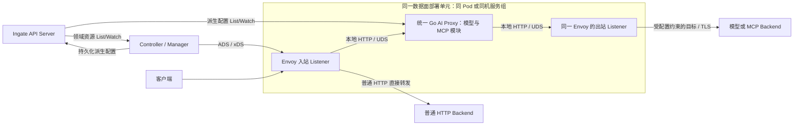
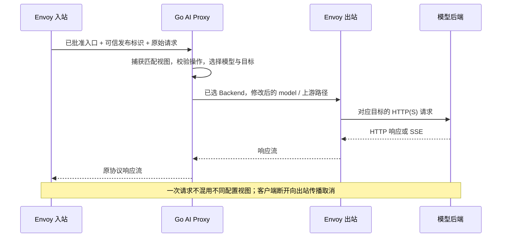

# AI 模型操作与数据面部署设计

- 状态：待 review；用户要求参考官方，本稿提出具体采用范围，不代表已批准实现
- 日期：2026-10-11
- Ingate 源码基线：`b247a4c6`，分支 `codex/rebuild-from-zero`
- 范围：首批模型操作、Go/Envoy 部署与通信边界；不新增 API、依赖、二进制或部署文件

## 摘要

建议首批采用 OpenAI schema 的两个创建操作：`POST /v1/chat/completions` 与 `POST /v1/responses`，分别支持普通响应和 SSE。它们是同一 API 家族的不同操作，不是两个新的 schema；首批只做同协议代理和已约定的模型名映射，不加入跨提供商转换、业务重试或计费。

建议 Envoy 与统一 Go AI Proxy 共同部署、分进程运行，本地 HTTP 通过 UDS 连接。Go 内部分模型与 MCP 模块，共用配置加载和进程生命周期；普通 HTTP 继续由 Envoy 直接转发。Controller 独立于请求数据面，按已确认方向向 Envoy 发布 xDS，向 Go 下发派生运行配置。

这两项是本稿请求确认的选择。凭据、安全、运行时对象和激活契约不在本稿中用示例补全，未定部分仍阻止相应实现。

## 背景：官方如何设计

本次读取 Agent Router 官网标注的 1.2 文档；读取日期为 2026-10-11。官网内容可更新，不等于重新核验了每个固定提交文件。已有固定源码基线仍使用 [上游设计对照](ai-gateway-upstream-alignment.md)中的 v1.2.0、`daa9f891a8afcb18576d4593ad18870d1d18abac`；本次未重新取得该提交的源码，也未执行官方组件。

官方 Kubernetes 部署将 AI sidecar 放入 Envoy Pod，Controller 在数据面之外运行。模型 ExtProc 使用本地 UDS，降低网络开销、共同扩缩容，并保持 Router/Upstream 两阶段的上下文亲和性。Controller 生成含处理配置和凭据的 Secret，由 sidecar 挂载。依据：[官方控制面说明](https://theagentrouter.ai/docs/concepts/architecture/control-plane/)。

官方模型处理接入 ExtProc，不是完整的 Go HTTP 转发链；它把后端尝试中的转换和认证放在 Upstream 阶段，以适应 Envoy 的重试位置。依据：[官方数据面说明](https://theagentrouter.ai/docs/concepts/architecture/data-plane/)。MCP 则是同一 sidecar 内的 HTTP Proxy，处理会话、工具路由和流合并；这不证明模型也走相同 HTTP Proxy，也不证明 MCP 的每一段连接都使用 UDS。依据：[官方 MCP 架构](https://theagentrouter.ai/docs/capabilities/mcp/#architecture)。

官方模型能力同时包含 Chat Completions、Responses、Anthropic Messages、Embeddings 等操作，并列出提供商差异。不能把“参考官方”解释成官方只提供 Chat Completions，也不能因提供商宣称 OpenAI-compatible 就认定它支持全部操作。依据：[官方支持的模型接口](https://theagentrouter.ai/docs/capabilities/llm-integrations/supported-endpoints/)。

Ingate 保留已经确认的两处差异：模型和 MCP 都进入统一 Go HTTP Proxy；Go 通过 Ingate API Server List/Watch 派生配置，而不是依赖尚不存在的 kubelet Secret 卷。借鉴官方共部署方式，不复制 ExtProc 的两阶段机制或 Kubernetes 注入设施。

## 设计

### 模型操作：采用现有协议，不重新命名 schema

| 维度 | 建议契约 | 行为影响 |
| --- | --- | --- |
| 输入与输出 schema | 首批均为 `OpenAI` | 不做 Chat↔Responses 或 OpenAI↔Anthropic 转换 |
| 首批入口 | 两个标准 POST 创建路径；每个 ModelRoute 仍绑定一个精确路径 | Chat 和 Responses 可共享 AIBackend，但各自定义模型规则；不把任意 `/v1/*` 自动暴露 |
| 模型选择 | 请求体顶层字符串 `model`，按已编译规则精确匹配 | 不增加官方内部模型 Header 的公开兼容接口；未知模型不转给 HTTP 兜底 |
| 模型覆盖 | 沿用可选 `modelNameOverride` | 只替换该目标的请求模型名，省略时保留原值；响应默认保留上游模型名 |
| 上游路径 | 已识别操作的路径后缀与 AIBackend 的 `schema.prefix` 组合 | `/v1` 是上游前缀，不是 API 版本枚举；不能直接拼接整个入站路径产生 `/v1/v1/...` |
| 上游能力 | 仅向实际支持该操作的服务配置规则 | 不为不支持 Responses 的服务静默降级为 Chat；接入具体服务时核对接口和认证要求 |
| 其他 JSON 字段 | 不由网关重新构造完整提供商请求对象 | 避免 SDK 重编码丢失扩展字段；语法、体积和路由字段仍需校验，不等于不受限透传 |

本稿建议标准路径作为首批入口范围，不添加新的 `operation` 资源字段。若批准任意自定义入口路径，需要另外明确它与上游操作的绑定方式；不能凭路径猜测后开放。`schema.version` 不用 `/v1` 填充；实际提供商存在版本参数要求时，按该 schema 契约单独处理。

现有[资源契约稿](ai-gateway-resource-contract.md)里的 `coding → code-v2` 示例可分别应用于 Chat 与 Responses：两个 ModelRoute 绑定各自路径，均引用 `model-service` AIBackend，再使用 `model-network` Backend。客户端协议字段分别是 `messages` 和 `input`，网关不把一种改写成另一种。示例模型名仅解释映射，不能证明某个真实模型支持这两个操作。

### 响应与流：共用传输，不混淆事件协议

普通响应保留上游 HTTP 状态、响应内容和允许转发的端到端 Header；SSE 持续转发，不等待完整响应后一次输出。响应中的工具调用属于提供商协议，网关不执行这些工具，不因 Responses 支持 MCP 工具就自动接入本项目 MCPRoute。

Chat 流的 chunk、终止标识和 usage chunk，与 Responses 的具名生命周期事件不是同一格式。Responses 可产生 `response.created`、`response.output_text.delta`、`response.completed` 和错误事件；不改写为 Chat 的 `choices[].delta`。依据：[OpenAI Responses 流协议](https://developers.openai.com/api/docs/guides/streaming-responses)、[Chat 流对象](https://developers.openai.com/api/reference/resources/chat/subresources/completions/streaming-events)。

首批不改写上游 SSE 事件，也不新增计费或 token 限流。取消或中断后拿不到最终 usage 时，不能记作零用量或成功完成。客户端断开需取消 Go 的出站请求，并由 Envoy 取消上游流；这个取消链需要组件验证，不能仅靠 Go 使用了 Context 作结论。

首批仅声明两个 POST 创建操作的代理能力，不宣称完整 Responses API。获取、删除、取消、后台任务、WebSocket 等能力不因创建接口存在就自动开放。`previous_response_id` 等提供商状态引用绑定到提供商和账号；路由或凭据变更不能假定状态跨账号可迁移，其放行范围和变更行为仍需在协议切片 review 中明确。

同协议 HTTP 转发优先复用 Go 标准库 `httputil.ReverseProxy` 的 `Rewrite`、Transport 和流式转发能力，不为两个入口先建 Provider 插件框架或引入模型 SDK。实现时显式构造已选上游 URL，清理身份与内部 Header，不使用客户端 Host 决定目标。已核对工作区 Go 1.27.0 的标准库声明；可追溯入口：[ReverseProxy](https://pkg.go.dev/net/http/httputil#ReverseProxy)。这只是传输复用，不替代路由、取消、安全和模型字段修改逻辑。

### 部署：同部署单元、不同进程，两段本地连接

入站 Listener 与出站 Listener 属于同一个 Envoy 进程，图中拆开是为了标明两种责任。两段本地连接使用不同 socket：Envoy 将协议请求交给 Go，Go 再将选定目标的请求交回 Envoy 出站。不得回到公开入口产生环路。外部模型 TLS、DNS/IP 连接和网络负载均衡仍由 Envoy 负责，不在 Go 中复制 Backend 网络池。

完整 Kubernetes 中建议同 Pod sidecar；非 Kubernetes 环境由部署系统将两个进程作为同机服务组运行。Ingate 的 mini API Server 不具备 Pod 调度、卷投射或 sidecar 注入能力，本稿不增加这套编排。UDS 需要共享目录、明确的 socket 所有者和访问权限；同机本身不是可信身份，不能让非授权本地进程写入 socket 或配置。

Go 出站只接受编译结果中已授权的目标，通过专用 Envoy 出站入口选择 Backend。目标标识、Host 重写、Header 清理与失效目标拒绝需要一起设计；禁止客户端通过任意 URL、Host 或内部标识改换目标。凭据注入位置必须保证目标与账号绑定、只在受信任本地链路及对应 TLS 出口流动，不能借内部 Header 将密钥泄露给普通 HTTP 后端。

共部署让 Envoy 与 Go 可作为同一服务单元扩缩容，减少跨机器服务身份与网络暴露面；代价是共同资源预算、故障和升级协调。AI Proxy 故障不应让模型请求落入普通 HTTP 兜底；普通 HTTP 不经过 Go，但进程组重启仍可能影响它。需要分别观测 Envoy 与 Go 的健康状态，不能把“同 Pod”写成“故障相互隔离”。

### 请求与配置使用的顺序

新配置先加载还是先切换路由、Envoy ACK 与 Go 已加载怎样关联，继续沿 [0010](../decisions/0010-unified-ai-proxy-config-delivery.md)的候选流程独立定稿。本地 UDS 不消除双输出发布的失败窗口；旧视图回收、离线实例与凭据撤销也不能靠共部署自动解决。不能将 Watch 成功或 `SetSnapshot` 成功当作真实生效。

## 理由与备选方案

只做 Chat 创建接口能缩小单次实现量，但它不代表官方完整的模型入口设计。建议首批纳入两个创建操作，复用同协议模型路由和 HTTP 传输，分别保留响应协议；不以实现顺序把资源模型锁定为 Chat。实际工作可以分两个小改动，每次 review 不变。

独立远程 Go Proxy 有独立扩缩容优势，但还要设计服务间认证、加密、准入和版本关联；当前没有这种部署要求。建议先采用有官方依据的共部署。官方保持 ExtProc 则可复用 Envoy 两阶段后端尝试机制，但与已确认统一 Go Proxy 不一致；这里不重新选择。

全部照搬官方提供商、转换、重试、配额和 MCP 聚合会引入尚未提出的业务和依赖。本稿只借鉴其 schema/操作区分与部署责任，不导入这些功能。

## 兼容性与实施边界

项目无旧 AI 接口兼容压力，也尚无 AI 运行代码。本稿不改变已提交的 Gateway、HTTPRoute、Backend、Admin Session 和 MySQL 投影行为；新增模型请求不能抢占已有 HTTP 入口或扩大操作暴露范围。跨种类冲突、无效引用与错误动作继续按资源契约单独 review。

下一步先确认本稿的“OpenAI 两个创建操作 + 同部署单元 UDS”范围，再补齐凭据来源与权限、后端 TLS/入站安全、派生运行对象及版本激活。2026-10-11 用户要求凭据参考官方，具体建议与代价见 [AI 凭据与运行配置设计](ai-credentials-and-runtime-config.md)，仍待 review。协议切片还须确定请求体与并发流界限、超时和退出排空，以及本地错误格式和提供商状态引用行为；这些项目未定时不开始对应运行实现，不接真实密钥。

日常代码审查、单元与静态检查继续执行；真实 Envoy、模型/MCP、实库、ACK/NACK 和故障恢复留到用户指定的统一测试阶段。相关能力在得到证据前标为未验证，不能因延期就宣称完成组件验收。

本轮使用 to-design 组织选择和备选方案，technical-writing 区分官方事实、项目建议与实现证据；OpenAI Docs 用于核对两种响应协议。GoCanon 规则快照为 `6f86c253fa7f983d402f5db24edd761b4bcc22bb`，来源工作树有未提交改动，沿用本连续任务已完整读取的开发入口与相关规范。仅修改文档，审查全部新增及修改文档的结构、链接、示例一致性与空白；不把此前 Go 检查结果算作本稿协议验证。两幅 Mermaid 图只做源码审查，未执行图形渲染验证。
