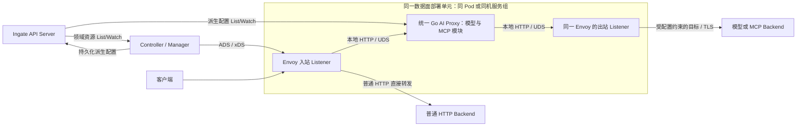
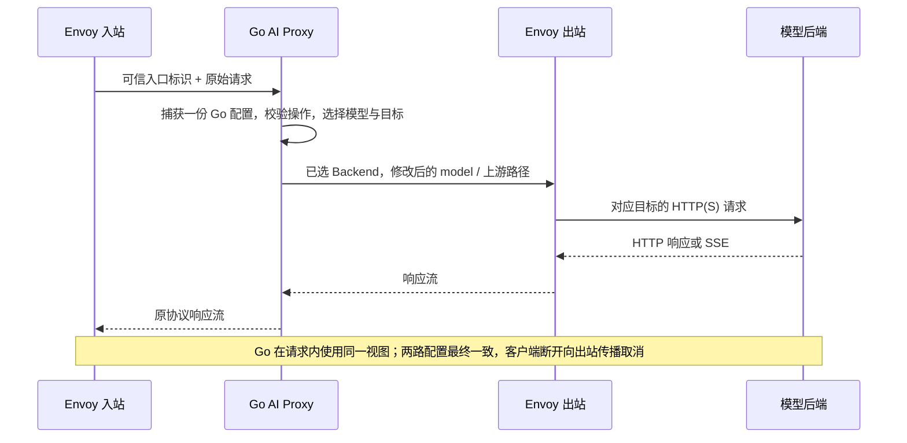

# AI 模型操作与数据面部署设计

- 状态：Chat Completions 链路及启动日志已提交；2026-10-16 Responses 创建扩展已通过 review 并获准本地提交，尚未进行真实 Envoy 联调
- 日期：2026-10-11
- 资源字段对齐：2026-10-12；首步操作与本地通信确认：2026-10-15
- Ingate 源码基线：`b247a4c6`，分支 `codex/rebuild-from-zero`
- 范围：已确认模型创建操作、Go/Envoy 部署与通信边界；本轮不新增领域资源、依赖、二进制或部署文件

## 摘要

建议首批采用 OpenAI schema 的两个创建操作：`POST /v1/chat/completions` 与 `POST /v1/responses`，分别支持普通响应和 SSE。它们是同一 API 家族的不同操作，不是两个新的 schema；首批只做同协议代理和已约定的模型名映射，不加入跨提供商转换、业务重试或计费。

建议 Envoy 与统一 Go AI Proxy 共同部署、分进程运行，本地 HTTP 通过 UDS 连接。Go 内部分模型与 MCP 模块，共用配置加载和进程生命周期；普通 HTTP 继续由 Envoy 直接转发。Controller 独立于请求数据面，按已确认方向向 Envoy 发布 xDS，向 Go 下发派生运行配置。

2026-10-15 用户已确认开始实际 AI Proxy 开发，先做 Chat Completions，普通响应与 SSE 使用同协议转发，Envoy 与 Go 同机通过 UDS 通信，网络连接仍由 Envoy 管理。随后确认两路配置采用最终一致性，不增加每请求整份 revision 相等的准入条件、全局实例确认或发布协调系统；传播期间可能暂时失败，仍须保证目标绑定与失效拒绝。两个创建操作的长期建议保留，但本次确认不包括 Responses。凭据、安全和具体入口/出口关联方式不在本稿中用示例补全，确认方向不等于确认全部内部 Header 或冲突裁决。

## 背景：官方如何设计

本次读取 Agent Router 官网标注的 1.2 文档；读取日期为 2026-10-11。官网内容可更新，不等于重新核验了每个固定提交文件。已有固定源码基线仍使用 [上游设计对照](ai-gateway-upstream-alignment.md)中的 v1.2.0、`daa9f891a8afcb18576d4593ad18870d1d18abac`；本次未重新取得该提交的源码，也未执行官方组件。

官方 Kubernetes 部署将 AI sidecar 放入 Envoy Pod，Controller 在数据面之外运行。模型 ExtProc 使用本地 UDS，降低网络开销、共同扩缩容，并保持 Router/Upstream 两阶段的上下文亲和性。Controller 生成含处理配置和凭据的 Secret，由 sidecar 挂载。依据：[官方控制面说明](https://theagentrouter.ai/docs/concepts/architecture/control-plane/)。

官方模型处理接入 ExtProc，不是完整的 Go HTTP 转发链；它把后端尝试中的转换和认证放在 Upstream 阶段，以适应 Envoy 的重试位置。依据：[官方数据面说明](https://theagentrouter.ai/docs/concepts/architecture/data-plane/)。MCP 则是同一 sidecar 内的 HTTP Proxy，处理会话、工具路由和流合并；这不证明模型也走相同 HTTP Proxy，也不证明 MCP 的每一段连接都使用 UDS。依据：[官方 MCP 架构](https://theagentrouter.ai/docs/capabilities/mcp/#architecture)。

官方模型能力同时包含 Chat Completions、Responses、Anthropic Messages、Embeddings 等操作，并列出提供商差异。不能把“参考官方”解释成官方只提供 Chat Completions，也不能因提供商宣称 OpenAI-compatible 就认定它支持全部操作。依据：[官方支持的模型接口](https://theagentrouter.ai/docs/capabilities/llm-integrations/supported-endpoints/)。

Ingate 保留已经确认的两处差异：模型和 MCP 都进入统一 Go HTTP Proxy；Go 通过 Ingate API Server List/Watch 派生配置，而不是依赖尚不存在的 kubelet Secret 卷。借鉴官方共部署方式，不复制 ExtProc 的两阶段机制或 Kubernetes 注入设施。

## 设计

### 模型操作：采用现有协议，不重新命名 schema

| 维度 | 建议契约 | 行为影响 |
| --- | --- | --- |
| 输入与输出 schema | 首批均为 `OpenAI` | 不做 Chat↔Responses 或 OpenAI↔Anthropic 转换 |
| 首批入口 | 两个标准 POST 创建路径；ModelRoute 不绑定单一操作 | 一组模型规则同时用于已开放操作；不把任意 `/v1/*` 自动暴露，也不为两个操作复制资源 |
| 模型选择 | 请求体顶层字符串 `model`，按官方 headers 规则形状匹配 | `x-ai-eg-model` 表达网关提取值，不信任客户端同名 Header；未知模型未命中且无 catch-all 时拒绝，不转给 HTTP 兜底 |
| 模型覆盖 | 沿用可选 `modelNameOverride` | 只替换该目标的请求模型名，省略时保留原值；响应默认保留上游模型名 |
| 上游路径 | 已识别操作的路径后缀与 AIBackend 的 `schema.prefix` 组合 | `/v1` 是上游前缀，不是 API 版本枚举；不能直接拼接整个入站路径产生 `/v1/v1/...` |
| 上游能力 | 仅向实际支持该操作的服务配置规则 | 不为不支持 Responses 的服务静默降级为 Chat；接入具体服务时核对接口和认证要求 |
| 其他 JSON 字段 | 不由网关重新构造完整提供商请求对象 | 避免 SDK 重编码丢失扩展字段；语法、体积和路由字段仍需校验，不等于不受限透传 |

本稿建议标准路径作为首批入口范围，不添加新的 `operation` 资源字段。2026-10-12 重读官方固定提交后，资源稿建议撤掉 ModelRoute.path/schema，客户端格式由已注册标准路径决定；具体证据见[上游对照](ai-gateway-upstream-alignment.md#2026-10-12-重新核对资源定义必须连到实际消费者)。任意自定义入口、按操作选不同目标并非当前需求，不先增加字段。首版 OpenAI 的上游 prefix 省略或为空时有效值为 `/v1`；不开放该 schema 忽略的 version 配置。

现有[资源契约稿](ai-gateway-resource-contract.md)里的 `coding → code-v2` 示例使用一份 ModelRoute，引用 `model-service` AIBackend，再使用 `model-network` Backend。Chat 与 Responses 的客户端字段分别是 `messages` 和 `input`，操作路径不同，但复用模型规则；网关不把一种请求改写成另一种。示例模型名仅解释映射，不能证明某个真实模型支持这两个操作。一个后端是否支持首批全部操作仍需在实际接入时核对，不能由 schema.name 推断。

### 响应与流：共用传输，不混淆事件协议

普通响应保留上游 HTTP 状态、响应内容和允许转发的端到端 Header；SSE 持续转发，不等待完整响应后一次输出。响应中的工具调用属于提供商协议，网关不执行这些工具，不因 Responses 支持 MCP 工具就自动接入本项目 MCPRoute。

Chat 流的 chunk、终止标识和 usage chunk，与 Responses 的具名生命周期事件不是同一格式。Responses 可产生 `response.created`、`response.output_text.delta`、`response.completed` 和错误事件；不改写为 Chat 的 `choices[].delta`。依据：[OpenAI Responses 流协议](https://developers.openai.com/api/docs/guides/streaming-responses)、[Chat 流对象](https://developers.openai.com/api/reference/resources/chat/subresources/completions/streaming-events)。

首批不改写上游 SSE 事件，也不新增计费或 token 限流。取消或中断后拿不到最终 usage 时，不能记作零用量或成功完成。客户端断开需取消 Go 的出站请求，并由 Envoy 取消上游流；这个取消链需要组件验证，不能仅靠 Go 使用了 Context 作结论。

首批仅声明两个 POST 创建操作的代理能力，不宣称完整 Responses API。获取、删除、取消、后台任务、WebSocket 等能力不因创建接口存在就自动开放。`previous_response_id` 等提供商状态引用绑定到提供商和账号；路由或凭据变更不能假定状态跨账号可迁移，其放行范围和变更行为仍需在协议切片 review 中明确。

当前按用户确认改用原生 HTTP Client：Service 完成解析、选路、适配和 Client.Do，Handler 负责响应写回。此前采用的 ReverseProxy 是 Ingate 的传输复用选择，不是官方模型链路。原生 Client 的重定向策略、固定 UDS Transport、正文关闭、逐跳 Header 清理、SSE 刷新与中断行为须显式实现和验证；不先建 Provider 插件框架或引入模型 SDK。实现细节与范围见下文 HTTP 装配节。

### 部署：同部署单元、不同进程，两段本地连接



入站 Listener 与出站 Listener 属于同一个 Envoy 进程，图中拆开是为了标明两种责任。两段本地连接使用不同 socket：Envoy 将协议请求交给 Go，Go 再将选定目标的请求交回 Envoy 出站。不得回到公开入口产生环路。外部模型 TLS、DNS/IP 连接和网络负载均衡仍由 Envoy 负责，不在 Go 中复制 Backend 网络池。

完整 Kubernetes 中建议同 Pod sidecar；非 Kubernetes 环境由部署系统将两个进程作为同机服务组运行。Ingate 的 mini API Server 不具备 Pod 调度、卷投射或 sidecar 注入能力，本稿不增加这套编排。UDS 需要共享目录、明确的 socket 所有者和访问权限；同机本身不是可信身份，不能让非授权本地进程写入 socket 或配置。

Go 出站只接受编译结果中已授权的目标，通过专用 Envoy 出站入口选择 Backend。目标标识、Host 重写、Header 清理与失效目标拒绝需要一起设计；禁止客户端通过任意 URL、Host 或内部标识改换目标。凭据注入位置必须保证目标与账号绑定、只在受信任本地链路及对应 TLS 出口流动，不能借内部 Header 将密钥泄露给普通 HTTP 后端。

共部署让 Envoy 与 Go 可作为同一服务单元扩缩容，减少跨机器服务身份与网络暴露面；代价是共同资源预算、故障和升级协调。AI Proxy 故障不应让模型请求落入普通 HTTP 兜底；普通 HTTP 不经过 Go，但进程组重启仍可能影响它。需要分别观测 Envoy 与 Go 的健康状态，不能把“同 Pod”写成“故障相互隔离”。

### 请求与配置使用的顺序



### 配置更新：最终一致，按请求目标关联

2026-10-15 用户确认：Envoy 与 Go 分别接收完整配置，允许更新传播期间因入口或目标暂时不可用而失败；不因整份配置 revision 不同就统一拒绝请求，也不引入全局实例确认、发布任务或分布式原子切换。ConfigMap 的 revision 继续用于内容校验和识别，xDS 仍按资源类型计算版本，两者不必使用同一个字符串。

依据为固定提交 `daa9f891a8afcb18576d4593ad18870d1d18abac` 的实际请求路径：[Server.setBackend](https://github.com/theagentrouter/agent-router/blob/daa9f891a8afcb18576d4593ad18870d1d18abac/internal/extproc/server.go) 从 Envoy 的后端元数据取标识，再查询当前 Go 配置；未知后端报错，该路径没有检查两边整份配置的版本是否相等。[配置加载器](https://github.com/theagentrouter/agent-router/blob/daa9f891a8afcb18576d4593ad18870d1d18abac/internal/filterapi/watcher.go)校验完整配置包后调用 LoadConfig，后者先构建新运行配置再替换当前值；这只保护 Go 配置的完整加载，不证明两路原子生效。以上是源码核对，没有运行上游组件，也不推广为官方所有协议的统一保证。

「目标正确」包含协议处理与实际网络目标的对应关系，不能仅以逻辑名称相同判断。例如同一个 Backend 从服务 A 改为 B，旧网络目标不能意外接收新账号的凭据。具体绑定、目标变更和删除时的拒绝方式在入口/出口切片中确定，不通过本次取舍默许错发请求、凭据泄露或用任意客户端 Header 选择目标。首步仍不接真实凭据。

一次请求捕获一份 Go 配置的只读约束保持不变，它不等于冻结了 Envoy 的网络配置。跨组件更新、旧请求处理和撤销仍存在窗口；不能将 Watch 成功或 SetSnapshot 成功当作真实生效。[0010](../decisions/0010-unified-ai-proxy-config-delivery.md)及凭据草案中的全局确认、整份版本校验和双版本发布保留为历史候选，不作为本次实现要求。

## Responses 创建操作扩展（2026-10-16）

用户已确认开始 `POST /v1/responses`，只接入 OpenAI 同协议创建操作及普通响应、
SSE，不实现 Chat/Responses 转换、TLS、凭据或后台任务接口。沿用现有 ModelRoute、
AIBackend、ConfigMap 与目标绑定，不新增资源字段或依赖。

实现主线为 Envoy 公共入口精确匹配两个 POST 路径 → 对应 Kratos Handler →
ModelProxy Service 从原始 model 选路 → 仅覆盖顶层 model → 固定 Envoy UDS 出口。
上游路径由既有 schema.prefix 与 responses 拼接，响应、事件与上游错误不改写。
共享正文限制、入口信任、中间件、取消及错误映射；没有模型路由的入口不增加这两个
模型入口，删除全部 ModelRoute 后恢复原普通 HTTP 路由表。

Responses 要求非空字符串 model；只校验路由字段、JSON 边界和本切片限制，不在网关
重建完整提供商请求。由于本轮不支持后台任务，background 为 true 时在转发前拒绝；
省略、null 或 false 不改变原始字段。previous_response_id、conversation 等提供商
状态引用原样传递，由上游解释；不承诺跨后端、跨账号或配置变化后的状态亲和性，
使用状态引用的调用方须保持路由目标与上游状态所属服务一致。GET/DELETE、取消、
input_tokens、WebSocket 及任意 responses 子路径不注册为模型接口。

协议依据为 [OpenAI 创建接口](https://developers.openai.com/api/reference/resources/responses/methods/create)
及 [Responses SSE](https://developers.openai.com/api/docs/guides/streaming-responses)。
本次创建接口网页超过读取上限，SSE 文档已取得正文；Agent Router 既有固定提交
网络读取失败，没有宣称重新核验。另只读核对本地 Envoy AI Gateway clean 提交
`06381c5195178b349fa5b77648179775f0b1d839` 的
[ResponsesEndpointSpec](https://github.com/envoyproxy/ai-gateway/blob/06381c5195178b349fa5b77648179775f0b1d839/internal/endpointspec/endpointspec.go#L336-L361)
和 [Responses 同协议适配](https://github.com/envoyproxy/ai-gateway/blob/06381c5195178b349fa5b77648179775f0b1d839/internal/translator/openai_responses.go#L25-L78)。
只借鉴 model 提取、独立操作路径和原始 JSON 的模型覆盖，不复制 ExtProc、usage、
Trace、SSE 解析或 sjson 依赖。background 拒绝属于 Ingate 的范围限制，不冒充官方规则。
GoCanon MCP 仍为 `6f63ad2a7eb341a15ab99453619a907422bcdc7a`、clean，沿用本连续任务
已完整读取的开发入口与相关规范，并补读 Controller 和测试规范；草案仅用于审查。
本切片实现后独立审查手写代码及语义空行，验证两个操作隔离、未命中拒绝、字段保留、
本地 HTTP/UDS 的首帧与取消；真实 Envoy、提供商及 API Server 联调仍留待统一测试。

实现与复查完成，用户已通过 review 并授权本地提交。新增组装测试先在旧实现上因 404 和
零出口调用失败，接线后通过。覆盖 JSON、具名 SSE、上游 429 原样透传、模型覆盖、
状态引用及大整数保留、未知模型、后台请求、正文超限、未注册操作、自定义转义前缀，
以及两个操作在未加载配置和取消时的稳定错误。Envoy 发布测试核对两个精确 POST、
入口 Header 覆盖、其他 Host/端口不受影响、普通路由顺序、重复发布和模型撤回。
所有新增与修改的手写文件均已审查，另行核对 GO-FUNC-012/013/014 的声明顺序、
错误检查相邻性和语义空行。gofmt、跟踪/未跟踪文件空白检查无诊断，golangci-lint
为 0 issues，go vet、全仓库 go test/build，以及 AI Proxy 全包和 Envoy 适配层
非缓存竞态测试通过。没有修改 API 类型、存储、protobuf 或依赖，未重新生成或运行
API Server integration。这些结果不代表真实 Envoy/提供商协议互操作或部署已验收。

## Chat Completions 请求处理切片

2026-10-15，配置加载与只读消费已提交为 `f20e4395`。用户随后确认[组件内能力包布局](../decisions/0015-ai-proxy-package-layout.md)，请求处理按职责重组到 `internal/aiproxy/pkg`，提交为 `c4c9d611`。模型准备与 Handler 提交为 `81d3e027`，受限转发与 Envoy 出口提交为 `350de244`。下文先保留各切片历史，再记录当前原生 Client 重构；历史切片的检查结果和未覆盖项不代表当前实现状态。

本轮重新取得固定提交 `daa9f891a8afcb18576d4593ad18870d1d18abac` 的 [ChatCompletionsEndpointSpec.ParseBody](https://github.com/theagentrouter/agent-router/blob/daa9f891a8afcb18576d4593ad18870d1d18abac/internal/endpointspec/endpointspec.go) 和 [OpenAI 同协议 RequestBody](https://github.com/theagentrouter/agent-router/blob/daa9f891a8afcb18576d4593ad18870d1d18abac/internal/translator/openai_openai.go)。官方先读取原始模型名用于路由，再用选中后端的覆盖值修改原始 JSON，而不通过完整类型重新生成所有字段。这里只采用处理顺序与字段保留原则，不移植 ExtProc、泛型 EndpointSpec、计费、流用量强制注入或跨协议 Translator。

[endpointspec.ParseChatCompletions](../../internal/aiproxy/pkg/endpointspec/chat_completions.go) 接受已经读完且由调用方限制大小的 UTF-8 JSON 对象，要求大小写精确的顶层 model 为非空字符串，不修剪或改变模型名。复用已有 sigs.k8s.io/json 拒绝重复顶层键，避免路由解析与上游对同一字段采用不同值；这项拒绝是 Ingate 的边界约束，不宣称来自官方。返回 [apischema/openai.ChatCompletionRequest](../../internal/aiproxy/pkg/apischema/openai/chat_completions.go)，目前只声明实际需要读取的 model，不代表完整提供商请求，不校验 messages、工具或扩展参数，也不能用于重新编码整个请求体。

协议字段独立于输入字节，原始请求体由调用方保留，不再用一个包装对象同时持有请求体、解析结果和编码方法。[translator.TranslateOpenAIToOpenAI](../../internal/aiproxy/pkg/translator/openai_openai.go) 接收经过入口校验的同一份原始 JSON；覆盖值为空或与原值相同时，返回原始字节的独立副本。非空且不同的覆盖值仅改变顶层 model 的 JSON 值，其他字段以标准库 json.RawMessage 保留，包括大整数和扩展对象；重编码可能改变对象顺序、空白和转义写法，不承诺逐字节保持。每次调用重新从原始字节构建独立结果，不原地修改请求或累积前一次覆盖，也不通过调用方可变的协议字段决定原始模型名。

此切片不接收客户端内部 Header，不建立入口信任或配置版本激活，不设置猜测性的请求体默认上限，不处理 SSE 响应，也不宣称已完成真实流量转发。未增加 SDK、JSON 修改库或其他依赖；后续 HTTP 接入仍须实现读取上限、Header 清理、错误协议与取消链。该切片及包布局已通过用户 review，提交为 `c4c9d611`。

GoCanon MCP 规则源仍为 `/Users/lgc202/workspace/source/lgc202/gocanon`，revision `08260b72394a104ebe8286088eb23383cd6a6235`、`08260b7-dirty`；沿用本连续任务已完整读取且来源未变的入口与相关规范，草案不等同于稳定约束。重组前的单包实现已通过手工审查、反例与所有权测试；本次保留同样的模型校验、字段保持和独立结果行为，重新核对包职责、GO-FUNC-012/013/014 及语义分段。原先包装对象持有私有请求体的测试调整为分别检查解析字段与输入独立、适配不修改源字节以及返回字节与源字节独立；不把测试迁移当作 HTTP/Envoy 调用链已经实现。

重组前后已通过的检查与审查范围记录在 [0015](../decisions/0015-ai-proxy-package-layout.md)。未修改声明式 API 类型或存储契约，未重新生成或运行 API integration；没有真实 Envoy/Proxy、UDS、提供商或 SSE 验证。下一步继续 HTTP 接入所需的入口信任、请求体读取和错误映射，不将此协议辅助实现视为已运行的 AI 服务。

### 历史切片：模型 Service 请求准备

`81d3e027` 中的模型 Service 曾以 PrepareChatCompletion(ctx, params) 接受 Listener 端口、Host 完整编译标识和原始请求体，返回按值的 ModelBackend 与独立出站字节。当前已移除该准备接口，改为下文的完整 ChatCompletion 用例。未加载或已撤回配置、请求解析失败、入口或模型未匹配、首个命中后端不可用的拒绝语义不变；不尝试后续 catch-all，包装保留底层原因，Service 不打印错误或编码公开响应。

依赖按 0015 从用例编排指向 aiconfig、endpointspec 和 translator；aiconfig 在这里提供已确认的只读运行视图，不是启动 conf。Service 不导入 Kubernetes 客户端、组件启动配置或 Transport，也不为无持久化行为增加 Repository。Loader 的启动和停止由后续组件组合根持有，构造 Service 不启动后台任务。当前编译配置只接受 OpenAI，后续增加其他 schema 时必须同时审查用例中的适配选择，不能只扩大配置枚举。

Service 切片不包含 Handler；后续 HTTP 适配见下节。可信入口的来源、出站路径和 Header 构造、最终公开错误协议仍未接入。Context 在处理前与交付结果前检查，不能中断同步 JSON 解码；此处不提供网络取消或流排空保证。测试复用已有 golden，使用原生 fake Clientset 驱动真实 Loader，验证原模型匹配、覆盖与扩展字段保持、无覆盖字节保持、结果独立、错误原因、入口隔离、首个失效目标拒绝，以及更新/删除后的新调用；不把这些进程内测试视为 API Server 或 Envoy 联调。Service 与测试已随 HTTP 适配一起通过用户 review，并获准本地提交。

本切片再次核对 GoCanon MCP，仍为 `08260b7-dirty` 启动快照，复用本连续任务已完整读取且来源未变的规范与决策；按 0015 的组件能力包归属实现，没有生成新的服务骨架。已审查全部新增手写文件与受影响调用，独立复查 GO-FUNC-012/013/014；格式、已跟踪及未跟踪文件空白检查无诊断，lint 为 0 issues，Vet、全量测试、构建及 `go test -race ./internal/aiproxy/... -count=3` 通过。未改 API 类型、存储或依赖，未重新生成或运行 API integration；真实 HTTP/UDS、Envoy、模型提供商和 SSE 验证未执行。

### 历史切片：HTTP Handler 有界读取

[ModelProxyHandler.ChatCompletion](../../internal/aiproxy/handler/modelproxy.go) 使用 Kratos v3 原生的 `func(http.Context) error`，由 Server 的原生 Router.POST 注册，错误交给 ErrorEncoder；没有新增 writeError 或伪造 protobuf 模型服务。此历史切片只在测试中注册路由，未创建生产 Server、二进制或监听地址。完整读取与后续 HTTP 阶段均放在 ctx.Middleware 调用中，避免绕过入站中间件或先读未授权正文；传给 Service 和后续阶段的是中间件派生的上下文。

[WithModelEntry](../../internal/aiproxy/handler/context.go) 使用私有类型 Context key 传递单次请求的入口。入口须由后续受信任适配层确定，不能照抄客户端 Header；缺入口返回 503，客户端自报 Header 不能建立此上下文。旧转发器曾另用目标 Context 交接选中后端；当前已删除该隐式交接，Service 直接构造出站请求。入口身份仍未实现，不能把 Context 封装当作认证已经完成。

请求体字节上限必须以正数显式传给 NewModelProxy，没有新增默认值或启动参数。http.MaxBytesReader 限制实际读取，不能靠伪报 Content-Length 绕过；超限返回 413。当前只处理未压缩 JSON，不解压请求，Content-Encoding 除空值和 identity 外返回 415，多个 Header 值逐一检查。JSON 解析与模型选择失败分别映射为固定的 400、404 或 503；取消与超时沿 Kratos 的 ClientClosed/499 和 GatewayTimeout/504，Service 未知错误固定映射 500。原因链留在服务端，未知 Service 错误只在此边界记录一次，不主动记录请求体；Middleware 仍须对自己的错误执行安全映射。

`81d3e027` 的 Handler 曾在准备成功后克隆请求并交给后续转发器；这段实现已由当前 Service 从零构造出站请求替换。请求体所有权、分帧隔离及不修改入站消息的约束保留，Handler 不再持有 forwarder 或选中后端。

公开错误的最终模型协议 envelope 仍留到 Server 编码切片；测试暂用 Kratos 默认 ErrorEncoder 检查状态和不泄露 cause，不把其 JSON 形状确定为模型公开接口。测试通过真实 Kratos Router 调用 Handler、真实模型 Service 与原生 fake Clientset/Loader，覆盖字节上限正反例、未命中/跨入口/未加载拒绝、客户端伪造入口、读取失败、取消、中间件先执行及上下文保留、未知下游 Kratos 错误兜底，以及原 Writer 与 Flush 保留。Recorder 检查不代表真实 SSE 时序、代理背压、网络取消或 Envoy 联调。

2026-10-15 用户确认本地提交本切片及 errors.AsType 调整；按 Go 1.27 将仓库 10 处 errors.As 改为泛型匹配，不增加依赖或改变目标错误类型。已复查手写改动的声明顺序、错误路径、反例与语义空行；未跟踪文件单独检查空白。当前 GoCanon MCP 不可用，沿用本连续任务已完整读取的规则快照，不声称重新获取了规则版本。真实组件验证范围仍如上文所列，Redis integration 测试只做带标签编译、不连接真实 Redis。

提交前重跑 `gofmt -l cmd internal pkg`、`git diff --check` 与未跟踪文件空白检查无诊断，`golangci-lint run ./...` 为 0 issues；`go vet ./...`、`go test ./... -count=1`、`go build ./...` 和 `go test -race ./internal/aiproxy/... -count=1` 均通过。没有修改 API 类型、存储契约或生成源，未重新生成或运行 API Server integration；这些检查不替代真实代理链路验收。

### 受限模型出口：目标绑定与两路发布

2026-10-15 用户确认继续实现 Go 转发器与 Envoy 出口，已提交为 `350de244`。不增加领域资源、JSON 字段、依赖、TLS 或凭据管理。JSON v1 的 golden 保持不变；共享 [ModelTargetName](../../internal/pkg/aidataplane/target.go) 定义两侧必须一致的出口名称算法。

算法将单个 Backend 协议绑定与其引用的 NetworkBackend 编码为固定字段顺序的 JSON；网络端点在副本中按 address、port、weight 排序，对内容求 SHA-256，得到 `ai/target/<hex>`。协议后端名称、schema、前缀、模型覆盖或网络端点内容改变时生成新名称；只改无关目标不影响该名称。Loader 在构建只读实例时计算一次，ResolveModel 返回 TargetName；Envoy 从同一份纯编译结果计算相同名称。没有保存额外的 targetName JSON 字段，也没有增加每请求整份 revision 比较、双版本保留或发布协调器。这个标识不是访问令牌，不冻结 DNS 实际解析结果，也不承诺即时撤销或未来凭据轮转安全；引入认证内容前仍须扩充相应绑定边界并单独审查。

`350de244` 曾通过 pkg/modelproxy.Proxy 复用标准 ReverseProxy，当前该包已删除；受限 UDS 连接策略迁入 [envoyclient.New](../../internal/aiproxy/pkg/envoyclient/client.go)，请求构造迁入 [modelproxy.Service](../../internal/aiproxy/service/modelproxy/service.go)，响应写回迁入 Handler。service/modelproxy 是完整模型用例，不是恢复旧转发器。仍只允许拨指定 UDS，不读取环境代理、不做 TCP/提供商直连回退。上游路径由选中 prefix 与 chat/completions 后缀构造，丢弃客户端 URL、Host 和查询参数；Header 从空集合重建，只保留 Accept，设置 JSON Content-Type，并写入共享的 `x-ingate-ai-target`。客户端认证、Cookie、任意扩展 Header 和 Envoy 控制 Header 不透传；当前不支持客户端自带上游密钥，也没有自动添加提供商认证。

普通响应保留上游状态和正文，SSE 持续转发；不解压响应，不增加模型重试。当前组合根不再注入出口错误回调，网络失败沿 Service 错误链返回给 Handler，响应开始后的失败直接中断流；仍由组合根在排空请求后清理连接池。本切片没有确定最终模型错误 envelope、并发上限、空闲超时或退出排空策略。

[Envoy 出口编译](../../internal/controllermanager/dataplane/envoy/ai_resources.go) 只为有效 ModelRoute 引用的协议绑定创建出口，不为 MCP 或普通 HTTP 生成 AI 出口。每个目标使用显式 Header 精确匹配和静态 Cluster；不使用可从 Header 任意指定 Cluster 的 cluster_header。未知、缺失或旧目标在仍存在的出口 Listener 上返回 503；没有有效目标时撤销整个出口 Listener，旧连接可能失败，不能保证统一的 HTTP 状态。匹配后移除内部目标 Header，按选中端点的 hostname 重写上游 Host；DNS、IP 连接和负载均衡仍由 Envoy 管理。出口 Route 关闭整体请求超时以免默认值截断 SSE，不改变其它运行时空闲限制，也不声明完整流量保护已经完成。

Controller Manager 新增可选 `--ai-egress-socket`，无默认路径；有模型目标时，空地址会让 AI xDS 发布失败并进入原生协调重试，没有模型目标时允许不配置。此值是所有共享数据面副本上的 Envoy 本地路径，不是 Controller 的文件路径。Controller 不创建目录、连接或删除 socket。Envoy Pipe 设置 0600，当前部署须让 Go 与 Envoy 以可访问该 owner-only socket 的身份运行，并保护目录写权限；仅同机并不构成身份认证。未来 Go 启动配置必须显式传入同一数据面路径，本切片尚无该启动命令。

[Publisher](../../internal/controllermanager/dataplane/envoy/publisher.go) 的 Publish 与 PublishAI 分别替换 HTTP、AI 期望资源，在同一把锁内合成完整快照并发布；构建失败保留该路上次有效的资源，不保留调用方可变集合。锁定版本 go-control-plane 的 SetSnapshot 先安装缓存，再通知 Watch，通知可以因取消失败且部分 Watch 已收到结果，不能假定发布错误代表回滚。发布器因此保留已经构建、交给 Cache 安装的新期望；同版本重试也重新调用 SetSnapshot 恢复未完成的 Watch，复用原 Snapshot 对象以避免无意义替换。这不是 ACK 协调或原子发布。Controller 的 compileAI 返回强类型共享配置，分别交给 Envoy 适配器和 Encode/ConfigMap writer，不把自己刚生成的 JSON 再解码。xDS 与 ConfigMap 独立尝试并聚合错误；重复 HTTP 发布不会清空 AI，撤销 AI 也不会删除普通 HTTP。重启后仍由初始协调从领域资源重建，不添加持久化发布状态；Cache 成功不代表 Envoy ACK。

处理方式参考已核对的官方固定提交 [MCP 后端出口路由](https://github.com/theagentrouter/agent-router/blob/daa9f891a8afcb18576d4593ad18870d1d18abac/internal/controller/mcp_route.go#L754)：官方将受信任的路由/后端 Header 匹配到后端。统一模型 HTTP Proxy、内容寻址目标及共享快照合并是 Ingate 的具体适配，不宣称官方原样采用了相同算法。Envoy 的精确 Header、静态 Cluster、Endpoint.hostname 和 auto_host_rewrite 均使用 go.mod 锁定的原生 v1.39.0 类型及校验器，没有增加路由插件或自写网络负载均衡。

测试覆盖目标名称固定向量、端点顺序独立与输入不变、协议/端点变化、新旧快照隔离、两类发布并发及互不覆盖、失效配置保留、AI 撤销、两路输出失败隔离、Unix socket 实际请求、Header 清理、原状态/正文、首个 SSE 事件和客户端取消。Unix 对端是原生测试 HTTP 服务，Envoy 部分检查生成的协议资源与 Snapshot Cache，不复制 Envoy 匹配器来伪装联调。尚未运行真实 Envoy/提供商、API Server/etcd、ACK/NACK、目录权限部署、背压或进程故障验证，也未装配生产 Server、可信入口、公开模型错误格式或 MCP 转发；不能直接作为可运行 AI 网关交付。

该切片提交前已按 GoCanon 已读规则与 Go 审查技能检查全部手写改动，并独立复查 GO-FUNC-012/013/014 的声明顺序、函数签名、错误检查相邻性及语义空行。原生 Cache 的取消通知恢复和整份 revision 改变但目标不变均有独立用例。格式、空白、lint、Vet、全量测试与构建通过，AI Proxy、Gateway Controller、Envoy 适配器和共享契约的 race 测试重复三轮通过。MCP 当时不可用，未声称重新查询规则快照；未改 API 类型、存储契约、生成源或依赖，没有重新生成或运行 API Server integration。

### HTTP 对象装配与路由注册

受限转发与 Envoy 出口切片已提交为 `350de244`。后续本地改动新增 [NewHTTPServer](../../internal/aiproxy/app.go) 作为对象装配入口；用户进一步确认将请求编排统一移入 Service，改用原生 HTTP Client，并将该用例命名为 modelproxy。组合根创建固定 Envoy UDS 的 Client、注入 modelproxy.Service，再创建 ModelProxyHandler，交给 [server.New](../../internal/aiproxy/server/server.go) 注册唯一的 `POST /v1/chat/completions`。旧 ReverseProxy 包、目标 Context、Handler.forwarder 和出口错误回调一并删除，不保留兼容方案。命名变更同步覆盖包路径、Handler、Server 字段、测试和文档，协议 model 字段及 ModelRoute 等资源名不变。

```text
Server → Handler（可信入口、有界读取）
              → Service.ChatCompletion
                  → Capture → Parse → ResolveModel → Translate
                  → 构造出站请求 → http.Client.Do → Envoy 出口 UDS
              ← 原生 http.Response（Body 未读）
       ← Handler（状态、Header、正文/SSE、Trailer、关闭 Body）
```

Service 是 HTTP 模型代理用例，允许使用原生 Request/Response 构造出站请求和交付响应，但不接收入站 Request/ResponseWriter，不依赖 Kratos。目标选择、路径、Header、正文和网络调用在同一方法链内完成，不再让 Handler 通过 Context 交接执行结果。仅允许 Accept 进入出站请求，禁用 GetBody 重放；未加载、未命中和首个失效目标仍在发出网络请求前拒绝。原生 Client.Do 失败保留原因链，映射 ErrForwardFailed；取消与期限错误由 Handler 优先识别。成功响应不预读正文，Body 所有权明确交给 Handler。

[envoyclient.New](../../internal/aiproxy/pkg/envoyclient/client.go) 直接返回原生 `*http.Client`，不增加 Client 接口或包装类型。Transport 固定拨号到指定 socket，无环境代理或 TCP 回退，DisableCompression 保留提供商压缩正文；CheckRedirect 返回 ErrUseLastResponse，3xx 连同正文直接交付，不访问 Location。没有整次请求超时，避免截断 SSE；未来的连接、首字节和空闲期限仍需明确，不能从本实现推导出完整超时保护。

本轮已核对官方固定提交：模型 [ExtProc.Process](https://github.com/theagentrouter/agent-router/blob/daa9f891a8afcb18576d4593ad18870d1d18abac/internal/extproc/server.go) 不是 HTTP Client 代理；[MCPProxy](https://github.com/theagentrouter/agent-router/blob/daa9f891a8afcb18576d4593ad18870d1d18abac/internal/mcpproxy/mcpproxy.go) 持有原生 Client，[会话连接](https://github.com/theagentrouter/agent-router/blob/daa9f891a8afcb18576d4593ad18870d1d18abac/internal/mcpproxy/session.go) 直接调用 Client.Do。本项目借鉴 HTTP 调用方式，保留统一 Proxy 决策；Service/Handler 分层与内容目标绑定是 Ingate 的适配，不宣称来自官方模板。

Server 接收已有的 Unix Listener，显式使用 Unix endpoint，关闭 Kratos 默认的整次请求期限，不创建 TCP 监听或猜测 socket 路径。调用方负责创建和保护入口、运行 Loader，并在 Server 停止接收及排空之后调用返回的出口连接池清理函数。构造失败不关闭调用方的 Listener。内部依赖由成功构造链保证有效，按用户反馈去掉新增的依赖 nil 检查；仅为这类分支构造的不完整对象测试同步移除，Server.New 不再返回虚构的初始化错误。

[Handler 响应写回](../../internal/aiproxy/handler/response.go) 接管并最终关闭 Body，移除固定逐跳 Header 及 Connection 指定字段，复制端到端 Header、原始状态和正文。SSE 与未知长度响应先刷新响应头，再在每次正文写入后 Flush；不解析事件或缓存完整响应。读取到 EOF 后交付原生 Trailer。正文读取、写入或 Flush 失败时，响应已经开始，使用 net/http.ErrAbortHandler 终止连接或 HTTP/2 流，不能向已有响应追加错误 JSON；将来加入恢复中间件时须保留此原生中断信号。当前范围仅为普通响应/SSE，不转发中间 1xx，非预期 101 会关闭 Body 并按转发失败拒绝，不是通用 ReverseProxy 的功能替身。

响应开始前，Handler 将网络失败映射为固定 502、取消为 499、期限为 504，保留已有校验和路由错误语义；未知失败固定 500。错误只在入站边界记录一次，不公开 socket 路径、内部原因或下游 Kratos 错误。这里暂用 Kratos 默认 ErrorEncoder，不把其 JSON 形状确定为最终模型协议 envelope。提供商已返回的错误状态和正文不再包装成本地错误。

本步没有进程启动命令、运行配置加载、Loader/Server 生命周期管理或 Envoy 入口身份适配。没有进程内可信入口的请求仍被拒绝，不将客户端 Header 转成可信上下文。测试在装配后的原生 Router 上调用真实 Handler、Service、Loader 和原生 Client，使用 fake Clientset 和本地 Unix HTTP 对端；成功场景仅在测试中注入可信入口。检查模型覆盖、原目标、原响应，以及无入口、未命中、正文超限和未实现操作不会额外访问出口。额外的原生 HTTP 测试确认首个 SSE 事件在对端结束前到达，取消会使 Unix 对端请求 Context 取消；单元用例覆盖重定向不重放、逐跳 Header、Trailer、响应 Body 所有权及部分流中断。它们不代表真实 API Server、Envoy 或完整进程已运行。

本切片已逐个审查全部新增、修改及删除的手写文件，先检查 GO-FUNC-012 的声明顺序，再审查职责、命名、参数/返回值、错误原因与注释，最后独立复查错误检查相邻性和语义空行。原模型、隔离入口与拒绝输入均检查是否真正触发预期断言，不用 lint 代替人工判断。重构技能用于按职责迁移并删除旧交接，Go 审查技能用于逐文件核对行为与风格；没有借此自动提交。

请求链重构后已通过三轮 AI Proxy race 检查；随后按用户确认重命名为 modelproxy，再次通过 `gofmt -l cmd internal pkg`、`git diff --check`、全部十二个未跟踪 Go 文件的空白检查、`golangci-lint run ./...`（0 issues）、`go vet ./...`、`go test ./... -count=1`、`go build ./...` 及一轮 AI Proxy race 检查。已独立复查声明顺序、语义空行及重命名引用；测试保留成功和拒绝输入，不通过兼容别名保留旧包。初轮沙箱禁止绑定 Unix socket，获准后重新运行通过，不将该环境拒绝算作功能失败或跳过验证。GoCanon MCP 仍不可用，沿用本连续任务已完整读取的本地规则来源及规范；未宣称取得新 MCP 快照。没有修改 API 类型、存储、生成源或依赖，未执行 API integration 或重新生成；真实 Envoy/API Server/提供商及进程生命周期仍未验证。用户已完成本阶段 review 并授权本地提交；提交前再次通过格式、空白、lint、Vet、全量测试和构建，不推送或创建 PR。

## Envoy 模型入口与 Go 入口适配

用户确认继续接通客户端到 Go 的链路，并明确不增加过度的冲突检测。此步复用已有 ModelRoute、Listener 和 Host：Envoy 在绑定的公共 VirtualHost 前插入唯一的 `POST /v1/chat/completions` 精确路由，转到 Go Unix socket。相同路径的普通 HTTPRoute 也保留在后面；其他方法或路径仍按原顺序匹配。不新增前端字段、API、依赖或协议操作，不创建冲突控制器，也不因这种重叠阻断整份配置。

```text
客户端 POST /v1/chat/completions
  → Envoy 已匹配的 Listener / Host
  → Go 入口 UDS：Server 解析入口 → Handler → modelproxy.Service
  → Envoy 出口 UDS：按已选目标转发 → 模型后端
```

入口 Header 定义在 [aidataplane/entry.go](../../internal/pkg/aidataplane/entry.go)：`x-ingate-ai-listener-port` 是公共 Listener 端口，`x-ingate-ai-host` 是包含 Namespace/Gateway/Listener 的完整编译名称，不是客户端域名。Envoy 使用原生 `OVERWRITE_IF_EXISTS_OR_ADD` 覆盖客户端的同名值，并删除客户端目标 Header。Go 的路由 Filter 在读取正文前检查这两个值的单值、非空和端口范围，转成已有的请求 Context；不存在的入口仍由原配置查询拒绝。Service 不重新捕获配置，也不将入口 Header 传给出口。

信任来自受保护的 Unix socket 与目录访问权限，不来自 Header 格式。Server 仍只接收调用方创建的 Unix Listener；获得该 socket 访问权的进程能够声明入口。本步不增加用户认证或跨主机身份方案，不认为同机就天然安全。

Controller Manager 新增 `--ai-ingress-socket`，指向 Envoy 所在主机上由 Go 监听的绝对路径；与已有 `--ai-egress-socket` 是两个不同文件，无默认值，不由 Controller 创建。模型入口存在时必须配置前者；有效模型目标存在时还须配置后者。仅有 MCPRoute 不生成模型入口。目标失效但 ModelRoute 仍在时保留 Go 入口，由现有逻辑拒绝，不退回 HTTP。

HTTP 视图继续拥有公共 Listener/VirtualHost，AI 视图只为相同端口、相同 Host 合入模型路由并提供入口 Cluster；不会因单独收到 AI 视图开放额外公共端口。合并复制 HTTP proto，不原地修改旧 Snapshot；AI 撤销时去掉模型入口，保留普通路由。两路发布仍是最终一致，更新传播期间可能短暂没有模型入口或发生旧新视图组合，不增加激活屏障，不宣称跨 xDS 与 ConfigMap 原子切换。

新增测试核对精确 POST、路由顺序、端口/Host 隔离、覆盖 Header 的原生 Envoy 配置、独立发布顺序与撤销、旧 Snapshot 不变，以及非法/重复 Header 不读取正文。装配测试不再注入可信 Context，而是走实际 Server Header 适配；SSE 测试两端均使用真实本地 Unix HTTP 连接，远端仍是测试对端。未启动真实 Envoy、API Server 或模型提供商，未验证 ACK/NACK、生产权限及进程生命周期；最终公开错误 envelope、TLS 和凭据仍不在本步范围。用户已完成本切片 review 并授权本地提交；提交前重跑格式、空白、lint、Vet、全量测试和构建通过，不推送或创建 PR。

本步 GoCanon MCP 仍不可用，沿用连续任务已完整读取的本地开发入口，并重新核对 GO-FUNC-012/013/014。按 Go 审查技能逐个检查 17 个修改文件和 5 个未跟踪文件，独立复查声明顺序、语义空行与反例断言；未用扫描器代替人工判断。`gofmt -l cmd internal pkg`、已跟踪/未跟踪空白检查均无诊断，lint 为 0 issues，Vet、全量测试、构建及 AI Proxy/Envoy 适配包 race 测试通过。未修改 API 类型、存储或依赖，未重新生成或执行 API integration；上述检查不替代真实组件验收。

## 启动配置读取与校验（已提交）

本切片已通过用户 review，提交为 `0b0eea18`。以下保留该切片范围与检查记录；Run 和 shutdown_timeout 属于下一节的新增改动。

本步只将已有构造参数落实为进程配置：`server.socket` 对应 Go Unix Listener，`server.max_request_body_bytes` 对应 Handler 正文上限；`api_server.kubeconfig` 和 `api_server.ai_config_namespace` 对应 Ingate API 连接与 Loader 读取范围；`envoy.egress_socket` 对应已有固定 UDS Client。字段来源是现有调用契约，不从参考服务复制 MySQL、Redis、gRPC、业务路由或其他未实现能力。

[conf.proto](../../internal/aiproxy/conf/conf.proto) 由现有固定版本 Buf 和 protoc-gen-go 生成 Go 类型。[config.go](../../internal/aiproxy/config.go) 沿用 Admin API 的严格 YAML 转 JSON、protojson 解码和 Protovalidate 校验；未知字段、重复字段、缺失项和非正正文上限均拒绝，错误保留文件路径与原因，不记录配置对象。Namespace 格式复用 Kubernetes 原生校验，不另维护正则；绝对路径、NUL 与两个 socket 不同的约束复用平台路径语义，不在 Service 再加判断。

[示例文件](../../configs/ai-proxy.yaml) 的两个 socket 必须分别匹配 Controller 的 `--ai-ingress-socket` 和 `--ai-egress-socket`；Namespace 必须是已有的 Ingate Namespace，Controller 和 Proxy 应配置同一值。示例正文上限为 1 MiB，不是代码默认值。kubeconfig 必须指向 Ingate API；省略路径只保留原生集群内配置的选择，不证明当前宿主环境已经指向 Ingate。

本步不访问 kubeconfig、不创建 API 客户端、目录或 socket，不启动 Watch，不读取动态 ConfigMap；也没有新增热更新、日志/遥测参数或请求超时。配置尚未由生产 Run 消费，下一小步再接命令与生命周期，不把解析通过当成部署完成。

测试覆盖完整示例、未知与重复输入、缺失配置、正文限值、Namespace、路径、相同 socket、集群内配置选择和读取错误原因；缺失依赖文件仍可完成纯输入校验，未创建目标目录。没有执行真实 Ingate API、Envoy 或提供商验证。

规则源重新核对为 `/Users/lgc202/workspace/source/lgc202/gocanon`、`08260b72394a104ebe8286088eb23383cd6a6235`，工作树有未提交修改；MCP 仍不可用，完整读取当前开发入口并按配置任务核对 RUNTIME、参数校验和已接受的组件布局决策。Go 函数、错误、命名、测试与审查技能用于组织读取/解码/校验阶段及错误路径；草案不据此转为稳定约束。逐文件检查手写改动，并独立复查 GO-FUNC-012/013/014；生成文件只核对来源与可重复性。

格式、已跟踪/未跟踪空白检查均无诊断；lint 为 0 issues，Vet、全量测试、构建、Buf lint/build 均通过。使用固定 Buf v1.73.0 和 protoc-gen-go v1.36.11 重复生成，新增 conf.pb.go 的 SHA-256 一致，已有生成文件无变更。未修改 Kubernetes API 类型、存储契约或依赖，未执行 Kubernetes 代码生成或 API integration；本步无新增并发，未额外运行 race。真实运行组件验证仍未执行。

## 运行入口与退出（已通过 review）

[命令入口](../../cmd/ingate-ai-proxy/main.go) 提供 --conf、--version 和 --help，分别处理参数错误与运行错误的退出码；不增加管理或迁移命令。可用 `make ingate-ai-proxy` 构建，再执行 `bin/ingate-ai-proxy --conf configs/ai-proxy.yaml`。help/version 不加载配置。启动文件只读一次；动态模型配置仍由 Loader 从指定 Namespace 的唯一 ConfigMap 读取，不自动创建 Namespace 或 ConfigMap，也不把 Watch 建立视作流量就绪。

[Run](../../internal/aiproxy/app.go) 负责创建和清理资源，[newApp](../../internal/aiproxy/app.go) 只做 Kratos 装配。它们复用已有 Loader、原生 Kubernetes Client、原生 HTTP Client 和 HTTP Server：

```text
启动：配置校验 → 组件日志 → API Client/Loader → 受保护的 Unix Listener → Kratos App + Watch
退出：HTTP 停止接收并有界排空 → 取消并等待 Watch → 关闭出口/API 空闲连接 → 关闭日志
```

Watch 使用明确拥有的子 Context；解除父取消是为了让正常停止时的 HTTP 排空先完成，App 返回后必定取消并等待 Watch，不遗留后台任务。Loader 的非取消错误会停止 App 并返回原因。App 的信号和 HTTP 生命周期由 Kratos 管理，不另写信号循环；直接取消 Run 的父 Context 会沿框架 BaseContext 取消在途请求，与收到停止信号后保留请求排空不同。

新增必填的正数 `server.shutdown_timeout`，通过 Kratos StopTimeout 限制排空期限。已核对锁定的 Kratos v3.0.0：HTTP Stop 在 Shutdown 超时后调用原生 Close，关闭仍未结束的连接；无需再包装一个强制关闭管理器。示例 30s 不是默认值，长 SSE 可能被中断，正常关闭可返回 nil；它也不是单个模型请求的超时。现有 HTTP 整次请求期限仍为零。

[Unix 监听](../../internal/aiproxy/listener_unix.go) 要求部署预先准备由运行用户拥有、组和其他用户无访问权限的目录，例如 0700；绑定后 socket 设为 0600。Envoy 与 Go 须按同一运行 UID 部署，并由部署侧保护祖先目录。启动不创建目录、不修改已有目录权限，也不删除已存在的文件或残留 socket；占用直接失败。关闭原生 Unix Listener 会移除本次拥有的 socket。非 Unix 平台明确拒绝运行，不回退到 TCP。此限制保护的是已经确认的同机可信入口，不引入用户认证或跨主机身份方案。

日志复用 internal/pkg/log 的现有默认配置：info、JSON、stdout，增加组件 service 字段，并注入 Kratos、Loader 和 Handler。Handler 不再依赖全局 slog，Service 不重复打印错误；最终运行错误由命令输出一次。本步没有增加日志配置项、模型端点、TLS、凭据、请求重试、初始配置就绪探针或发布屏障。

新增测试运行真实 Kratos App、本地 Unix HTTP 连接和原生 API Client：核对受限 Watch 请求及取消、HTTP 入口可用、关闭后 socket 移除、启动依赖失败不绑定入口；用 fake Clientset 配合持续 SSE 核对配置的关闭期限会中断连接并取消上游，同时等待 Loader 停止。另有 socket 权限、已占用路径保留和开放目录拒绝的反例；错误转换核对注入日志、一次记录及取消不打印。没有启动真实 Envoy、Ingate API Server 或模型提供商，没有验证操作系统信号投递、跨 UID 部署、xDS ACK/NACK 或性能。

本步实现时 GoCanon MCP 仍不可用，使用连续任务已完整读取的本地来源 `08260b72394a104ebe8286088eb23383cd6a6235`（当时工作树有修改），按生命周期、并发、Context、错误、日志和 Go 审查规范检查资源所有权与退出顺序；技术写作技能用于区分实现证据与未验证范围。逐个审查新增及修改的手写文件，并独立复查 GO-FUNC-012/013/014 的声明顺序、错误检查相邻性和语义空行。用户已通过 review 并授权本地提交，不推送或创建 PR。

格式、已跟踪/未跟踪文件空白检查无诊断；lint 为 0 issues，Vet、全量测试和构建通过，命令及 AI Proxy 包的 race 测试重复三轮通过。Buf lint/build 通过，固定版本重复生成 conf.pb.go 的 SHA-256 一致，其他生成文件无变更。没有修改 Kubernetes API、存储或依赖，未执行 Kubernetes 代码生成或 API integration；这些检查不代替上述真实组件验证。

提交前重新核对本地 GoCanon 为 `e3ff4a1f8a807a9b88c6b9a78b23e98986104540`（工作树有修改），MCP 仍不可用；重新完整读取开发入口，并确认本次适用的规范与分层决策较上述实现来源未变。再次审查全部手写改动及未跟踪文件，独立复查语义空行，并重跑格式、空白、lint、Vet、全量测试及构建；生成结果与上一轮核对的哈希一致。不将普通检查通过算作真实组件验收。

## 理由与备选方案

只做 Chat 创建接口能缩小单次实现量，但它不代表官方完整的模型入口设计。建议首批纳入两个创建操作，复用同协议模型路由和 HTTP 传输，分别保留响应协议；不以实现顺序把资源模型锁定为 Chat。实际工作可以分两个小改动，每次 review 不变。

独立远程 Go Proxy 有独立扩缩容优势，但还要设计服务间认证、加密、准入和版本关联；当前没有这种部署要求。建议先采用有官方依据的共部署。官方保持 ExtProc 则可复用 Envoy 两阶段后端尝试机制，但与已确认统一 Go Proxy 不一致；这里不重新选择。

全部照搬官方提供商、转换、重试、配额和 MCP 聚合会引入尚未提出的业务和依赖。本稿只借鉴其 schema/操作区分与部署责任，不导入这些功能。

## 兼容性与实施边界

项目无旧 AI 接口兼容压力，当前新增进程入口已通过 review，尚待真实组件验收。本稿不改变 Gateway、HTTPRoute、Backend、Admin Session 和 MySQL 的管理契约；已配置 ModelRoute 的入口按上文顺序优先处理模型 POST，不扩大到其他操作。无效引用继续按现有规则拒绝。

资源、配置编译、存储与 Loader 已分步完成；2026-10-15 起按确认的 Chat Completions 范围继续 AI Proxy。模型公共入口与 Unix Header 适配已提交为 `d988f8df`，启动配置已提交为 `0b0eea18`；进程入口及有界退出已通过 review 并获准本地提交。最终一致性取舍已确认，凭据来源与权限、后端 TLS/客户端认证仍在相应实现前确认。2026-10-11 用户要求凭据参考官方，具体建议与代价见 [AI 凭据与运行配置设计](ai-credentials-and-runtime-config.md)，凭据部分仍待 review。协议切片还须确定并发流界限、请求超时、本地错误格式和提供商状态引用行为；未定时不接真实密钥。

日常代码审查、单元与静态检查继续执行；真实 Envoy、模型/MCP、实库、ACK/NACK 和故障恢复留到用户指定的统一测试阶段。相关能力在得到证据前标为未验证，不能因延期就宣称完成组件验收。

本轮使用 to-design 组织选择和备选方案，technical-writing 区分官方事实、项目建议与实现证据；OpenAI Docs 用于核对两种响应协议。GoCanon 规则快照为 `6f86c253fa7f983d402f5db24edd761b4bcc22bb`，来源工作树有未提交改动，沿用本连续任务已完整读取的开发入口与相关规范。仅修改文档，审查全部新增及修改文档的结构、链接、示例一致性与空白；不把此前 Go 检查结果算作本稿协议验证。两幅 Mermaid 图只做源码审查，未执行图形渲染验证。
