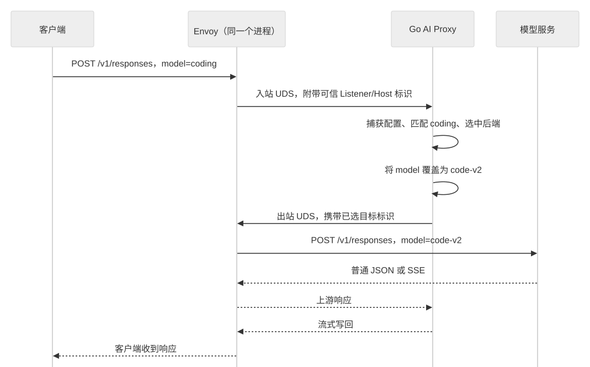

# AI Proxy 操作、请求链与部署

- 状态：模型、MCP、Delta ADS 与上游 TLS 子集已实现；真实组件和部署验收待执行。
- 更新日期：2026-10-20。
- 范围：统一 Go HTTP Proxy 的当前运行契约，不包含新增提供商、凭据或治理能力。

## 架构与职责

普通 HTTP 请求由 Envoy 直接转发；模型与 MCP 共用一个 Go AI Proxy 进程，但分别实现协议。
Envoy 与 Go 同机或同 Pod 部署，经两段不同的 Unix 域套接字（UDS）通信。
Controller 不在请求路径上，配置通过两路 Delta ADS 分别交给 Envoy 与 Go。

API Server/etcd 保存六类领域资源，MySQL 提供异步管理查询。
Controller 使用 controller-runtime Cache 和 krt 计算图解析引用、附着与冲突，
Envoy 消费网络资源，Go 只消费 Entry、ModelRule、MCPRoute。
详见[增量设计](control-plane-incremental-design.md)与[编译资源契约](ai-compiled-config-contract.md)。

这是对参考项目责任分工的采用，不是照搬其请求拓扑。此前核对的 Agent Router 固定提交
`daa9f891a8afcb18576d4593ad18870d1d18abac` 中，模型走 ExtProc，MCP 走 HTTP Proxy；
Ingate 已确认将两者统一为 Go HTTP Proxy。上游版本、源码与采用差异集中维护在
[上游设计对照](ai-gateway-upstream-alignment.md)，本文不将旧资料当作最新官方能力。

## 模型操作

| 项目 | 当前契约 |
| --- | --- |
| 创建入口 | POST /v1/chat/completions、POST /v1/responses |
| 协议 | OpenAI 同协议转发，不做 Chat/Responses 或跨提供商转换 |
| 选路字段 | 请求 JSON 顶层非空字符串 model，按原值匹配，不修剪或改变大小写 |
| 模型覆盖 | modelNameOverride 非空时覆盖顶层 model；空值保留原模型 |
| 上游路径 | 已默认化的 schema.prefix 与 chat/completions 或 responses 拼接 |
| 请求边界 | 显式正文大小上限、UTF-8 JSON 对象、精确字段名和重复顶层键检查 |
| 响应 | 上游状态、允许转发的端到端 Header、普通正文与原始 SSE |
| 未注册操作 | 不自动代理 /v1/*、Responses GET/DELETE、查询、取消、后台任务或 WebSocket |

schema.name 表示格式，不证明后端实现了所有操作；接入方须将规则配置到实际支持该操作的后端。
网关不校验完整 messages、input、工具或提供商扩展对象，也不执行响应中的工具调用。

Responses 的 background=true 在转发前拒绝；省略、null、false 保留原始字段。
previous_response_id、conversation 等状态引用原样交给后端，不承诺跨目标、账号或配置变更的亲和性。

### 模型名映射示例

客户端请求 model=coding。ModelRoute 匹配 coding，引用 model-service AIBackend，
并设置 modelNameOverride=code-v2。AIBackend 选择 OpenAI 和 /v1，再引用 model-network Backend。
以下时序描述该示例的请求和响应，不代表图中的服务已部署：

两处 Envoy 是同一个进程的不同职责。Go 先按原始 coding 选路，再将上游正文中的 model 改为 code-v2，
最终仍由 Envoy 选择端点。普通 HTTP 请求不进入此链。

### Handler、Service 与能力包

[ModelProxyHandler](../../internal/aiproxy/handler/modelproxy.go) 使用 Kratos 原生 HTTP Context，
通过 ctx.Middleware 执行请求链，随后有界读取正文、调用 Service、映射公开错误和写回响应。
中间件派生 Context 继续传给 Service 和出站请求，不绕过入口链先读取正文。

[modelproxy.Service](../../internal/aiproxy/service/modelproxy/service.go) 完整承担配置捕获、
操作解析、目标选择、模型覆盖、上游请求构造和 Client.Do。它使用原生 HTTP Response
交付流与 Body 所有权，不接收入站 Request/ResponseWriter，也不依赖 Kratos。

endpointspec 只解析选路及当前操作限制；apischema/openai 只定义实际需要的协议字段，
不能用于重编码完整请求。translator 用 RawMessage 保留扩展字段和数字精度：
无覆盖或相同覆盖返回原字节副本，实际覆盖只替换 model，但可能改变排版和转义形式。

## 首版 MCP：Streamable HTTP（2026-07-28）

当前代码固定支持 2026-07-28 版本的单 Backend 远程 POST 转发，不终止协议会话、
不转换版本、不执行工具。不支持 stdio、多后端聚合、旧版初始化会话、GET 事件流、
DELETE 终止或会话亲和存储；不能称为任意 MCP 客户端的兼容代理。

请求经过 Envoy 的精确路径入口、入站 UDS、MCPProxyHandler、mcpproxy.Service，
再从固定出站 UDS 交给 Envoy。路径匹配保留尾斜杠，客户端查询参数不参与选路也不转发。
上游路径只使用所选 Backend 引用中已经默认化的固定路径。

Envoy 为 MCP 精确路径接管所有方法；Go 只转发 POST，其他方法返回 405 和 Allow: POST，
不落普通 HTTP 兜底。同路径候选按来源确定顺序，首个失效目标拒绝，不尝试后续候选。
同一个 Listener/Host 已启用模型路由时，MCP 路径与两个模型操作路径完全重叠会阻止该批 AI 编译；
MCP-only 入口可以使用这些路径。

### 信封与 Origin

[mcpprotocol](../../internal/aiproxy/pkg/mcpprotocol/validate.go) 校验 JSON-RPC 信封，不解释工具参数：

- MCP-Protocol-Version 必须唯一且为所支持版本；请求中还须与 params._meta 的协议版本一致。
- 请求的 Mcp-Method 与 method 一致；tools/call、prompts/get 的 name 及 resources/read 的 uri
  与解码后的 Mcp-Name 一致。
- 通知只要求已支持的版本头，不新增方法与名称镜像要求。
- 拒绝批量、响应信封、重复已解释字段、非法 id 和非 UTF-8 JSON；id 保留原始字节。

不支持的版本使用 -32022，镜像字段不一致使用 -32020。通知的上游 202 空正文、
普通 JSON、SSE 与上游错误响应均按原样交付，不由网关改成方法结果。

Origin 缺失时放行；存在时必须是单一合法来源，并与 Envoy 匹配后保留的外部 authority 同源。
当前公共 Listener 只有 HTTP，所以 scheme 固定为 http，不采信 Forwarded/X-Forwarded-*。
公网 HTTPS 接入必须同时确定可信 scheme 来源，现有校验不能直接套用于 TLS 终止后的入口。

[Handler](../../internal/aiproxy/handler/mcpproxy.go) 负责 Origin、方法、有界读取与 JSON-RPC
错误写回；[Service](../../internal/aiproxy/service/mcpproxy/service.go) 捕获一次配置、
精确选路、校验信封并调用固定出口。未知参数 Header 可以透传，但移除逐跳 Header、
Authorization、Cookie、内部入口标记和 Envoy/Forwarded 控制字段。

## 可信入口与受限出口

Envoy 公共入口匹配 Listener/Host 后，覆盖写入内部协议、端口和 Host 标识；
AI Proxy 只在受保护 UDS 上使用这些值。标识用于定位入口，不替代客户端认证。

模型与 MCP 精确入口排在该 Host 的普通 HTTP 路由之前。删除模型或 MCP 路由会撤销相应入口，
其后请求可能重新匹配已有普通 HTTP 路由，不提供永久路径封禁。

[envoyclient.New](../../internal/aiproxy/pkg/envoyclient/client.go) 返回原生 HTTP Client：
只拨指定 UDS，不读取环境代理，不跟随重定向，不自动解压，不做 TCP 或提供商直连回退。
Service 从已选目标构造请求，不采用客户端 URL、查询参数或 Host；模型只保留 Accept，
不透传客户端密钥或 Cookie，也不自动注入提供商凭据。

Go 写入内容寻址的 target Header，Envoy 用精确 Header 与 POST 匹配静态 Cluster，
不使用客户端可任意选择 Cluster 的 cluster_header。转发上游前移除目标 Header，
根据选中端点重写模型/MCP 上游 Host。未知或撤销目标拒绝；出口 Listener 已撤销时连接也可能失败，
不能保证始终得到统一的 503。

## 响应、取消与配置更新

[响应写回](../../internal/aiproxy/handler/response.go) 接管并最终关闭上游 Body，
复制状态与端到端 Header，移除逐跳字段，流式复制正文，读取到 EOF 后交付 Trailer。
SSE 和未知长度响应先刷新响应头，再逐段刷新，不缓存完整流。

响应开始后的读取、写入或 Flush 失败，通过 net/http.ErrAbortHandler 中断连接，
不能追加错误 JSON。后续增加 panic 恢复中间件时，必须保留这个原生中断约定。
不转发中间 1xx，拒绝非预期 101，不声称实现通用 ReverseProxy 的全部能力。

本地模型错误使用 OpenAI 形状的 error envelope，cause 与 metadata 不序列化；
本地 MCP 错误使用 JSON-RPC 2.0。上游错误响应不经过本地错误编码。
Service 只返回错误；Handler 消费并记录需要处理的转发失败，Server 不重复记录。
成功及常规请求没有完整访问日志或可靠审计保证。

每次请求只 Capture 一份不可变配置。更新不会修改已捕获视图，新请求使用新视图。
两路 Delta ADS 分别传播，不比较每请求整份 revision，不提供跨代理原子提交。
传播窗口可暂时失败；内容寻址保证目标与协议/网络绑定，不保证在途流不受更新影响。

客户端取消沿请求 Context 传给原生 Client。普通测试覆盖本地链路取消，但真实 Envoy 到上游
的取消效果仍需验收。代码关闭了模型 Route 的整体请求超时和 Go 整体请求超时，
不代表 Envoy 其他空闲、连接或部署超时全部关闭。

## 部署与生命周期

Ingate API Server 不具备 Pod 调度、kubelet 文件投射或 sidecar 注入能力。
由外部部署系统共同运行 Envoy 与 Go；Controller 中的 socket 配置是数据面主机路径，
不是 Controller 本机要连接的文件。

组合根 [Run](../../internal/aiproxy/app.go) 严格加载 protobuf 启动配置，创建日志、ADS 连接、
Loader、私有目录下的 Unix Listener 与原生 Kratos App。
HTTP 停止接收并按显式 shutdown_timeout 有界排空后，取消并等待 Loader，
再关闭空闲出站连接、发现连接和日志。超时可能中断仍在进行的 SSE。

入口目录须由运行用户拥有且禁止组/其他用户访问，socket 权限为 0600；
启动不删除已有 socket 或其他路径，残留占用须由部署侧确认处理。
出口同样为 owner-only socket，Go 与 Envoy 的运行身份必须能访问它，祖先目录也须保护。

启动示例和依赖顺序见[初始化说明](../control-plane-initialization.md)。
当前 ADS 没有 TLS/服务身份鉴权，Manager 仅支持单副本；同组可以有多个数据面副本。

## 上游 TLS 的运行前提

Backend 的可选 tls 已贯通资源、管理 API、查询投影、Controller 与 Envoy Cluster。
当前只支持显式 DNS SNI、系统 CA 和同身份 DNS SAN 验证；不支持私有 CA、mTLS 或跳过校验。

Envoy 读取固定系统 bundle `/etc/ssl/certs/ca-certificates.crt`，不是读取 Go 或 Controller 的证书池；
部署须提供该路径。Go 到 Envoy 仍为 UDS HTTP，TLS 只发生在 Envoy 到后端之间。
上游端口必须显式配置，不自动改为 443；普通 HTTP Host 不因 SNI 自动改写。

完整更新主动省略 tls 可以恢复明文期望；证书或连接失败不会触发明文重试。
这不提供入口 HTTPS、ADS 加密或凭据管理。CA 文件、实际握手、错名/不受信任证书拒绝
及旧连接行为，仍需真实 Envoy 环境验收。

## 验证与未实现范围

现有普通测试包含本地 HTTP/UDS、JSON/SSE、首帧、取消、公开错误、目标隔离、
Origin/信封反例、配置更新与在途视图、原生 ADS 订阅/删除/重连和编译发布恢复。
这些测试可以验证受控输入下的本地契约，不等于运行了真实 Envoy 或模型提供商。

尚未实现提供商密钥存储/注入/轮转、跨提供商转换、模型重试/计费/配额、完整 Responses API、
完整 MCP 会话与聚合、配置分块、ADS 工作负载身份及控制面高可用。
真实数据库、API Server/etcd、Envoy 与跨进程部署的统一验收按用户要求暂缓。
