# 控制面增量编译与配置分发设计

状态：实施中

## 1. 设计目标

Ingate 的控制面管理 Gateway、Route 和 Backend，为共享数据面的 Envoy 与 Go AI Proxy 生成运行配置。
多个 Gateway 可以共享一组代理实例，但各条路由及其后端应具有独立的计算和更新边界。

本设计采用依赖驱动的增量编译和资源级 Delta xDS 分发：修改一条 Route，只重新计算它及受影响的聚合结果；
下发时只发送内容变化或被删除的命名资源。首次连接建立完整状态，后续连接可以基于已接受版本恢复。

例如，8080 端口有路由 A、B，9090 端口有路由 C。修改 A 的匹配路径，需要更新 A 和 8080 的路由表，
不应重新转换 B、C 或未变化的 Backend。共享数据面决定配置最终由谁消费，不决定所有配置必须一起重新计算。

本文设计配置的编译、组织和分发，不扩展模型协议、路由功能或用户资源种类。

## 2. 方案选择

### 2.1 采用分层编译，业务资源与代理协议分开

Envoy Gateway 将资源处理分为 Resource Watcher、Resource Translator、IR、xDS Translator 和 xDS Server。
外部资源先转为内部表示，再生成代理配置，避免业务 API 与 Envoy protobuf 相互渗透。
我们采用这一分层，分别为 Envoy 和 Go AI Proxy 生成它们需要的配置。
参考：[Envoy Gateway System Design](https://gateway.envoyproxy.io/community/design/system-design/)。

直接从 API 对象拼接 xDS 代码少一层结构，但会将引用解析、路由裁决、网络配置和协议序列化混在一起。
内部表示使这些计算可以独立缓存，也让两个数据面复用相同的业务裁决。

### 2.2 采用 krt 管理依赖和增量计算

Istio krt 把控制器表达为源集合和派生集合。转换函数通过 Fetch 读取依赖，库记录依赖关系，
相关对象变化时重新执行转换，输出相等时停止继续传播。
Agentgateway 的 Syncer 使用这一方式组织 Listener、Route、Backend 等集合，最后将结果接入 xDS。
参考：[krt](https://github.com/istio/istio/blob/master/pkg/kube/krt/README.md)、
[Agentgateway Syncer](https://github.com/agentgateway/agentgateway/blob/main/controller/pkg/syncer/syncer.go)。

我们选择复用 krt。自行使用 Informer、反向索引和 Workqueue 也能实现增量协调，
但多级引用、改绑、缺失对象恢复和中间结果去重都要逐条维护。
krt 承担这些通用机制，Ingate 负责定义业务转换和依赖查询。
代价是引入 Istio 模块，需要选择固定版本并核对其依赖；我们不复制它的内部实现，也不自建另一套依赖框架。

### 2.3 采用 Delta ADS，按命名资源下发

Envoy 的 Delta xDS 支持独立资源版本、变化资源、显式删除和带已知版本重连；
ADS 将不同资源类型的发现交互复用到同一条 gRPC 流。
我们采用 Delta ADS，并使用 go-control-plane 实现服务端。
参考：[Envoy xDS 协议](https://www.envoyproxy.io/docs/envoy/latest/api-docs/xds_protocol.html)。

完整 ConfigMap、文件或完整 gRPC 消息适合整体替换配置，但每次小改动仍会传输并加载完整对象。
自行设计 gRPC 增量接口则需要重新定义订阅、版本、删除、确认和重连协议。
Delta xDS 已提供这些机制，也能与 Envoy 共用分发基础设施，因此不另建配置推送协议。

### 2.4 Go 使用自己的资源类型，不解释 Envoy 配置

Agentgateway 复用 xDS 传输，但使用面向自身运行时的 protobuf 类型；
其配置设计强调资源粒度接近用户 API，并让 Route 指向 Listener，避免父对象嵌入全部子路由。
我们采用这两个原则：Go 使用自己的编译资源，规则引用入口，入口不包含路由列表。
参考：[Agentgateway Configuration](https://github.com/agentgateway/agentgateway/blob/main/architecture/configuration.md)。

Go 需要模型匹配、模型名覆盖、协议前缀和 MCP 路径；Envoy 需要监听、路由、集群和端点。
强行共用 Envoy 类型，会让 Go 从网络配置中反推业务语义。
让 Go 直接 Watch 领域资源，则要在数据面重复实现引用解析和裁决。
两者都不符合控制面编译、数据面执行的职责划分。

## 3. 总体架构



API Server 和 etcd 保存用户声明的领域资源。Controller Manager 使用统一的源缓存接收资源变化，
将对象送入 krt 计算图。计算图完成入口裁决、路由附着、后端解析和代理资源生成。

发布器读取计算图的最新结果，校验资源引用，按名称比较内容版本，将变化安装到两类缓存：
Envoy 的原生 xDS 资源进入 SnapshotCache；Go 的自定义资源进入 LinearCache。
ADS 服务通过 MuxCache 将请求分派到相应缓存。两个代理各自建立连接、订阅和确认配置。

领域资源是事实来源，编译结果保存在控制面内存中。控制面重启后从领域资源重新建立计算图，
不依赖持久化的编译产物或历史增量日志。

这张图描述配置流。业务请求由 Envoy 接收，普通 HTTP 请求由 Envoy 转发；
模型和 MCP 请求进入 Go 处理，再通过 Envoy 出口访问后端。配置订阅不在业务请求路径上。

## 4. 资源设计

### 4.1 用户资源表达业务关系

```text
Gateway
  ├─ HTTPRoute ─────────────→ Backend
  ├─ ModelRoute → AIBackend → Backend
  └─ MCPRoute ──────────────→ Backend
```

Gateway 定义 Listener，Route 通过 parentRefs 附着到具体入口。
Backend 描述网络目标，AIBackend 描述模型协议及其网络引用。
资源以 Namespace 和 name 标识，引用遵循同 Namespace 约束。
一组数据面可以接收多个 Gateway 的编译结果，不因此合并它们的资源身份。

### 4.2 编译结果按依赖边界组织

计算图使用以下内部结果，不将整个数据面的配置作为单个派生对象：

| 内部结果 | 内容 | 主要依赖 |
| --- | --- | --- |
| Listener | 已接纳入口、端口、主机名和所属 Gateway | Gateway 及入口冲突裁决 |
| Route 匹配 | 路径、模型条件或 MCP 路径、规则顺序 | 对应 Route |
| Route 附着 | 规则与有效入口的关联 | Route 的 parentRefs、相关 Listener |
| 网络后端 | 端点、连接与 TLS 参数 | 对应 Backend |
| 模型绑定 | 有效协议、模型覆盖和目标标识 | AIBackend、规则引用、网络后端 |
| 入口路由表 | 本入口候选及确定的优先级 | 附着到该入口的规则 |

匹配条件与网络内容分开计算。修改 Backend 端点时，不重新解释路由的路径或模型匹配；
修改 Route 条件时，也不重新规范化 Backend。
共享后端由 Backend 结果唯一拥有，Route 只建立使用关系，避免多条 Route 竞争输出同名资源。

### 4.3 Envoy 使用原生资源，Go 使用独立规则资源

Envoy 接收 Listener、RouteConfiguration、Cluster 和 ClusterLoadAssignment。
每个命名资源独立比较版本；同一 RouteConfiguration 内的路由仍按 Envoy 的结构聚合。

Go 接收一个自定义 protobuf 外层类型，资源内容分为 Entry、ModelRule 和 MCPRoute：

```proto
message Resource {
  string name = 1;
  oneof payload {
    Entry entry = 2;
    ModelRule model_rule = 3;
    MCPRoute mcp_route = 4;
  }
}
```

这是结构示意。三种 payload 分别对应入口、一条 ModelRoute 规则和一条 MCPRoute，
每个实例都是独立的 xDS 资源，并不是把它们封装成一份完整配置。
可生成的完整契约见 [resource.proto](../../api/aidataplane/v1/resource.proto)，
统一消息类型为 `aidataplane.v1.Resource`。模型条件用 oneof 区分精确值与 catch-all，
规则结果用 oneof 区分 target 与 unavailable，不依赖字段缺省推断拒绝或放行。
Agentgateway 的 [Resource protobuf](https://github.com/agentgateway/agentgateway/blob/main/crates/protos/proto/resource.proto)
也采用统一外层类型承载不同配置资源；这里仅采用组织方式，不复制其全部资源。

Entry 和 ModelRule 的逻辑结构如下，示例值不代表新增 API 字段：

```yaml
kind: Entry
name: entry/8080/gateway/team-a/public/listener/api
port: 8080
hostName: gateway/team-a/public/listener/api
hostname: api.example.com
---
kind: ModelRule
name: model/team-a/coding/rule/0
entryRefs:
  - port: 8080
    hostName: gateway/team-a/public/listener/api
origin:
  namespace: team-a
  name: coding
  creationTime: "2026-10-19T08:00:00Z"
ruleIndex: 0
matches:
  - type: Exact
    model: coding
target:
  bindingName: team-a/provider/route/coding/rule/0/ref/0
  schema:
    name: OpenAI
    prefix: /v1
  modelNameOverride: code-v2
  networkBackendName: team-a/model-network
  targetName: model-<content-hash>
```

Entry 不保存子路由列表。ModelRule 可引用多个入口；修改模型匹配时，只更新该规则资源，
不会因为入口需要知道子路由而重发 Entry 或其他规则。
MCPRoute 使用相同的入口引用和来源信息，内容为精确请求路径、上游路径与目标标识。

Go 不接收网络端点和 TLS 参数。targetName 由协议绑定与网络内容共同计算，
Go 将它交给 Envoy 选择对应出口。网络目标变化会改变相关规则的 targetName，
但不会使无关规则发生变化。

本设计将目标嵌入规则，保证一次规则替换同时更新匹配和协议目标。
与独立发布共享 Backend 相比，这会在后端变化时更新所有相关规则；
选择这一方式，是因为 Go 的目标还要与 Envoy 出口对应，规则携带完整目标更容易保持绑定一致。
共享网络资源仍由 Envoy 独立管理，不随每条规则复制。

后端引用无效时，规则保留匹配并以 unavailable 代替 target。
首个命中规则失效就拒绝请求，不回退到其他候选。
排序依据写入来源信息：模型 Exact 优先，其次按创建时间、Namespace、名称及规则、匹配位置排序，
不依赖配置事件到达顺序。

## 5. 增量编译

### 5.1 将业务转换表达为派生集合

源缓存为六类领域资源提供集合。输入先提取运行字段，排除展示名称和状态等不影响转发的内容，
然后通过 krt 建立派生集合。创建时间、资源身份和删除状态仍参与计算。

单对象转换使用 NewCollection，一条 Route 展开多条规则使用 NewManyCollection，
需要关联的对象通过按键或索引过滤的 Fetch 读取。
例如某个模型规则只查询它引用的 AIBackend，该绑定只查询对应 Backend。
即使引用暂时不存在，也登记这次查询，使目标后续创建能够触发重新计算。

转换函数只读取集合并返回结果，不发网络请求、不发布 xDS、不写资源状态。
依赖变化使转换重新执行；结果相等则不继续通知下游。
需要按入口聚合时，按入口索引查询关联规则，避免用一个全局 Singleton 读取全部 Route。

入口冲突是共享约束，需要集中裁决 Gateway，再将结果拆为独立 Listener。
一次裁决可能影响多个端口，但普通 Route 条件修改不会触发这一步。
只有共享约束使用全组计算，不把全部业务转换都放进这个聚合节点。

### 5.2 修改 Route A 的完整过程

设 A、B 附着 8080，C 附着 9090，分别引用后端 P、Q、R。
将 A 的路径从 `/orders` 改为 `/v2/orders`：

1. A 的源投影变化，krt 重新生成 A 的匹配结果；附着和后端结果未变化，可以复用。
2. 8080 的聚合节点取得新的 A 与已有 B，重新排序并生成该入口的 RouteConfiguration。
3. 9090 的聚合节点、B/C 的匹配转换和 P/Q/R 的网络转换不执行。
4. 发布器安装变化的命名资源，Envoy 收到完整的 8080 RouteConfiguration；Go 没有相关变化，不收到业务配置更新。

若修改的是模型规则 A 的匹配条件，则更新对应 ModelRule，Go 只重建 A 所属入口的查询索引。
若修改的是后端 P 的端点，则重算 P 和引用 P 的绑定、出口及相关资源，不重译 B/C。
删除和改绑同时影响旧、新关联入口，最后一个使用者消失后撤销不再使用的共享输出。

### 5.3 增量不等于所有步骤都只处理一个对象

Envoy 的一份 RDS 资源包含多条路由，修改其中一条仍要组装和发送该资源。
共享冲突裁决、最终引用校验和 Snapshot 封装也可能遍历多个结果。
本设计减少的是重复转换、无关资源生成和无关资源传输，不承诺所有操作都是 O(变化量)。

## 6. 配置分发与应用

### 6.1 按资源内容生成版本

发布器按资源名称保存最新期望，为规范化后的 protobuf 内容计算确定性哈希，作为资源版本。
名称相同且内容版本未变时不作为变化资源发布；资源消失时进入删除集合。
版本不使用 API Server 的 resourceVersion，也不要求连续递增。

Envoy 的 SnapshotCache 保存命名原生资源，通过 Delta 协议发送订阅范围内的差异。
Go 的 LinearCache 接收资源更新和删除的批次，通过 MuxCache 接入同一 ADS 服务。
保留一份完整的服务端资源状态，用于新连接和恢复；这不意味着正常更新要重新生成或传输完整配置。

同一共享数据面组中的副本订阅同一份期望配置。不同 Gateway 的资源名称保持独立，
共享端口只在必要的 Envoy 资源处聚合。Envoy 与 Go 按消费类型隔离，不向 Go 下发普通 HTTP 路由和网络端点。

### 6.2 首次同步、更新与重连



首次连接时，控制面在源缓存和计算图初始化完成后提供当前完整状态。
Go 建立有效视图之后才接受需要配置的请求；合法空配置表示没有可用路由。
后续响应只包含变化资源和 removed_resources。

Go 将一个响应应用到临时资源表，校验字段及引用，重建受影响入口的索引，再一次性交换不可变运行视图并 ACK。
校验失败时整批拒绝，继续使用上一份有效视图。
请求开始时捕获视图，处理中不切换到另一个版本。

Go 资源使用一个 type URL，关联变更在同一批响应中交付，避免入口与规则跨类型到达时的激活顺序问题。
首次和恢复同步由服务端提供一份完整差异响应，包括合法的空响应；这是本设计的服务端约束，不是通用 xDS 保证。
这一选择使初始化和整批应用简单，但完整初始响应必须满足消息大小预算。
若规模需要分块同步，必须同时设计完成边界，不能将任意第一包视为完整配置。

断线不视为资源删除。Go 在新流通过 initial_resource_versions 报告实际已接受的资源版本，
控制面补发变化与删除，避免重复发送未变资源。
NACK 后重新建立流，以已接受版本重新对账；控制面发布失败也继续对最新期望重试，不依赖下一次用户修改。

### 6.3 两路数据面保持最终一致

Envoy 与 Go 独立接收配置，不建立跨进程原子提交。
内容寻址的 targetName 使旧协议配置不能误用新的网络目标；传播顺序不一致时可以暂时失败，但不能转发到错误目标。
ACK 表示对应代理接受了配置，不表示另一代理或真实后端已经可用。

编译器只发布引用闭合的候选。合法的后端缺失生成 unavailable，正常删除和空配置可以发布；
内部构建失败则保留最近有效结果。这一保旧策略意味着持续无效的候选可能延迟删除生效，
本设计不承诺配置撤销的绝对时限，也不取消已经使用旧视图的在途请求。

## 7. 实现组织

| 部分 | 采用的实现 | Ingate 需要实现的内容 |
| --- | --- | --- |
| 资源获取 | controller-runtime Cache / Informer | 将源事件和初始化状态适配为 krt 输入 |
| 增量计算 | Istio krt | 运行字段投影、转换、索引、引用和裁决 |
| 分发服务 | go-control-plane | 命名资源转换、Cache 接线、发布与订阅范围 |
| 传输协议 | Delta ADS protobuf、grpc-go | 客户端连接、资源校验、版本登记与恢复 |
| 请求读取 | 不可变运行视图 | 入口索引、规则排序、目标查询和视图交换 |

Controller 持有业务内部表示，Envoy 适配层持有原生 protobuf，Go 适配层持有自定义 protobuf；
发布器统一拥有共享输出的写入顺序，转换函数不各自直接写 Cache。
同一份 AI 编译结果同时生成 Go 规则和 Envoy 出口，避免两条独立编译链对目标作出不同解释。

实现顺序先确定内部结果及 Go 资源结构，再建立源集合和依赖图，
随后接入两个资源缓存与 Delta 服务，最后实现 Go 的资源表和查询视图。
通用依赖追踪和 xDS 协议复用库；业务资源如何裁决、编译和执行由 Ingate 实现。

## 8. 参考设计

上述选择采用不同项目各自对应的机制，不将其中一个项目的全部实现当作本系统架构：

- [Envoy Gateway System Design](https://gateway.envoyproxy.io/community/design/system-design/)：资源、IR、代理资源和分发服务分层。
- [Istio krt](https://github.com/istio/istio/blob/master/pkg/kube/krt/README.md)：派生集合、查询依赖和结果相等抑制。
- [Agentgateway Syncer](https://github.com/agentgateway/agentgateway/blob/main/controller/pkg/syncer/syncer.go)：将派生资源集合、索引和 xDS 输出连接起来。
- [Agentgateway Configuration](https://github.com/agentgateway/agentgateway/blob/main/architecture/configuration.md) 及 [Resource protobuf](https://github.com/agentgateway/agentgateway/blob/main/crates/protos/proto/resource.proto)：面向运行时设计资源、规则引用入口、统一外层类型。
- [Envoy xDS 协议](https://www.envoyproxy.io/docs/envoy/latest/api-docs/xds_protocol.html)：资源级版本、Delta、删除、ACK/NACK 和重连。
- [go-control-plane Cache](https://github.com/envoyproxy/go-control-plane/tree/v0.14.0/pkg/cache/v3)：SnapshotCache、LinearCache 和 MuxCache 的服务端组合。

Envoy Gateway 的系统设计页含早期版本假设，这里仅采用分层方式；
Agentgateway 和 Istio 的可变分支用于设计参考，依赖实现时固定版本。
