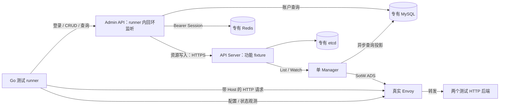

# HTTP 主链路隔离验证方案

- 日期：2026-10-11
- 状态：后续统一测试阶段的备查方案；用户于 2026-10-11 明确当前开发阶段不安排这类测试，没有创建环境或执行真实组件验收
- 实现基线：`31a711be`；用户于 2026-10-11 授权提交本轮 MySQL 回归测试、排版与文档调整
- 范围：现有 Gateway → HTTPRoute → Backend，不增加 AI/MCP 业务、资源或依赖

## 验证目标与现有证据

当前单元测试能验证 SQL 组装、配置编译、Snapshot 发布和模拟 ADS 收取；API Server 集成测试能验证临时 etcd + HTTPS 存储。这些结果没有证明真实 MySQL 执行、Manager Watch 收敛、Envoy 配置接纳和真实请求转发。

本轮已补齐两个回归缺口：Gateway/Backend 多资源子记录归属，以及五个事务读取入口传给 `BeginTx` 的只读、可重复读选项。临时 overlay 将子记录都绑定到首个资源、关闭只读或降为 Read Committed 时，测试分别失败。这里证明的是项目传参与组装契约，实际数据库隔离效果仍需以下验证。

当前继续按已确认契约开发，不将真实 MySQL、Envoy 联动和 ACK/NACK 验收作为开发前置条件；日常单元测试、格式、静态检查、构建和手写代码 review 仍执行。本稿保留后续统一测试的场景与隔离边界，不安排环境工程、容器或专用测试 fixture 的实现。

后续统一测试时，按真实 MySQL Repository、HTTP 功能主链路、部署权限与 TLS 分别取证。权限、凭据和 TLS 的设计与必要实现仍随对应功能评审；推迟整链路测试不表示允许提前接入真实密钥或开放不安全的公网入口。测试失败若需要修改生产实现，先说明问题、依据和行为影响，不随测试工程扩展产品契约。

源码依据：[MySQL 读取实现](../../internal/adminapi/repository/mysql/store.go) 明确事务选项；[迁移入口](../../internal/adminapi/migration/migration.go) 只执行尚未应用的迁移；[Manager 入口](../../internal/controllermanager/command.go) 在启动控制器前打开 MySQL；[Admin 装配](../../internal/adminapi/app.go) 创建初始账户并挂接真实会话校验；[API Server 集成 fixture](../../internal/apiserver/integration_test.go) 关闭认证授权；[ADS 服务](../../internal/controllermanager/dataplane/envoy/server.go) 与 [Publisher](../../internal/controllermanager/dataplane/envoy/publisher.go) 区分监听、Snapshot 和 Envoy 确认。以上都是当前实现，不能替代拟执行的验证。

## 环境与复用边界

建议使用专用 Compose 项目管理 MySQL、Redis、etcd、Envoy 和测试 runner。项目名每轮唯一，网络设为内部网络，不复用 external network、已有容器、数据卷或宿主数据库；默认不发布宿主端口。服务名用于容器间访问，避免把容器 IP 固定进配置。这些采用 [Compose 官方网络机制](https://docs.docker.com/compose/how-tos/networking/)，不实现自己的环境编排器。

测试 runner 内使用现有 Go 装配入口运行 API Server、Manager 和 Admin API，断言仍由 Go `testing` 执行。它是集成测试装配，不等价于三个发行二进制的部署验收。API Server 的功能 fixture 复用现有集成测试的 Options/Config 组装方式，显式关闭 Authentication、Authorization、Admission、CoreAPI，仅用于这张隔离网络中的存储与控制器联动；不新增生产 CLI 的认证绕过参数。

Admin HTTP/gRPC 仍只监听 runner 的 `127.0.0.1`，测试调用者在同一 runner 内；不为容器可达性取消现有限制。Manager 的 ADS 与测试后端监听 runner 的内部网络接口，Envoy 仅连接该内部地址。Envoy admin 只允许隔离网络中的 runner 访问，不映射到宿主或公网；配置和访问日志视为测试资料。该接口包含敏感信息和修改操作，保护要求见 [Envoy 官方 admin 文档](https://www.envoyproxy.io/docs/envoy/latest/operations/admin)。

复用已有的 MySQL driver、GORM、Goose、Kubernetes 客户端、go-control-plane 与 Go 标准库；不增加 Testcontainers、通用 CRUD 测试接口、业务插件或新 DSL。普通 `go test ./...` 不自动启动容器。新增测试使用独立标签/明确目标，缺少已声明的环境时直接失败，不悄悄跳过或退回 sqlmock。

每个镜像在执行前固定版本与 digest，记录与 Go 依赖的兼容验证结果，不使用 `latest`。本稿没有替用户选择或下载镜像，也没有确认本机 Docker daemon 已就绪。配置在测试临时目录生成，不修改 `configs/*.yaml` 的示例 DSN，不读取用户 kubeconfig、生产密钥或已有服务地址。

## 第一步：真实 MySQL Repository 验证

只连接本轮新建的 MySQL 实例和测试数据库。执行仓库现有的 00001、00002 Goose 迁移并检查表、列、注释及唯一索引；再执行一次，确认无待执行迁移。不对应用过旧基线的数据库做升级兼容、清表或重建。

| 用例 | 必须观测的结果 | 必须有的反例 |
| --- | --- | --- |
| HTTPRoute JSON 往返 | 多路由、多父引用、多规则和多匹配保持所属对象与数组顺序 | 逆字母顺序不能被名称重排；更新后旧规则不残留 |
| 展示名称筛选 | 包含匹配，`%`、`_`、`!` 都按文字处理；Count 与分页条件一致 | 普通名称不能被带通配符的输入扩大命中；空结果总数为零 |
| Gateway 精确筛选 | `JSON_CONTAINS` 命中完整父引用名称 | `edge` 不能命中 `edge-other`，不同 Gateway 的路由不能混入 |
| Gateway/Backend 父子投影 | 多资源分别读取自己的 Listener/Endpoint，资源无子记录时返回空集合 | 在不同插入顺序、父 ID 顺序与分页顺序下不串资源；完整更新清除旧子记录 |
| 写事务失败 | 子记录唯一键冲突导致整次替换回滚 | 原主记录与原子记录仍完整存在，无部分新配置 |
| 版本与名称 | 投影保留不透明版本；重复展示名称合法；修改展示名称保留稳定名称 | 技术名称重复违反唯一索引；不把版本转为数字或按大小排序 |
| 只读与一致快照 | 实际事务禁止写入；并发提交后同次读取的 Count/主记录/子记录仍属于同一快照 | 对照组降低隔离级别后，测试能观察到受控的读取变化 |

一致快照用例采用两个独立数据库连接和显式同步屏障：事务 A 完成首次一致性读取后，允许连接 B 修改主/子记录并提交，再让 A 继续查询；A 应读取旧快照，新事务应读到新值。不用固定 sleep 或并发概率碰撞作为证明。项目读取入口与数据库语义分别检查；如需暂停项目查询，在测试侧包装现有真实连接池，不给生产 Repository 增加测试接口，也不根据 MySQL 默认隔离级别推断本次事务选项。

记录 `SHOW CREATE TABLE` 与查询结果以验证 Schema；不凭存在索引就声称筛选性能合格。这里不做性能基准，也不重新测试 MySQL 的所有能力。

## 第二步：真实 HTTP 功能主链路

启动顺序为：专有依赖健康 → 迁移完成 → API Server HTTPS 可用 → Manager 与 Admin 可用 → Envoy 建立 ADS → 创建资源 → 分别等待投影和数据面达到用例要求。Admin 启动会创建默认管理员；只在隔离环境内使用该账户，随后改密、重新登录并检查旧 Session 撤销，不把默认密码带入部署示例。

Envoy bootstrap 使用官方 `node`、`dynamic_resources`、`static_resources` 结构，`node.cluster` 必须为现有 `ingate-shared-data-plane`，每个 Envoy 的 `node.id` 独立；ADS Cluster 使用 HTTP/2，LDS/CDS 从 ADS 获取，RDS/EDS 按项目生成的引用订阅。参考 [Envoy 官方动态控制面示例](https://www.envoyproxy.io/docs/envoy/latest/start/quick-start/configuration-dynamic-control-plane)，不自制 xDS 协议。这里使用明文 ADS 和 HTTP 测试后端，仅限上述隔离环境。

两个测试后端分别返回固定标记及收到的 Host/路径；断言同时检查 Envoy 响应和后端请求记录，不只检查 HTTP 200。按用例创建资源，使用创建响应中的稳定名称引用，不依赖展示名称查询定位。

| 场景 | 接纳 / 投影证据 | 实际请求与反例 |
| --- | --- | --- |
| 创建与修改 | API Server 保存配置；MySQL 投影达到预期 spec 与版本 | Envoy 命中后端 A，更新目标后命中 B，不再命中 A |
| 路径匹配优先级 | Exact、最长 PathPrefix 和声明顺序与已有契约一致 | `/api`、`/api/x` 命中对应规则；`/apix` 不命中 `/api` 的段前缀；更具体 Exact 不被兜底覆盖 |
| Host 与父引用 | 有效 Listener 接纳；无效 parent/section 不被附着 | 正确 Host 命中，错误 Host 不到达目标；跨 Gateway 引用不能串入口 |
| IP 与 DNS Backend | 分别出现 EDS 与 STRICT_DNS 资源 | 使用隔离网络内后端 IP / 服务名各自转发成功；不访问公共 DNS 或互联网后端 |
| 后端缺失与恢复 | 匹配保留，ResolvedRefs 报告缺失；恢复后引用有效 | 更具体失效路径返回 500，后端请求数为零且不落入健康兜底；恢复后转发成功 |
| 更新冲突与删除 | 旧版本 PUT 被拒绝且配置不改变；删除投影最终消失 | 冲突不改变流量目标；删除 HTTPRoute 后不再转发该匹配；删除 Gateway 后旧 Listener 最终移除 |
| 重启恢复 | 重启单 Manager，List/Watch 重建当前配置；投影启动对账清理残留 | Envoy ADS 重连后恢复当前请求结果；旧路由不复活；不据此承诺 HA 或零中断 |
| Admin 会话 | 真实账户与 Redis Session 验证身份 | 缺少/伪造 Token 和改密后的旧 Session 被拒绝，API Server 没有产生对应资源 |

Gateway/HTTPRoute 的 Conditions 只证明配置接纳与引用状态。Status 更新本身会产生新资源版本，不能等待「写响应版本永远等于投影版本」；按当前 API Server 对象、所需 spec 和投影收敛判断，版本只做等值与 CAS 校验，不做跨对象数值比较。

### 配置发布、安装与请求分别取证

每次变化记录三组证据：API 对象与投影、Envoy 已加载配置、实际请求及后端记录。使用 `/config_dump?include_eds` 的相关 active 配置、版本和 `/stats?format=json` 的更新/拒绝统计；warming 配置不算已安装，`/ready` 或 Manager readyz 单独成功也不算流量验收。观测入口和字段需按最终固定的 Envoy 版本核对，参见 [官方 admin 文档](https://www.envoyproxy.io/docs/envoy/latest/operations/admin)。

当前 ADS 构造器传入 nil callbacks，Manager 没有业务 ACK/NACK 状态。config_dump 和统计可证明安装/拒绝，不替代对应 nonce 的协议 ACK 记录。需要协议级验收时，另设 Envoy 包内测试 fixture，使用现有 go-control-plane 原生 callbacks 记录真实 Envoy 的 `type_url`、`version_info`、`response_nonce` 和 `error_detail`；只在测试装配中使用，不借测试新增管理接口或生产 Ready 状态。

协议 fixture 先发送合法配置，再向自己的 Snapshot Cache 注入一份预校验后仍会被 Envoy 拒绝的配置，确认 NACK、旧 active 配置保留，再发送修复版本确认 ACK 与流量恢复。该受控注入绕过项目 Publisher 的合法性检查，只证明真实 Envoy/ADS 协议行为，不能冒充 Manager 正常发布路径。若固定版本下不能稳定构造拒绝样本，应报告未完成，不以模拟客户端 NACK 代替。

## 等待、失败与清理

每个等待使用有截止时间的条件轮询，超时保存最后一次资源、MySQL 查询结果、Envoy 配置/统计及相关日志。超时说明测试失败，不自动修改产品重试或一致性契约；等待时长是测试预算，不写成系统收敛 SLA。各用例串行维护自身资源，快照切换过渡期不承诺跨系统原子性。

进程取消和退出有界等待，由创建者清理；Compose 只清理本轮唯一项目名对应的容器、内部网络和新建数据卷，禁止全局 prune、清共享缓存或删除已有数据库。失败先保留不含口令/Token 的诊断资料，再清理运行资源。测试 runner 不挂载宿主 Docker socket；环境启动、重启与清理由外层受控命令完成，runner 自身只管理本轮 Go 进程及测试资源。

## 第三步：权限与 TLS 独立评审

功能 fixture 关闭 API Server 认证授权，不能据此接入真实模型密钥。后续先确认 API Server 的控制器/管理端身份、授权与 HTTPS 信任，再确认 ADS 认证加密、Envoy 上游 TLS 的 SNI/证书校验，以及 Admin TLS/限流部署。当前 Listener 只支持 HTTP，没有 Secret 资源或已批准的上游 TLS 策略，本稿不新增字段或凭据实现。

功能测试使用真实单节点 Redis，只覆盖本轮登录会话路径，不验收 Redis TLS、Sentinel/Cluster 故障转移。AI 普通响应、SSE、取消、MCP 会话和运行时快照均不在本次 HTTP 验收范围。

## 评审与执行顺序

当前开发阶段不执行下列步骤。AIBackend/ModelRoute 的首个协议、凭据及运行时加载契约可继续评审，不等待本稿的实库或真实数据面验收；对应实现仍需用户确认范围。

1. 进入后续统一测试阶段后，再确认可丢弃的环境及固定版本。安装 Docker/启动 daemon、拉取镜像等需按实际环境单独确认；本稿不授权这些操作。
2. 实现真实 MySQL 测试及最小环境描述，逐个审查新增手写代码，运行隔离用例后等待 review，不自动提交。
3. 实现 HTTP 联动与独立 ACK/NACK fixture，按上述矩阵执行并记录未覆盖项；需要生产修复时先解释行为影响，再按确认范围修改。
4. 结合届时已实现的 AI/MCP 路径完善统一验收清单。上线前完成适用的真实组件、安全与故障验收，不把日常单测和静态检查当作替代证据。

本轮没有新增 Compose、Dockerfile、测试工程骨架、Make 目标或生产配置，避免在方案确认前形成默认部署契约。
